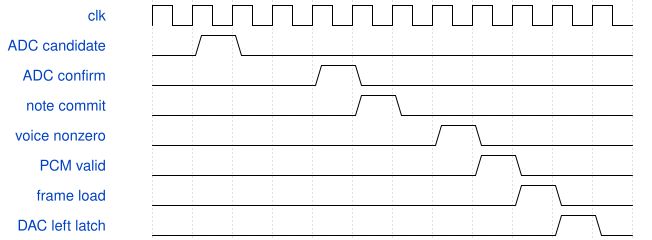

# LatencyAxisTop 模块规范

> RTL: `src/LatencyAxisTop.v`

## 1. 模块目的

完整实体键ADC→双确认判键→参数桥→多核合成→响度→PT8211，监测器只观察。

## 2. 参数

| 参数 | 默认值 | 说明 |
| --- | --- | --- |
| — | — | 本模块没有可配置参数。 |

## 3. 时钟与复位

- 时钟：`{"name": "i_clk", "edge": "posedge", "period_ns": 20}`
- 复位：`{"name": "i_rstn", "active": "low", "style": "asynchronous", "values": "取消事件和任务，键状态及计数清零"}`

## 4. 接口信号规范

| 信号 | 方向 | 位宽 | 时钟域 | 语义角色 | 描述 |
| --- | --- | --- | --- | --- | --- |
| `i_clk` | input | 1 | 未声明 | clock | 50MHz统一计算时钟 |
| `i_rstn` | input | 1 | 未声明 | reset | 低有效复位，异步置位同步释放 |
| `i_adc_dout` | input | 1 | 未声明 | data | 外部ADC串行数据 |
| `i_uart_rx` | input | 1 | 未声明 | data | 调试命令输入 |
| `o_mux_sel` | output | 3 | 未声明 | data | 模拟多路选择 |
| `o_mux_en` | output | 1 | 未声明 | data | 多路器使能 |
| `o_adc_cs_n` | output | 1 | 未声明 | data | ADC片选 |
| `o_adc_sclk` | output | 1 | 未声明 | data | ADC时钟 |
| `o_adc_din` | output | 1 | 未声明 | data | ADC命令 |
| `o_uart_tx` | output | 1 | 未声明 | data | 调试快照 |
| `HP_BCK` | output | 1 | 未声明 | data | PT8211位时钟 |
| `HP_WS` | output | 1 | 未声明 | data | PT8211声道选择 |
| `HP_DIN` | output | 1 | 未声明 | data | PT8211音频数据 |
| `PA_EN` | output | 1 | 未声明 | data | 低有效功放使能 |

## 5. 周期行为与延迟

- 完整实体键ADC→双确认判键→参数桥→多核合成→响度→PT8211，监测器只观察。
- 首次门限候选/二次确认/取消由判键模块提供；远程起点为FPGA有效gate上升沿。
- 六种核心数量保持1/2/3/1/1/1；50MHz计算，1024拍输出一帧。
- L仅清零延迟统计和监测事务，不复位声音引擎或更改音色。

## 6. WaveDrom 时序图

### 采集到数字起音

概念时序，扫描等待与音频帧间隔被压缩；所有时间戳来自同一50MHz计数器。

- WaveJSON：[LatencyAxisTop_onset.json5](waveforms/LatencyAxisTop_onset.json5)

## 7. 边界、反压与错误

- 32键同时完成
- 计数回绕
- 候选取消
- 静音与慢起音
- 覆盖与超时并发
- 清零时仍按住键

## 8. CDC 与综合约束

- 50MHz同一时钟域，异步低有效复位，顶层同步释放。
- 监测无音频控制反馈；一次事件窗口小于32位时间戳周期，默认1秒超时。

## 9. 验证与验收

- 独立时间差模型
- 逐分段确定值比较
- 真实ADC和PT8211 WS边沿关联
- 协议4全部分包边界及坏包恢复
- Gowin时序与板上串口/听感

## 10. 可追溯性

- 规格模块：`LatencyAxisTop`
- RTL 路径：`src/LatencyAxisTop.v`
- 交付要求：本文档、WaveJSON 和 SVG 必须与同一版本规格一同发布。
