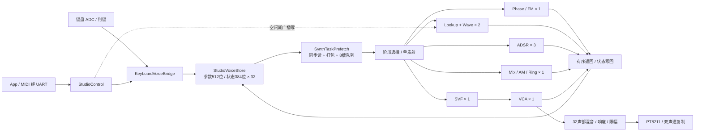

# Tang Mega 60K 部分并行合成引擎

本工程在 `keyboard-studio` 的 32 声部 Studio 引擎上增加了可配置的物理计算池，并把逐任务等待 RAM 改为连续预取。默认配置的引擎计算时间从 **873 拍降至 385 拍**，50 MHz 下为 **17.46 µs → 7.70 µs**，相同工作量加速 **2.27 倍**。原工程和可回退固件保留在原目录，备份固件也位于 `baseline/Studio_180A.fs`。

## 物理核心数量

在 `core_counts.json` 编辑数量后执行 `python configure_cores.py`，会更新板级顶层 `ParallelAxisTop.v` 的参数。`--check` 只核对配置。每项支持 **1～4**，这是综合期选择，修改后必须重新仿真、综合和时序验证。只有下面的默认组合有 Tang Mega 60K 实现资源和时序证据；不能推断全四核也装得进本板。

| 功能 | 顶层参数 | 默认物理数量 | 配置理由 |
|---|---|---:|---|
| 相位累加 / FM 相位调制 | `C_PHASE_CORES` | 1 | 单核可每拍接受任务 |
| 波形查表 / 插值 / 波表 | `C_WAVE_CORES` | 2 | 原查表每两拍接受一次，两份交错接受 |
| ADSR 包络 | `C_ENV_CORES` | 3 | 单核每三拍接受一次，三份轮转 |
| 双振荡器混合 / AM / Ring | `C_MOD_CORES` | 1 | 单核可每拍接受任务 |
| SVF 滤波 | `C_FILTER_CORES` | 1 | 延迟较长，但内部流水支持连续发射 |
| VCA 音量 / 力度缩放 | `C_VCA_CORES` | 1 | 单核可每拍接受任务 |

逻辑上仍为 32 个声部，每声部保留 2 个振荡器的相位、2 个独立包络的状态和自己的滤波历史。它们不固定绑定到某一物理核心；同一个核心轮流处理不同 voice 的快照。波形池每份含 `AxisWaveLookup + AxisWaveSample` 以及独立波表读缓存，写波表广播到所有副本。

## 互联与存储



此图是调度和数据汇集关系。一次采样的执行顺序保持为：

```text
调制包络 → B相位 → B波形 → A相位/FM → A波形 → 振幅包络 → 混合/AM/Ring → SVF → VCA → 混音
```

每阶段处理完全部 32 个声部才进入下一阶段。核心池内部轮流发射、顺序返回：输入游标仅在 `valid && ready` 时前进，返回游标同理。每份核心有独立的在途任务信用和结果缓冲。遇到背压，完整数据及标签保持不变，避免参数、状态与声部身份错配。当前仍是每拍最多发射及提交一个任务，没有引入任意计算图调度。

`SynthTaskPrefetch` 在边沿 N 发起同步 RAM 读，N+1 寄存任务及调制深度乘法结果，N+2 写入任务队列。8 槽信用同时覆盖读流水中的请求和已入队任务，不能只数队列项。标签为 `{epoch[15:0], voice[4:0]}`。振幅包络消费 note 事件时使用实际发射标签，不使用已经超前的 RAM 读地址。

## 周期与资源

同一套 32 声部工作负载，单位为 50 MHz 时钟周期：

| 阶段 | 原引擎 | 默认并行配置 |
|---|---:|---:|
| 调制 ADSR | 99 | 38 |
| B 相位 | 100 | 39 |
| B 波形 | 107 | 46 |
| A 相位 / FM | 100 | 39 |
| A 波形 | 107 | 46 |
| 振幅 ADSR | 99 | 38 |
| 混合 / AM / Ring | 104 | 43 |
| SVF + VCA | 157 | 96 |
| **总计** | **873** | **385** |

分开观察预取和复制核心的收益：

| 配置（Phase/Wave/ADSR/Mod/Filter/VCA） | 引擎周期 |
|---|---:|
| 原引擎，逐任务等待 RAM | 873 |
| 连续预取，1/1/1/1/1/1 | 571 |
| 连续预取，2/2/2/2/2/2 | 415 |
| **默认 1/2/3/1/1/1** | **385** |
| 连续预取，3/3/3/3/3/3 | 385 |
| 连续预取，4/4/4/4/4/4 | 385 |

全部增加到四份没有进一步加速，因为当前单发射/单提交和阶段排空开销成为限制。继续扩吞吐，需要多发射、参数/状态 RAM 分 bank 和多路写回，或在满足声部依赖的前提下重叠阶段；仅复制滤波器不能缩短其单条数据的算术延迟。

Gowin V1.9.11.03 Education，GW5AT-LV60PG484AC1/I0，默认配置实现结果：

| 资源 | 原 Studio | 默认并行版 | 器件总量 |
|---|---:|---:|---:|
| Logic | 13,336 | 16,255 | 59,904 |
| CLS | 17,385 | 19,088 | 29,952 |
| Register | 22,176 | 23,272 | 60,780 |
| BSRAM | 84 | 92 | 118 |
| DSP | 73 | 74 | 118 |
| 工具报告 Fmax | 50.589 MHz | 52.178 MHz | 50 MHz 约束 |

默认配置 setup 最小裕量 0.835 ns，hold 最小裕量 0.001 ns，无报告时序违例。沿用的时钟一般布线警告仍存在；很小的 hold 裕量不应被解释为额外设计余量。详见 `reports/gowin_summary.json`、`impl/pnr/keyboard_parallel.tr.html` 和 `reports/build.log`。

计算变快增加了每音频帧的空闲预算，减少配置事务等待，并为后续处理腾出时间。**输出采样率仍为 48,828.125 Hz，键盘 ADC 扫描周期和音频串行输出节拍未改变，不能把 2.27 倍计算加速解释为按键到声音延迟也缩短 2.27 倍。**

## 验证和复现

- `parallel_model.py`：1～4 核、不同启动间隔、随机延迟与背压的独立有序任务模型。
- `run_test.py parallel_equivalence`：默认配置与原引擎逐声部、逐状态、逐 PCM 比较，覆盖 FM、AM、Ring、双振荡器混合、两帧自定义波表、双包络、三种滤波模式、释放/重触发及处理中复位；5,376 个声部结果、168 个 PCM 帧。
- `run_matrix.py`：每类核心全 1、全 2、全 3、全 4 的相同等值测试，最后运行完整引脚级集成测试。
- `run_test.py pool_backpressure`：1/2/3/4 核各 400 个任务，长时间及随机返回停顿、独立有符号 FM 算术计分板、返回保序/保持、在途复位取消。
- `run_test.py parallel_keyboard_audio`：真实 ADC SPI 模型 → 判键 → 配置/双包络/合成/滤波/混音 → PT8211 串行采样，包含 32 键、多音响度、释音、UART 参数/演奏 ACK、CRC 错包和活动参数保持。
- `write_parallel_specs.py`：生成六份同名模块合同和 WaveDrom 时序图，位于 `spec/src/`。
- 构建：先 `python configure_cores.py --check`，再在本目录使用 Gowin `gw_sh.exe build.tcl`。工程引用相邻原项目的已验证核心及约束，不是独立复制整个 RTL 树。

每次仿真保存被测源码 SHA-256 和实际日志。板上验证以 `reports/preflash.json`、`reports/program.log`、`reports/flash_live.json` 的实际存在及状态为准。板级采样监测可证明数字通路和协议，不能替代模拟音频的听感确认。

2026-11-02 板卡状态：并行版成功下载过 SRAM（User Code `0x5D17`、Status `0x76026238`，SHA-256 `b37d4accc580d8148fb2b6a69c7e506eceb9f1e6fd395bc79c6a1f72290b9f75`）。随后发现 COM4 正被 `TangHardwareLab` 用于另一项 HDMI 硬件测试，无法读取合成器遥测，因此未执行远程音符测试、未确认模拟声音。已恢复该测试此前的 `hardware_hdmi.fs`，见 `reports/hardware_state.json` 和 `reports/restore_hdmi.log`。**板卡当前保留 HDMI 固件，并行合成器固件保留在本工程磁盘上。** `program_verified.py --program` 已增加下载前串口独占检查，避免在 App 占用板卡时再次覆盖其固件。

严格 Verilog 风格门禁当前**未通过**（`reports/readability.json`）：包含原工程继承的命名/注释/组合锥要求及工具对紧凑端口声明的解析问题。这不是外部编译或时序报告，不将其标成通过。`AxisComputePool` 的参数化端口宽度也触发技能规格解析器把参数名误认为端口的错误；该模块用已声明的合同生成文档，真实接口由 xsim 和 Gowin 编译核验，其余五份规格进行了源码端口交叉检查。

## 顶层 hierarchy

```text
ParallelAxisTop
├── 键盘采集 / UART / StudioControl / KeyboardVoiceBridge / Telemetry（沿用）
└── ParallelAudioSystem
    ├── ParallelSynthEngine
    │   ├── StudioVoiceStore ×1
    │   ├── SynthTaskPrefetch ×1
    │   ├── Phase_Inst: AxisComputePool
    │   │   └── AxisPhaseFm ×1
    │   ├── Wave_Inst: AxisComputePool
    │   │   ├── AxisWaveLookup ×2（含波表读缓存）
    │   │   └── AxisWaveSample ×2
    │   ├── Envelope_Inst: AxisComputePool
    │   │   └── AxisAdsr ×3
    │   ├── Modulation_Inst: AxisComputePool
    │   │   └── StudioOscMixer ×1
    │   ├── ParallelVoiceChain
    │   │   ├── AxisComputePool → AxisSvfSample ×1
    │   │   └── AxisComputePool → AxisVoiceVca ×1
    │   └── KeyboardFrameMixer ×1
    ├── KeyboardLoudness ×1
    └── I2sTx / PT8211 输出 ×1
```

这是 RTL 计算核心实例数量；一个核心内部可包含多个乘法器、流水寄存器和 RAM，不能将其数量直接等同于 DSP/BSRAM 原语数量。
