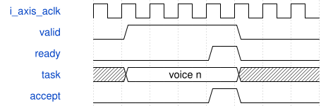

# AxisComputePool 模块规范

> RTL: `src/AxisComputePool.v`

## 1. 模块目的

C_KIND=0..5依次实例化PhaseFm、WaveLookup+WaveSample、ADSR、StudioOscMixer、SVF、VCA；每池C_CORES=1..4。

## 2. 参数

| 参数 | 默认值 | 说明 |
| --- | --- | --- |
| — | — | 本模块没有可配置参数。 |

## 3. 时钟与复位

- 时钟：`{"name": "i_axis_aclk", "edge": "posedge", "period_ns": 20}`
- 复位：`{"name": "i_axis_arstn", "active": "low", "style": "asynchronous", "values": "取消事件和任务，键状态及计数清零"}`

## 4. 接口信号规范

| 信号 | 方向 | 位宽 | 时钟域 | 语义角色 | 描述 |
| --- | --- | --- | --- | --- | --- |
| `i_axis_aclk` | input | 1 | 未声明 | clock | i axis aclk |
| `i_axis_arstn` | input | 1 | 未声明 | reset | i axis arstn |
| `i_s_axis_tdata` | input | C_INPUT_WIDTH | 未声明 | data | i s axis tdata |
| `i_s_axis_tuser` | input | C_USER_WIDTH | 未声明 | data | i s axis tuser |
| `i_s_axis_tvalid` | input | 1 | 未声明 | data | i s axis tvalid |
| `o_s_axis_tready` | output | 1 | 未声明 | data | o s axis tready |
| `o_m_axis_tdata` | output | C_OUTPUT_WIDTH | 未声明 | data | o m axis tdata |
| `o_m_axis_tuser` | output | C_USER_WIDTH | 未声明 | data | o m axis tuser |
| `o_m_axis_tvalid` | output | 1 | 未声明 | data | o m axis tvalid |
| `i_m_axis_tready` | input | 1 | 未声明 | data | i m axis tready |
| `i_wave_write` | input | 1 | 未声明 | data | i wave write |
| `i_wave_frame` | input | 1 | 未声明 | data | i wave frame |
| `i_wave_address` | input | 11 | 未声明 | data | i wave address |
| `i_wave_data` | input | 16 | 未声明 | data | i wave data |

## 5. 周期行为与延迟

- C_KIND=0..5依次实例化PhaseFm、WaveLookup+WaveSample、ADSR、StudioOscMixer、SVF、VCA；每池C_CORES=1..4。
- 输入游标只在valid&&ready时前进；输出游标只在结果握手时前进；二者分别模C_CORES轮转。
- 各lane保存独立信用和返回FIFO，按发射顺序回收；排在前面的lane未完成时保守阻塞，不能跨声部乱序提交。
- 背压时保持结果及标签；复位清游标和核心有效位，取消全部旧任务。
- Wave池每lane含独立波表缓存；仅空闲时广播每个写采样，所有副本接收相同写地址和数据。
- 合法输入/输出位宽依次为128/32、54/32、112/64、136/64、320/192、64/32；前四类user固定21位。

## 6. WaveDrom 时序图

### 背压与有序返回

示意ready为0时保持队首；箭头不代表固定核心算术延迟。实际周期见各核心和阶段统计。

- WaveJSON：[AxisComputePool_handshake.json5](waveforms/AxisComputePool_handshake.json5)

## 7. 边界、反压与错误

- 全满背压及同时接受/返回
- 非2次幂核心数游标回绕
- 处理中复位
- wave副本写一致性
- note-off保留旧参数

## 8. CDC 与综合约束

- 50MHz同一时钟域，低有效复位；板级复位同步释放。
- C_*_CORES是综合期参数，1..4；任意配置需要独立验证资源和时序，只有默认配置有本板实现证据。
- 一个issue和一个retire端口；仍保留阶段屏障，不是任意连接的多发射计算图。

## 9. 验证与验收

- 原引擎逐声部及PCM等值比较
- 各池1/2/3/4核配置
- 输入输出停顿及复位
- 真实ADC/UART/PT8211引脚闭环
- Gowin综合与50MHz时序

## 10. 可追溯性

- 规格模块：`AxisComputePool`
- RTL 路径：`src/AxisComputePool.v`
- 交付要求：本文档、WaveJSON 和 SVG 必须与同一版本规格一同发布。
