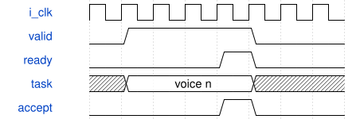

# ParallelAxisTop 模块规范

> RTL: `src/ParallelAxisTop.v`

## 1. 模块目的

完整ADC采集、迟滞判键、UART StudioControl、32声部参数/状态存储、多核合成和PT8211。

## 2. 参数

| 参数 | 默认值 | 说明 |
| --- | --- | --- |
| — | — | 本模块没有可配置参数。 |

## 3. 时钟与复位

- 时钟：`{"name": "i_clk", "edge": "posedge", "period_ns": 20}`
- 复位：`{"name": "i_rstn", "active": "low", "style": "asynchronous", "values": "取消事件和任务，键状态及计数清零"}`

## 4. 接口信号规范

| 信号 | 方向 | 位宽 | 时钟域 | 语义角色 | 描述 |
| --- | --- | --- | --- | --- | --- |
| `i_clk` | input | 1 | 未声明 | clock | 50MHz统一计算时钟 |
| `i_rstn` | input | 1 | 未声明 | reset | 低有效复位，异步置位同步释放 |
| `i_adc_dout` | input | 1 | 未声明 | data | 外部ADC串行数据 |
| `i_uart_rx` | input | 1 | 未声明 | data | 调试命令输入 |
| `o_mux_sel` | output | 3 | 未声明 | data | 模拟多路选择 |
| `o_mux_en` | output | 1 | 未声明 | data | 多路器使能 |
| `o_adc_cs_n` | output | 1 | 未声明 | data | ADC片选 |
| `o_adc_sclk` | output | 1 | 未声明 | data | ADC时钟 |
| `o_adc_din` | output | 1 | 未声明 | data | ADC命令 |
| `o_uart_tx` | output | 1 | 未声明 | data | 调试快照 |
| `HP_BCK` | output | 1 | 未声明 | data | PT8211位时钟 |
| `HP_WS` | output | 1 | 未声明 | data | PT8211声道选择 |
| `HP_DIN` | output | 1 | 未声明 | data | PT8211音频数据 |
| `PA_EN` | output | 1 | 未声明 | data | 低有效功放使能 |

## 5. 周期行为与延迟

- 完整ADC采集、迟滞判键、UART StudioControl、32声部参数/状态存储、多核合成和PT8211。
- 六个C_*_CORES参数由core_counts.json在构建前确定，支持1..4；不支持运行时改变硬件实例数。
- 默认Phase=1、Wave=2、Envelope=3、Modulation=1、Filter=1、VCA=1；波表更新广播到所有Wave副本。
- 配置和波表接受窗口仍位于引擎空闲期；参数下次起音快照生效，音量实时平滑。

## 6. WaveDrom 时序图

### 背压与有序返回

示意ready为0时保持队首；箭头不代表固定核心算术延迟。实际周期见各核心和阶段统计。

- WaveJSON：[ParallelAxisTop_handshake.json5](waveforms/ParallelAxisTop_handshake.json5)

## 7. 边界、反压与错误

- 全满背压及同时接受/返回
- 非2次幂核心数游标回绕
- 处理中复位
- wave副本写一致性
- note-off保留旧参数

## 8. CDC 与综合约束

- 50MHz同一时钟域，低有效复位；板级复位同步释放。
- C_*_CORES是综合期参数，1..4；任意配置需要独立验证资源和时序，只有默认配置有本板实现证据。
- 一个issue和一个retire端口；仍保留阶段屏障，不是任意连接的多发射计算图。

## 9. 验证与验收

- 原引擎逐声部及PCM等值比较
- 各池1/2/3/4核配置
- 输入输出停顿及复位
- 真实ADC/UART/PT8211引脚闭环
- Gowin综合与50MHz时序

## 10. 可追溯性

- 规格模块：`ParallelAxisTop`
- RTL 路径：`src/ParallelAxisTop.v`
- 交付要求：本文档、WaveJSON 和 SVG 必须与同一版本规格一同发布。
