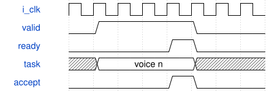

# ParallelSynthEngine 模块规范

> RTL: `src/ParallelSynthEngine.v`

## 1. 模块目的

32声部按7→0→1→2→3→4→5→6运行：调制包络、B相位、B波形、A相位FM、A波形、振幅包络、AM/混合、滤波/VCA。

## 2. 参数

| 参数 | 默认值 | 说明 |
| --- | --- | --- |
| — | — | 本模块没有可配置参数。 |

## 3. 时钟与复位

- 时钟：`{"name": "i_clk", "edge": "posedge", "period_ns": 10}`
- 复位：`{"name": "i_rstn", "active": "low", "style": "asynchronous", "values": "全局清除任务、相位包络滤波状态，保留波表RAM；外部同步释放"}`

## 4. 接口信号规范

| 信号 | 方向 | 位宽 | 时钟域 | 语义角色 | 描述 |
| --- | --- | --- | --- | --- | --- |
| `i_clk` | input | 1 | 未声明 | clock | 统一计算时钟 |
| `i_rstn` | input | 1 | 未声明 | reset | 全系统低有效复位，释放须同步 |
| `i_start` | input | 1 | 未声明 | data | 请求计算下一音频帧，忙时拒收并记过载 |
| `i_cfg_valid` | input | 1 | 未声明 | data | 源端持有完整声部配置 |
| `o_cfg_ready` | output | 1 | 未声明 | data | 仅空闲帧接收配置 |
| `i_cfg_voice` | input | 5 | 未声明 | data | 目标声部索引 |
| `i_cfg_data` | input | 512 | 未声明 | data | 音色参数和一次性门控事件 |
| `i_wave_valid` | input | 1 | 未声明 | data | 波表上传字有效 |
| `o_wave_ready` | output | 1 | 未声明 | data | 空闲时允许更新波表 |
| `i_wave_frame` | input | 1 | 未声明 | data | 选择波表的A或B帧 |
| `i_wave_address` | input | 11 | 未声明 | data | 银行位及1024点地址 |
| `i_wave_data` | input | 16 | 未声明 | data | 有符号波表采样 |
| `o_pcm_valid` | output | 1 | 未声明 | data | 完整混音帧可消费 |
| `i_pcm_ready` | input | 1 | 未声明 | data | 音频出口消费当前帧 |
| `o_pcm_left` | output | 24 | 未声明 | data | 限幅后的左声道PCM |
| `o_pcm_right` | output | 24 | 未声明 | data | 首版复制单声道到右声道 |
| `o_busy` | output | 1 | 未声明 | data | 当前音频帧尚未完全退役 |
| `o_overrun` | output | 1 | 未声明 | data | 忙时采样触发丢失的粘滞标志 |
| `o_fault` | output | 1 | 未声明 | data | 返回身份或算法错误，需要复位 |
| `o_frame_cycles` | output | 16 | 未声明 | data | 最近完成帧的计算周期数 |
| `o_result_valid` | output | 1 | 未声明 | data | 一个有效声部尾部结果提交 |
| `o_result_voice` | output | 5 | 未声明 | data | 本次提交所属声部 |
| `o_result_data` | output | 192 | 未声明 | data | 完整音频与滤波新状态 |
| `o_active` | output | 32 | 未声明 | data | 实际ADSR非空闲位图 |
| `o_stages` | output | 7 | 未声明 | data | 已接受阶段位图 |
| `o_wave_peak` | output | 32 | 未声明 | data | 振荡峰值 |
| `o_mod_peak` | output | 32 | 未声明 | data | AM峰值 |
| `o_env_peak` | output | 18 | 未声明 | data | 包络峰值 |

## 5. 周期行为与延迟

- 32声部按7→0→1→2→3→4→5→6运行：调制包络、B相位、B波形、A相位FM、A波形、振幅包络、AM/混合、滤波/VCA。
- 同步参数/状态RAM连续预取，经两级寄存及8槽任务FIFO发射；FIFO信用包含在途读请求。
- 每个阶段最多发射及提交一个任务/拍，同类型核心轮流接受任务；返回保序，全部声部提交后切换阶段。
- 振幅包络任务握手后按已发射标签消费事件；不能使用超前预取地址消费事件。
- 默认1/2/3/1/1/1核心配置32声部385拍；外部PCM背压可延长busy，但不改变音频数值。

## 6. WaveDrom 时序图

### 背压与有序返回

示意ready为0时保持队首；箭头不代表固定核心算术延迟。实际周期见各核心和阶段统计。

- WaveJSON：[ParallelSynthEngine_handshake.json5](waveforms/ParallelSynthEngine_handshake.json5)

## 7. 边界、反压与错误

- 全满背压及同时接受/返回
- 非2次幂核心数游标回绕
- 处理中复位
- wave副本写一致性
- note-off保留旧参数

## 8. CDC 与综合约束

- 50MHz同一时钟域，低有效复位；板级复位同步释放。
- C_*_CORES是综合期参数，1..4；任意配置需要独立验证资源和时序，只有默认配置有本板实现证据。
- 一个issue和一个retire端口；仍保留阶段屏障，不是任意连接的多发射计算图。

## 9. 验证与验收

- 原引擎逐声部及PCM等值比较
- 各池1/2/3/4核配置
- 输入输出停顿及复位
- 真实ADC/UART/PT8211引脚闭环
- Gowin综合与50MHz时序

## 10. 可追溯性

- 规格模块：`ParallelSynthEngine`
- RTL 路径：`src/ParallelSynthEngine.v`
- 交付要求：本文档、WaveJSON 和 SVG 必须与同一版本规格一同发布。
