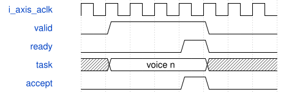

# ParallelVoiceChain 模块规范

> RTL: `src/ParallelVoiceChain.v`

## 1. 模块目的

SVF池与VCA池独立配置物理实例数量，通过AXI-Stream直接级联。

## 2. 参数

| 参数 | 默认值 | 说明 |
| --- | --- | --- |
| — | — | 本模块没有可配置参数。 |

## 3. 时钟与复位

- 时钟：`{"name": "i_axis_aclk", "edge": "posedge", "period_ns": 20}`
- 复位：`{"name": "i_axis_arstn", "active": "low", "style": "asynchronous", "values": "取消事件和任务，键状态及计数清零"}`

## 4. 接口信号规范

| 信号 | 方向 | 位宽 | 时钟域 | 语义角色 | 描述 |
| --- | --- | --- | --- | --- | --- |
| `i_axis_aclk` | input | 1 | 未声明 | clock | i axis aclk |
| `i_axis_arstn` | input | 1 | 未声明 | reset | i axis arstn |
| `i_s_axis_tdata` | input | 352 | 未声明 | data | i s axis tdata |
| `i_s_axis_tuser` | input | 21 | 未声明 | data | i s axis tuser |
| `i_s_axis_tvalid` | input | 1 | 未声明 | data | i s axis tvalid |
| `o_s_axis_tready` | output | 1 | 未声明 | data | o s axis tready |
| `o_m_axis_tdata` | output | 192 | 未声明 | data | o m axis tdata |
| `o_m_axis_tuser` | output | 21 | 未声明 | data | o m axis tuser |
| `i_m_axis_tready` | input | 1 | 未声明 | data | i m axis tready |
| `o_m_axis_tvalid` | output | 1 | 未声明 | data | o m axis tvalid |

## 5. 周期行为与延迟

- SVF池与VCA池独立配置物理实例数量，通过AXI-Stream直接级联。
- 滤波user携带原21位标签+18位包络+7位力度，共46位；VCA user携带21位标签+156位滤波状态与标志，共177位。
- 最终返回192位音频与状态以及原21位标签；算术、量化和状态格式与旧AxisVoiceChain一致。
- 每池保序并传递背压；复位取消所有在途上下文。

## 6. WaveDrom 时序图

### 背压与有序返回

示意ready为0时保持队首；箭头不代表固定核心算术延迟。实际周期见各核心和阶段统计。

- WaveJSON：[ParallelVoiceChain_handshake.json5](waveforms/ParallelVoiceChain_handshake.json5)

## 7. 边界、反压与错误

- 全满背压及同时接受/返回
- 非2次幂核心数游标回绕
- 处理中复位
- wave副本写一致性
- note-off保留旧参数

## 8. CDC 与综合约束

- 50MHz同一时钟域，低有效复位；板级复位同步释放。
- C_*_CORES是综合期参数，1..4；任意配置需要独立验证资源和时序，只有默认配置有本板实现证据。
- 一个issue和一个retire端口；仍保留阶段屏障，不是任意连接的多发射计算图。

## 9. 验证与验收

- 原引擎逐声部及PCM等值比较
- 各池1/2/3/4核配置
- 输入输出停顿及复位
- 真实ADC/UART/PT8211引脚闭环
- Gowin综合与50MHz时序

## 10. 可追溯性

- 规格模块：`ParallelVoiceChain`
- RTL 路径：`src/ParallelVoiceChain.v`
- 交付要求：本文档、WaveJSON 和 SVG 必须与同一版本规格一同发布。
