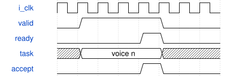

# SynthTaskPrefetch 模块规范

> RTL: `src/SynthTaskPrefetch.v`

## 1. 模块目的

调用方提供同步一拍RAM读；边沿N发起读，N+1寄存任务和深度乘法，N+2写入队列。

## 2. 参数

| 参数 | 默认值 | 说明 |
| --- | --- | --- |
| — | — | 本模块没有可配置参数。 |

## 3. 时钟与复位

- 时钟：`{"name": "i_clk", "edge": "posedge", "period_ns": 20}`
- 复位：`{"name": "i_rstn", "active": "low", "style": "asynchronous", "values": "取消事件和任务，键状态及计数清零"}`

## 4. 接口信号规范

| 信号 | 方向 | 位宽 | 时钟域 | 语义角色 | 描述 |
| --- | --- | --- | --- | --- | --- |
| `i_clk` | input | 1 | 未声明 | clock | i clk |
| `i_rstn` | input | 1 | 未声明 | reset | i rstn |
| `i_begin` | input | 1 | 未声明 | data | i begin |
| `i_run` | input | 1 | 未声明 | data | i run |
| `i_stage` | input | 3 | 未声明 | data | i stage |
| `i_epoch` | input | 16 | 未声明 | data | i epoch |
| `o_read_voice` | output | 5 | 未声明 | data | o read voice |
| `i_profile` | input | 512 | 未声明 | data | i profile |
| `i_state` | input | 384 | 未声明 | data | i state |
| `o_valid` | output | 1 | 未声明 | data | o valid |
| `i_ready` | input | 1 | 未声明 | data | i ready |
| `o_data` | output | 352 | 未声明 | data | o data |
| `o_user` | output | 21 | 未声明 | data | o user |

## 5. 周期行为与延迟

- 调用方提供同步一拍RAM读；边沿N发起读，N+1寄存任务和深度乘法，N+2写入队列。
- 默认C_QUEUE_BITS=3，8槽队列；cnt_reserved同时覆盖读流水和队列，接受一个下游任务才返还一个信用。
- 352位任务按阶段打包，标签为16位epoch+5位voice；FM/AM深度乘调制包络后右移18位。
- i_begin清空队列有效性、读写游标及在途有效位；阶段/epoch在运行该阶段期间保持不变。
- 每阶段固定发射C_VOICES个任务；board仅使用32；背压时输出队首保持不变。

## 6. WaveDrom 时序图

### 背压与有序返回

示意ready为0时保持队首；箭头不代表固定核心算术延迟。实际周期见各核心和阶段统计。

- WaveJSON：[SynthTaskPrefetch_handshake.json5](waveforms/SynthTaskPrefetch_handshake.json5)

## 7. 边界、反压与错误

- 全满背压及同时接受/返回
- 非2次幂核心数游标回绕
- 处理中复位
- wave副本写一致性
- note-off保留旧参数

## 8. CDC 与综合约束

- 50MHz同一时钟域，低有效复位；板级复位同步释放。
- C_*_CORES是综合期参数，1..4；任意配置需要独立验证资源和时序，只有默认配置有本板实现证据。
- 一个issue和一个retire端口；仍保留阶段屏障，不是任意连接的多发射计算图。

## 9. 验证与验收

- 原引擎逐声部及PCM等值比较
- 各池1/2/3/4核配置
- 输入输出停顿及复位
- 真实ADC/UART/PT8211引脚闭环
- Gowin综合与50MHz时序

## 10. 可追溯性

- 规格模块：`SynthTaskPrefetch`
- RTL 路径：`src/SynthTaskPrefetch.v`
- 交付要求：本文档、WaveJSON 和 SVG 必须与同一版本规格一同发布。
