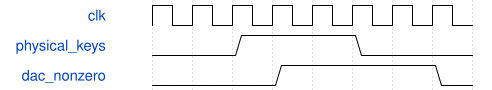

# tb_keyboard_audio 模块规范

> RTL: `sim/tb_keyboard_audio.v`

## 1. 模块目的

引脚级模拟ADC双转换及UART，独立解码PT8211左右声道并对照PCM舍入。

## 2. 参数

| 参数 | 默认值 | 说明 |
| --- | --- | --- |
| — | — | 本模块没有可配置参数。 |

## 3. 时钟与复位

- 时钟：`{"name": "clk", "edge": "posedge", "period_ns": 20}`
- 复位：`{"name": "rstn", "active": "low", "style": "asynchronous", "values": "取消事件和任务，键状态及计数清零"}`

## 4. 接口信号规范

| 信号 | 方向 | 位宽 | 时钟域 | 语义角色 | 描述 |
| --- | --- | --- | --- | --- | --- |
| `o_done` | output | 1 | 未声明 | data | 所有引脚级检查完成 |

## 5. 周期行为与延迟

- 引脚级模拟ADC双转换及UART，独立解码PT8211左右声道并对照PCM舍入。
- 覆盖启动静音、三键跨行和弦、释音归零、单独数字自测及停止、遥测帧校验。
- 增加32键同时按下、释音仍计入补偿、音乐和弦无限幅，以及64字节遥测校验。

## 6. WaveDrom 时序图

### 接口概念时序

为事件顺序示意，间隔不按比例；实际周期见仿真与构建报告。

- WaveJSON：[tb_keyboard_audio_pipeline.json5](waveforms/tb_keyboard_audio_pipeline.json5)

## 7. 边界、反压与错误

- 复位后按住键
- 门限附近抖动
- 事件遇到音频忙帧
- 多个键同时变化

## 8. CDC 与综合约束

- 固定32个逻辑声部；50MHz；板型31004；只用于本轮SRAM诊断验证。

## 9. 验证与验收

- 上电静音
- 跨行多键按下和释放
- ADC至DAC引脚解码
- 配置反压保持
- 命令自测与物理键隔离

## 10. 可追溯性

- 规格模块：`tb_keyboard_audio`
- RTL 路径：`sim/tb_keyboard_audio.v`
- 交付要求：本文档、WaveJSON 和 SVG 必须与同一版本规格一同发布。
