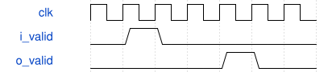

# tb_keyboard_loudness 模块规范

> RTL: `sim/tb_keyboard_loudness.v`

## 1. 模块目的

ROM由已保存的32键实测校准产生，包含方向、50%按下门限和35%释放门限。

## 2. 参数

| 参数 | 默认值 | 说明 |
| --- | --- | --- |
| — | — | 本模块没有可配置参数。 |

## 3. 时钟与复位

- 时钟：`{"name": "i_clk", "edge": "posedge", "period_ns": 20}`
- 复位：`{"name": "i_rstn", "active": "low", "style": "asynchronous", "values": "取消事件和任务，键状态及计数清零"}`

## 4. 接口信号规范

| 信号 | 方向 | 位宽 | 时钟域 | 语义角色 | 描述 |
| --- | --- | --- | --- | --- | --- |
| `o_done` | output | 1 | 未声明 | data | 独立向量与复位检查完成 |

## 5. 周期行为与延迟

- 固定除32混音之后，Q16目标增益=floor(4*65536/sqrt(max(N,1)))*volume/8。
- N来自实际包络，包含释音。音量0至8，越界钳位8。
- 每帧增益向下ceil(delta/64)，向上ceil(delta/4096)；最后恰好达到静音。
- 四级有效流水：完整乘积、绝对值、对称半值远离零舍入、限幅至正负0x700000。
- 峰值以约84ms时间常数衰减；限幅次数饱和计数。电平不是LUFS；没有前视限幅，超阈值样本可能失真。

## 6. WaveDrom 时序图

### 四沿输出

第一个沿接收乘积，第四沿提交限幅结果。

- WaveJSON：[tb_keyboard_loudness_pipeline.json5](waveforms/tb_keyboard_loudness_pipeline.json5)

## 7. 边界、反压与错误

- 复位后按住键
- 门限附近抖动
- 事件遇到音频忙帧
- 多个键同时变化

## 8. CDC 与综合约束

- 固定32个逻辑声部；50MHz；板型31004；只用于本轮SRAM诊断验证。

## 9. 验证与验收

- 55500独立整数向量
- 多复音与增益切换
- 最负数和正满量程
- 管线复位取消
- 32键音乐和弦与松键

## 10. 可追溯性

- 规格模块：`tb_keyboard_loudness`
- RTL 路径：`sim/tb_keyboard_loudness.v`
- 交付要求：本文档、WaveJSON 和 SVG 必须与同一版本规格一同发布。
