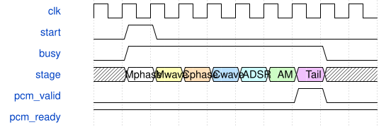

# KeyboardAudioSystem 模块规范

> RTL: `src/KeyboardAudioSystem.v`

## 1. 模块目的

逻辑音频系统顶层：共享任务引擎到I2S双声道

## 2. 参数

| 参数 | 默认值 | 说明 |
| --- | --- | --- |
| — | — | 本模块没有可配置参数。 |

## 3. 时钟与复位

- 时钟：`{"name": "i_clk", "edge": "posedge", "period_ns": 10}`
- 复位：`{"name": "i_rstn", "active": "low", "style": "asynchronous", "values": "全局清除任务、相位包络滤波状态，保留波表RAM；外部同步释放"}`

## 4. 接口信号规范

| 信号 | 方向 | 位宽 | 时钟域 | 语义角色 | 描述 |
| --- | --- | --- | --- | --- | --- |
| `i_clk` | input | 1 | 未声明 | clock | 统一计算时钟 |
| `i_rstn` | input | 1 | 未声明 | reset | 全系统低有效复位，释放须同步 |
| `i_run` | input | 1 | 未声明 | data | 配置结束后启动音频；只在空闲时停止 |
| `i_cfg_valid` | input | 1 | 未声明 | data | 源端持有完整声部配置 |
| `o_cfg_ready` | output | 1 | 未声明 | data | 仅空闲帧接收配置 |
| `i_cfg_voice` | input | 5 | 未声明 | data | 目标声部索引 |
| `i_cfg_data` | input | 376 | 未声明 | data | 音色参数和一次性门控事件 |
| `i_wave_valid` | input | 1 | 未声明 | data | 波表上传字有效 |
| `o_wave_ready` | output | 1 | 未声明 | data | 空闲时允许更新波表 |
| `i_wave_frame` | input | 1 | 未声明 | data | 选择波表的A或B帧 |
| `i_wave_address` | input | 11 | 未声明 | data | 银行位及1024点地址 |
| `i_wave_data` | input | 16 | 未声明 | data | 有符号波表采样 |
| `o_pcm_valid` | output | 1 | 未声明 | data | 完整混音帧可消费 |
| `o_pcm_left` | output | 24 | 未声明 | data | 限幅后的左声道PCM |
| `o_pcm_right` | output | 24 | 未声明 | data | 首版复制单声道到右声道 |
| `o_busy` | output | 1 | 未声明 | data | 当前音频帧尚未完全退役 |
| `o_overrun` | output | 1 | 未声明 | data | 忙时采样触发丢失的粘滞标志 |
| `o_fault` | output | 1 | 未声明 | data | 返回身份或算法错误，需要复位 |
| `o_frame_cycles` | output | 16 | 未声明 | data | 最近完成帧的计算周期数 |
| `o_result_valid` | output | 1 | 未声明 | data | 一个有效声部尾部结果提交 |
| `o_result_voice` | output | 5 | 未声明 | data | 本次提交所属声部 |
| `o_result_data` | output | 192 | 未声明 | data | 完整音频与滤波新状态 |
| `o_sample_tick` | output | 1 | 未声明 | data | 音频帧节拍监测 |
| `o_bclk` | output | 1 | 未声明 | data | 串行位时钟 |
| `o_lrclk` | output | 1 | 未声明 | data | 左右声道选择 |
| `o_sdata` | output | 1 | 未声明 | data | I2S音频输出 |
| `o_mclk` | output | 1 | 未声明 | data | 主音频时钟 |
| `o_underrun` | output | 1 | 未声明 | data | I2S缺帧粘滞标志 |
| `i_volume` | input | 4 | 未声明 | data | 主音量0至8 |
| `o_active_count` | output | 6 | 未声明 | data | ADSR非空闲声部数，包括释音 |
| `o_gain` | output | 19 | 未声明 | data | 平滑后的Q16增益 |
| `o_input_peak` | output | 24 | 未声明 | data | 处理前采样峰值保持 |
| `o_output_peak` | output | 24 | 未声明 | data | 处理后采样峰值保持 |
| `o_clips` | output | 32 | 未声明 | data | 保护限幅累计次数 |
| `o_stages` | output | 7 | 未声明 | data | 已提交阶段累计位图 |
| `o_wave_peak` | output | 32 | 未声明 | data | 振荡波形绝对峰值 |
| `o_mod_peak` | output | 32 | 未声明 | data | AM输出绝对峰值 |
| `o_env_peak` | output | 18 | 未声明 | data | 包络整数峰值 |

## 5. 周期行为与延迟

- 实例化AxisSynthEngine与I2sTx，用音频帧节拍触发计算，PCM出口固定ready。
- i_run=0时允许配置与波表上传；启动后首帧静音，新PCM在下一I2S帧边界播放。
- C_FRAME_STEP为2/1时，每帧512/1024个i_clk周期；输出左右声道复制单声道混音。
- i_run必须同步变化且仅在空闲时停止；板级时钟、复位同步、引脚和主机桥由外层提供。
- Engine与I2sTx之间插入KeyboardLoudness，计算448拍后增加四拍音量处理；1024拍截止期不变。

## 6. WaveDrom 时序图

### 阶段屏障和音频提交

阶段宽度为示意，实际周期来自仿真报告。

- WaveJSON：[KeyboardAudioSystem_pipeline.json5](waveforms/KeyboardAudioSystem_pipeline.json5)

## 7. 边界、反压与错误

- 空/禁用声部
- 整帧输出反压
- 运行中配置和波表写被阻挡
- 复位取消在途任务
- 双银行与邻点回绕

## 8. CDC 与综合约束

- C_VOICES: 1..32；C_MIX_SHIFT: 0..16。
- 所有控制、存储、算术采用同一i_clk；控制接口不是外部串行物理协议。
- AxisSynthSystem的i_run同步输入，启动前上传波表，停止仅允许空闲时。
- I2S周期为1024/C_FRAME_STEP，常规24位I2S或PT8211由参数选择。
- 严格门禁未通过前仅为诊断候选，不替换现有板级SynthSystem。

## 9. 验证与验收

- 全部七阶段逐位比较
- 三种声部配置容量
- PCM逐位比较与串行I2S解码
- 忙时拒收和稳定性
- 在途复位与静音重启

## 10. 可追溯性

- 规格模块：`KeyboardAudioSystem`
- RTL 路径：`src/KeyboardAudioSystem.v`
- 交付要求：本文档、WaveJSON 和 SVG 必须与同一版本规格一同发布。
