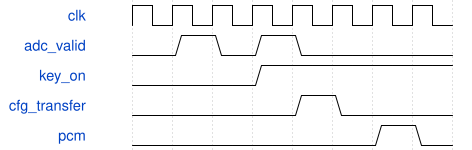

# KeyboardAxisTop 模块规范

> RTL: `src/KeyboardAxisTop.v`

## 1. 模块目的

50MHz单域，1024拍音频帧，采样率48828.125Hz，相位增量按此采样率计算。

## 2. 参数

| 参数 | 默认值 | 说明 |
| --- | --- | --- |
| — | — | 本模块没有可配置参数。 |

## 3. 时钟与复位

- 时钟：`{"name": "i_clk", "edge": "posedge", "period_ns": 20}`
- 复位：`{"name": "i_rstn", "active": "low", "style": "asynchronous", "values": "取消事件和任务，键状态及计数清零"}`

## 4. 接口信号规范

| 信号 | 方向 | 位宽 | 时钟域 | 语义角色 | 描述 |
| --- | --- | --- | --- | --- | --- |
| `i_clk` | input | 1 | 未声明 | clock | 50MHz统一计算时钟 |
| `i_rstn` | input | 1 | 未声明 | reset | 低有效复位，异步置位同步释放 |
| `i_adc_dout` | input | 1 | 未声明 | data | 外部ADC串行数据 |
| `i_uart_rx` | input | 1 | 未声明 | data | 调试命令输入 |
| `o_mux_sel` | output | 3 | 未声明 | data | 模拟多路选择 |
| `o_mux_en` | output | 1 | 未声明 | data | 多路器使能 |
| `o_adc_cs_n` | output | 1 | 未声明 | data | ADC片选 |
| `o_adc_sclk` | output | 1 | 未声明 | data | ADC时钟 |
| `o_adc_din` | output | 1 | 未声明 | data | ADC命令 |
| `o_uart_tx` | output | 1 | 未声明 | data | 调试快照 |
| `HP_BCK` | output | 1 | 未声明 | data | PT8211位时钟 |
| `HP_WS` | output | 1 | 未声明 | data | PT8211声道选择 |
| `HP_DIN` | output | 1 | 未声明 | data | PT8211音频数据 |
| `PA_EN` | output | 1 | 未声明 | data | 低有效功放使能 |

## 5. 周期行为与延迟

- 50MHz单域，1024拍音频帧，采样率48828.125Hz，相位增量按此采样率计算。
- 真实ADC双转换扫描，门限判键，376位完整参数握手，32声部AXIS，16位PT8211。
- 配置初始化完成后才启动音频；功放延时打开，fault或overrun时关闭。
- UART T产生有标记的一秒C4数字自测，P结束自测；不改物理按键状态。
- 固定正弦和ADSR音色；本次不实现App音色编辑、SD加载或任意任务图。
- 命令0至8设置主音量，默认6；ADSR释音仍计入发声数，按4/sqrt(N)及音量缩放，增益变化平滑。
- 输出经四拍响度流水后送入PT8211，64字节遥测包含电平、增益和限幅。

## 6. WaveDrom 时序图

### 接口概念时序

为事件顺序示意，间隔不按比例；实际周期见仿真与构建报告。

- WaveJSON：[KeyboardAxisTop_pipeline.json5](waveforms/KeyboardAxisTop_pipeline.json5)

## 7. 边界、反压与错误

- 复位后按住键
- 门限附近抖动
- 事件遇到音频忙帧
- 多个键同时变化

## 8. CDC 与综合约束

- 固定32个逻辑声部；50MHz；板型31004；只用于本轮SRAM诊断验证。

## 9. 验证与验收

- 上电静音
- 跨行多键按下和释放
- ADC至DAC引脚解码
- 配置反压保持
- 命令自测与物理键隔离

## 10. 可追溯性

- 规格模块：`KeyboardAxisTop`
- RTL 路径：`src/KeyboardAxisTop.v`
- 交付要求：本文档、WaveJSON 和 SVG 必须与同一版本规格一同发布。
