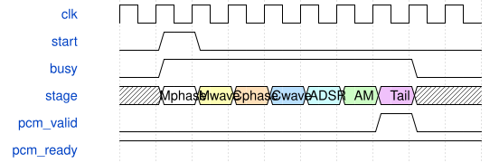

# KeyboardFrameMixer 模块规范

> RTL: `src/KeyboardFrameMixer.v`

## 1. 模块目的

完整帧累加、固定余量和24位PCM饱和

## 2. 参数

| 参数 | 默认值 | 说明 |
| --- | --- | --- |
| — | — | 本模块没有可配置参数。 |

## 3. 时钟与复位

- 时钟：`{"name": "i_clk", "edge": "posedge", "period_ns": 10}`
- 复位：`{"name": "i_rstn", "active": "low", "style": "asynchronous", "values": "全局清除任务、相位包络滤波状态，保留波表RAM；外部同步释放"}`

## 4. 接口信号规范

| 信号 | 方向 | 位宽 | 时钟域 | 语义角色 | 描述 |
| --- | --- | --- | --- | --- | --- |
| `i_clk` | input | 1 | 未声明 | clock | 统一计算时钟 |
| `i_rstn` | input | 1 | 未声明 | reset | 全系统低有效复位，释放须同步 |
| `i_start` | input | 1 | 未声明 | data | 开始一帧，清除旧累加值 |
| `i_valid` | input | 1 | 未声明 | data | 一个声部音频提交 |
| `i_sample` | input | 32 | 未声明 | data | 有符号Q17声部样值 |
| `i_last` | input | 1 | 未声明 | data | 最后一个声部已提交 |
| `o_pcm_valid` | output | 1 | 未声明 | data | 完整混音帧可消费 |
| `i_pcm_ready` | input | 1 | 未声明 | data | 音频出口消费当前帧 |
| `o_pcm_left` | output | 24 | 未声明 | data | 限幅后的左声道PCM |
| `o_pcm_right` | output | 24 | 未声明 | data | 首版复制单声道到右声道 |

## 5. 周期行为与延迟

- i_start清除64位累加器；优先于i_valid，两者由父层保证互斥。
- 每次i_valid接受一个有符号Q17样本；i_last只随最后一个有效样本提交。
- 最后一次累加在同一沿生成PCM：先算术右移C_MIX_SHIFT，再左移6，饱和到signed24。
- 输出有效后保持到i_pcm_ready；父层保证未消费时不发新一帧。左右声道复制同一值。
- 仅用于32声部，40位累加足以保留32个signed32样本之和。输入、最终帧和、缩放及限幅分别寄存，数值与旧64位实现一致；PCM发布比旧版增加三拍。
- i_start必须在上一帧完全退役后，i_last只随最后有效输入；当前Engine已保证这些条件。

## 6. WaveDrom 时序图

### 阶段屏障和音频提交

阶段宽度为示意，实际周期来自仿真报告。

- WaveJSON：[KeyboardFrameMixer_pipeline.json5](waveforms/KeyboardFrameMixer_pipeline.json5)

## 7. 边界、反压与错误

- 空/禁用声部
- 整帧输出反压
- 运行中配置和波表写被阻挡
- 复位取消在途任务
- 双银行与邻点回绕

## 8. CDC 与综合约束

- C_VOICES: 1..32；C_MIX_SHIFT: 0..16。
- 所有控制、存储、算术采用同一i_clk；控制接口不是外部串行物理协议。
- AxisSynthSystem的i_run同步输入，启动前上传波表，停止仅允许空闲时。
- I2S周期为1024/C_FRAME_STEP，常规24位I2S或PT8211由参数选择。
- 严格门禁未通过前仅为诊断候选，不替换现有板级SynthSystem。

## 9. 验证与验收

- 全部七阶段逐位比较
- 三种声部配置容量
- PCM逐位比较与串行I2S解码
- 忙时拒收和稳定性
- 在途复位与静音重启

## 10. 可追溯性

- 规格模块：`KeyboardFrameMixer`
- RTL 路径：`src/KeyboardFrameMixer.v`
- 交付要求：本文档、WaveJSON 和 SVG 必须与同一版本规格一同发布。
