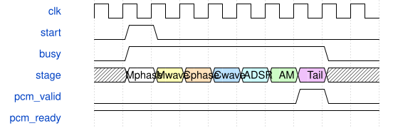

# KeyboardSynthEngine 模块规范

> RTL: `src/KeyboardSynthEngine.v`

## 1. 模块目的

七阶段交错调度、身份校验和多声部状态回写

## 2. 参数

| 参数 | 默认值 | 说明 |
| --- | --- | --- |
| — | — | 本模块没有可配置参数。 |

## 3. 时钟与复位

- 时钟：`{"name": "i_clk", "edge": "posedge", "period_ns": 10}`
- 复位：`{"name": "i_rstn", "active": "low", "style": "asynchronous", "values": "全局清除任务、相位包络滤波状态，保留波表RAM；外部同步释放"}`

## 4. 接口信号规范

| 信号 | 方向 | 位宽 | 时钟域 | 语义角色 | 描述 |
| --- | --- | --- | --- | --- | --- |
| `i_clk` | input | 1 | 未声明 | clock | 统一计算时钟 |
| `i_rstn` | input | 1 | 未声明 | reset | 全系统低有效复位，释放须同步 |
| `i_start` | input | 1 | 未声明 | data | 请求计算下一音频帧，忙时拒收并记过载 |
| `i_cfg_valid` | input | 1 | 未声明 | data | 源端持有完整声部配置 |
| `o_cfg_ready` | output | 1 | 未声明 | data | 仅空闲帧接收配置 |
| `i_cfg_voice` | input | 5 | 未声明 | data | 目标声部索引 |
| `i_cfg_data` | input | 376 | 未声明 | data | 音色参数和一次性门控事件 |
| `i_wave_valid` | input | 1 | 未声明 | data | 波表上传字有效 |
| `o_wave_ready` | output | 1 | 未声明 | data | 空闲时允许更新波表 |
| `i_wave_frame` | input | 1 | 未声明 | data | 选择波表的A或B帧 |
| `i_wave_address` | input | 11 | 未声明 | data | 银行位及1024点地址 |
| `i_wave_data` | input | 16 | 未声明 | data | 有符号波表采样 |
| `o_pcm_valid` | output | 1 | 未声明 | data | 完整混音帧可消费 |
| `i_pcm_ready` | input | 1 | 未声明 | data | 音频出口消费当前帧 |
| `o_pcm_left` | output | 24 | 未声明 | data | 限幅后的左声道PCM |
| `o_pcm_right` | output | 24 | 未声明 | data | 首版复制单声道到右声道 |
| `o_busy` | output | 1 | 未声明 | data | 当前音频帧尚未完全退役 |
| `o_overrun` | output | 1 | 未声明 | data | 忙时采样触发丢失的粘滞标志 |
| `o_fault` | output | 1 | 未声明 | data | 返回身份或算法错误，需要复位 |
| `o_frame_cycles` | output | 16 | 未声明 | data | 最近完成帧的计算周期数 |
| `o_result_valid` | output | 1 | 未声明 | data | 一个有效声部尾部结果提交 |
| `o_result_voice` | output | 5 | 未声明 | data | 本次提交所属声部 |
| `o_result_data` | output | 192 | 未声明 | data | 完整音频与滤波新状态 |
| `o_active` | output | 32 | 未声明 | data | 实际ADSR非空闲位图 |
| `o_stages` | output | 7 | 未声明 | data | 已接受阶段位图 |
| `o_wave_peak` | output | 32 | 未声明 | data | 振荡峰值 |
| `o_mod_peak` | output | 32 | 未声明 | data | AM峰值 |
| `o_env_peak` | output | 18 | 未声明 | data | 包络峰值 |

## 5. 周期行为与延迟

- C_VOICES个声部按七阶段交错发射，同一阶段全部返回后才进入下一阶段。
- 发射快照来自状态池；以帧编号和声部编号核对返回，再按阶段回写。
- 配置和上传只在空闲且无起始请求时握手，包络事件只在阶段4接受时消费。
- 无阻塞计算周期11*C_VOICES+96；最后累加后PCM有效，消费下一沿返回空闲。
- 忙时采样请求拒收并置overrun；错误返回置fault、静音并在当前帧完成后停止新帧。
- 保留原有算术和调度；仅观察flag_commit有效结果，包络stage非0保持活动，包含release。

## 6. WaveDrom 时序图

### 阶段屏障和音频提交

阶段宽度为示意，实际周期来自仿真报告。

- WaveJSON：[KeyboardSynthEngine_pipeline.json5](waveforms/KeyboardSynthEngine_pipeline.json5)

## 7. 边界、反压与错误

- 空/禁用声部
- 整帧输出反压
- 运行中配置和波表写被阻挡
- 复位取消在途任务
- 双银行与邻点回绕

## 8. CDC 与综合约束

- C_VOICES: 1..32；C_MIX_SHIFT: 0..16。
- 所有控制、存储、算术采用同一i_clk；控制接口不是外部串行物理协议。
- AxisSynthSystem的i_run同步输入，启动前上传波表，停止仅允许空闲时。
- I2S周期为1024/C_FRAME_STEP，常规24位I2S或PT8211由参数选择。
- 严格门禁未通过前仅为诊断候选，不替换现有板级SynthSystem。

## 9. 验证与验收

- 全部七阶段逐位比较
- 三种声部配置容量
- PCM逐位比较与串行I2S解码
- 忙时拒收和稳定性
- 在途复位与静音重启

## 10. 可追溯性

- 规格模块：`KeyboardSynthEngine`
- RTL 路径：`src/KeyboardSynthEngine.v`
- 交付要求：本文档、WaveJSON 和 SVG 必须与同一版本规格一同发布。
