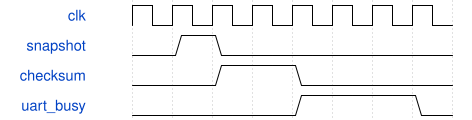

# KeyboardSynthTelemetry 模块规范

> RTL: `src/KeyboardSynthTelemetry.v`

## 1. 模块目的

周期性锁存32字节原子状态快照，计算前30字节异或，最后字节0D。

## 2. 参数

| 参数 | 默认值 | 说明 |
| --- | --- | --- |
| — | — | 本模块没有可配置参数。 |

## 3. 时钟与复位

- 时钟：`{"name": "i_clk", "edge": "posedge", "period_ns": 20}`
- 复位：`{"name": "i_rstn", "active": "low", "style": "asynchronous", "values": "取消事件和任务，键状态及计数清零"}`

## 4. 接口信号规范

| 信号 | 方向 | 位宽 | 时钟域 | 语义角色 | 描述 |
| --- | --- | --- | --- | --- | --- |
| `i_clk` | input | 1 | 未声明 | clock | 50MHz统一计算时钟 |
| `i_rstn` | input | 1 | 未声明 | reset | 低有效复位，异步置位同步释放 |
| `i_frames` | input | 32 | 未声明 | data | 音频帧计数 |
| `i_pressed` | input | 32 | 未声明 | data | 物理键状态 |
| `i_delivered` | input | 32 | 未声明 | data | 提交键状态 |
| `i_nonzero` | input | 32 | 未声明 | data | 非零PCM计数 |
| `i_events` | input | 32 | 未声明 | data | 事件计数 |
| `i_cycles` | input | 16 | 未声明 | data | 合成周期 |
| `i_flags` | input | 8 | 未声明 | data | 错误及测试标志 |
| `i_key` | input | 5 | 未声明 | data | 最近键号 |
| `i_raw` | input | 12 | 未声明 | data | 最近ADC结果 |
| `o_uart_tx` | output | 1 | 未声明 | data | 115200 8N1输出 |
| `i_volume` | input | 4 | 未声明 | data | 主音量0至8 |
| `i_active_count` | input | 6 | 未声明 | data | ADSR非空闲声部数，包括释音 |
| `i_gain` | input | 19 | 未声明 | data | 平滑后的Q16增益 |
| `i_input_peak` | input | 24 | 未声明 | data | 处理前采样峰值保持 |
| `i_output_peak` | input | 24 | 未声明 | data | 处理后采样峰值保持 |
| `i_clips` | input | 32 | 未声明 | data | 保护限幅累计次数 |
| `i_stages` | input | 7 | 未声明 | data | 已提交阶段累计位图 |
| `i_wave_peak` | input | 32 | 未声明 | data | 振荡波形绝对峰值 |
| `i_mod_peak` | input | 32 | 未声明 | data | AM输出绝对峰值 |
| `i_env_peak` | input | 18 | 未声明 | data | 包络整数峰值 |

## 5. 周期行为与延迟

- 周期锁存64字节快照；头A5 5A 02 40，0至61字节XOR写62，63字节0D。
- 0至29字节沿用旧状态布局，30音量，31声部数，32增益，36输入峰值，40输出峰值，44限幅计数，48包络峰值，52波形峰值，56调制峰值，60阶段位图，61音量副本。
- 多字节整数小端；发完整包后才重新锁存，等待UART停止位。

## 6. WaveDrom 时序图

### 接口概念时序

为事件顺序示意，间隔不按比例；实际周期见仿真与构建报告。

- WaveJSON：[KeyboardSynthTelemetry_pipeline.json5](waveforms/KeyboardSynthTelemetry_pipeline.json5)

## 7. 边界、反压与错误

- 复位后按住键
- 门限附近抖动
- 事件遇到音频忙帧
- 多个键同时变化

## 8. CDC 与综合约束

- 固定32个逻辑声部；50MHz；板型31004；只用于本轮SRAM诊断验证。

## 9. 验证与验收

- 上电静音
- 跨行多键按下和释放
- ADC至DAC引脚解码
- 配置反压保持
- 命令自测与物理键隔离

## 10. 可追溯性

- 规格模块：`KeyboardSynthTelemetry`
- RTL 路径：`src/KeyboardSynthTelemetry.v`
- 交付要求：本文档、WaveJSON 和 SVG 必须与同一版本规格一同发布。
