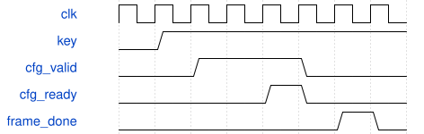

# KeyboardVoiceBridge 模块规范

> RTL: `src/KeyboardVoiceBridge.v`

## 1. 模块目的

启动依次初始化32个独立逻辑声部，全部接受后允许音频运行。

## 2. 参数

| 参数 | 默认值 | 说明 |
| --- | --- | --- |
| — | — | 本模块没有可配置参数。 |

## 3. 时钟与复位

- 时钟：`{"name": "i_clk", "edge": "posedge", "period_ns": 20}`
- 复位：`{"name": "i_rstn", "active": "low", "style": "asynchronous", "values": "取消事件和任务，键状态及计数清零"}`

## 4. 接口信号规范

| 信号 | 方向 | 位宽 | 时钟域 | 语义角色 | 描述 |
| --- | --- | --- | --- | --- | --- |
| `i_clk` | input | 1 | 未声明 | clock | 50MHz统一计算时钟 |
| `i_rstn` | input | 1 | 未声明 | reset | 低有效复位，异步置位同步释放 |
| `i_pressed` | input | 32 | 未声明 | data | 目标键状态 |
| `i_frame_done` | input | 1 | 未声明 | data | PCM完成脉冲 |
| `o_cfg_valid` | output | 1 | 未声明 | data | 完整配置有效 |
| `i_cfg_ready` | input | 1 | 未声明 | data | 引擎接受配置 |
| `o_cfg_voice` | output | 5 | 未声明 | data | 目标逻辑声部 |
| `o_cfg_data` | output | 376 | 未声明 | data | 完整参数和单次事件 |
| `o_initialized` | output | 1 | 未声明 | data | 全部初始配置已接受 |
| `o_delivered` | output | 32 | 未声明 | data | 最后接受的键状态 |
| `o_events` | output | 32 | 未声明 | data | 已接受事件计数 |

## 5. 周期行为与延迟

- 启动依次初始化32个独立逻辑声部，全部接受后允许音频运行。
- 按键0至31对应MIDI48至79；此版按键对应逻辑声部，运算器仍共享。
- 配置保持到valid和ready同时有效；事件为重触发或释音。
- 运行中每次配置接受后等待该音频帧PCM完成，避免同声部单槽事件被提前覆盖。

## 6. WaveDrom 时序图

### 接口概念时序

为事件顺序示意，间隔不按比例；实际周期见仿真与构建报告。

- WaveJSON：[KeyboardVoiceBridge_pipeline.json5](waveforms/KeyboardVoiceBridge_pipeline.json5)

## 7. 边界、反压与错误

- 复位后按住键
- 门限附近抖动
- 事件遇到音频忙帧
- 多个键同时变化

## 8. CDC 与综合约束

- 固定32个逻辑声部；50MHz；板型31004；只用于本轮SRAM诊断验证。

## 9. 验证与验收

- 上电静音
- 跨行多键按下和释放
- ADC至DAC引脚解码
- 配置反压保持
- 命令自测与物理键隔离

## 10. 可追溯性

- 规格模块：`KeyboardVoiceBridge`
- RTL 路径：`src/KeyboardVoiceBridge.v`
- 交付要求：本文档、WaveJSON 和 SVG 必须与同一版本规格一同发布。
