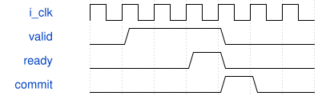

# KeyboardVoiceBridge 模块规范

> RTL: `src/KeyboardVoiceBridge.v`

## 1. 模块目的

启动依次初始化32个独立逻辑声部，全部接受后允许音频运行。

## 2. 参数

| 参数 | 默认值 | 说明 |
| --- | --- | --- |
| — | — | 本模块没有可配置参数。 |

## 3. 时钟与复位

- 时钟：`{"name": "i_clk", "edge": "posedge", "period_ns": 20}`
- 复位：`{"name": "i_rstn", "active": "low", "style": "asynchronous", "values": "取消事件和任务，键状态及计数清零"}`

## 4. 接口信号规范

| 信号 | 方向 | 位宽 | 时钟域 | 语义角色 | 描述 |
| --- | --- | --- | --- | --- | --- |
| `i_clk` | input | 1 | 未声明 | clock | 50MHz统一计算时钟 |
| `i_rstn` | input | 1 | 未声明 | reset | 低有效复位，异步置位同步释放 |
| `i_pressed` | input | 32 | 未声明 | data | 目标键状态 |
| `i_frame_done` | input | 1 | 未声明 | data | PCM完成脉冲 |
| `o_cfg_valid` | output | 1 | 未声明 | data | 完整配置有效 |
| `i_cfg_ready` | input | 1 | 未声明 | data | 引擎接受配置 |
| `o_cfg_voice` | output | 5 | 未声明 | data | 目标逻辑声部 |
| `o_cfg_data` | output | 512 | 未声明 | data | 完整参数和单次事件 |
| `o_initialized` | output | 1 | 未声明 | data | 全部初始配置已接受 |
| `o_delivered` | output | 32 | 未声明 | data | 最后接受的键状态 |
| `o_events` | output | 32 | 未声明 | data | 已接受事件计数 |
| `i_patch_valid` | input | 1 | 未声明 | data | i patch valid |
| `o_patch_ready` | output | 1 | 未声明 | data | o patch ready |
| `i_patch_key` | input | 5 | 未声明 | data | i patch key |
| `i_patch_data` | input | 512 | 未声明 | data | i patch data |
| `i_velocity` | input | 224 | 未声明 | data | i velocity |

## 5. 周期行为与延迟

- 启动逐声部清零状态并装入ROM初始音色，完成后启动音频。
- 程序RAM接受CRC验证后的音色；同步读取后在下一note-on复制到活动声部。
- note-off仅更新事件，保留发声中的旧参数，直到释音结束。
- 物理键与远程键合并；一次事件提交后等待音频帧结束，避免覆盖未消费的事件。

## 6. WaveDrom 时序图

### 参数与任务提交

有效期间保持完整事务，接受后才发射或确认；算术延迟见行为合同。

- WaveJSON：[KeyboardVoiceBridge_handshake.json5](waveforms/KeyboardVoiceBridge_handshake.json5)

## 7. 边界、反压与错误

- 复位取消旧任务
- 输出背压
- 32键复音
- CRC失败与残包
- 参数在释音中更新

## 8. CDC 与综合约束

- 50MHz单时钟域；异步低有效复位，板级同步释放。
- 新固件协议与旧96kHz Studio不兼容，必须核对版本3。

## 9. 验证与验收

- 完整ADC/UART/PT8211闭环
- 400个混合整数向量
- 配置ACK及短演奏包
- 无覆盖的活动参数快照
- Gowin综合实现时序

## 10. 可追溯性

- 规格模块：`KeyboardVoiceBridge`
- RTL 路径：`src/KeyboardVoiceBridge.v`
- 交付要求：本文档、WaveJSON 和 SVG 必须与同一版本规格一同发布。
