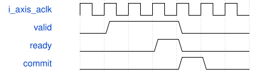

# StudioOscMixer 模块规范

> RTL: `src/StudioOscMixer.v`

## 1. 模块目的

136位任务含Q26载波、调制源、深度、2位AM模式、mix开关、两个Q16音量。

## 2. 参数

| 参数 | 默认值 | 说明 |
| --- | --- | --- |
| — | — | 本模块没有可配置参数。 |

## 3. 时钟与复位

- 时钟：`{"name": "i_axis_aclk", "edge": "posedge", "period_ns": 20}`
- 复位：`{"name": "i_axis_arstn", "active": "low", "style": "asynchronous", "values": "取消事件和任务，键状态及计数清零"}`

## 4. 接口信号规范

| 信号 | 方向 | 位宽 | 时钟域 | 语义角色 | 描述 |
| --- | --- | --- | --- | --- | --- |
| `i_axis_aclk` | input | 1 | 未声明 | clock | i axis aclk |
| `i_axis_arstn` | input | 1 | 未声明 | reset | i axis arstn |
| `i_s_axis_tdata` | input | 136 | 未声明 | data | i s axis tdata |
| `i_s_axis_tuser` | input | 21 | 未声明 | data | i s axis tuser |
| `i_s_axis_tvalid` | input | 1 | 未声明 | data | i s axis tvalid |
| `o_s_axis_tready` | output | 1 | 未声明 | data | o s axis tready |
| `o_m_axis_tdata` | output | 64 | 未声明 | data | o m axis tdata |
| `o_m_axis_tuser` | output | 21 | 未声明 | data | o m axis tuser |
| `o_m_axis_tvalid` | output | 1 | 未声明 | data | o m axis tvalid |
| `i_m_axis_tready` | input | 1 | 未声明 | data | i m axis tready |

## 5. 周期行为与延迟

- 136位任务含Q26载波、调制源、深度、2位AM模式、mix开关、两个Q16音量。
- 七拍算术：锁存、深度乘法、AM因子、载波乘法、两个音量乘法、混合、饱和。信用池持有票据并支持背压。
- 混合模式A+B按总增益归一化；FM/AM/环形模式仅输出A，调制振荡器用于控制。

## 6. WaveDrom 时序图

### 参数与任务提交

有效期间保持完整事务，接受后才发射或确认；算术延迟见行为合同。

- WaveJSON：[StudioOscMixer_handshake.json5](waveforms/StudioOscMixer_handshake.json5)

## 7. 边界、反压与错误

- 复位取消旧任务
- 输出背压
- 32键复音
- CRC失败与残包
- 参数在释音中更新

## 8. CDC 与综合约束

- 50MHz单时钟域；异步低有效复位，板级同步释放。
- 新固件协议与旧96kHz Studio不兼容，必须核对版本3。

## 9. 验证与验收

- 完整ADC/UART/PT8211闭环
- 400个混合整数向量
- 配置ACK及短演奏包
- 无覆盖的活动参数快照
- Gowin综合实现时序

## 10. 可追溯性

- 规格模块：`StudioOscMixer`
- RTL 路径：`src/StudioOscMixer.v`
- 交付要求：本文档、WaveJSON 和 SVG 必须与同一版本规格一同发布。
