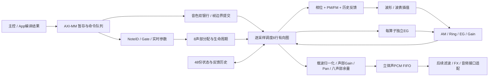

# 驻留六算子 Voice Engine

最新扩展见 **[FX.md](FX.md)**：ABI 0x00010004，共17个RTL定义。Voice/LFO渲染858拍，加入Delay→Reverb后的完整路径931拍。精简 `AxiSynthEndpoint` 逻辑77%、BSRAM97%；全兼容旧raw/context配置超出器件逻辑容量。下面658拍、旧hierarchy和39%资源是历史Voice阶段。调制细节见 [MODULATION.md](MODULATION.md)，当前证据见 [fx-verification.json](reports/fx-verification.json)。

2026-11-02。本轮把基础算子接成了能够持续生成立体声 PCM 的候选内核。入口仍是 `AxiVoiceEndpoint`，ABI 升为 **0x00010002**。旧 raw/context 命令继续可用；新内核已经通过独立整数模型、xsim 和 Gowin 单独综合，尚未替换当前上板顶层。

## 能力与层次

```text
AxiVoiceEndpoint                         1  AXI-MM Slave，CMD/Completion 各深4
└─ AxisSynthSystem                       1  内部路由、完成仲裁、1024拍分频、PCM FIFO深4
   ├─ VoiceSynthEngine                   1  新增持续发声域
   │  ├─ Patch banks                     4个音色槽，每槽双银行，每银行6个算子描述
   │  ├─ Voice allocator                8个动态声部，NoteID、延音、释音、最老声部抢占
   │  ├─ Logical operator state         48份独立相位/EG/噪声/两拍反馈历史
   │  ├─ Sample scheduler + stereo mix  1
   │  └─ AxisFmOperator                 1  复用物理复合算子
   │     ├─ Phase / PM / FM / feedback  内置流水计算
   │     ├─ Wave lookup / morph         内置正弦ROM + 两帧可写波表
   │     ├─ AM / Ring / gain            内置流水计算
   │     └─ AxisEnvelopeMulti           1
   │        └─ AxisEnvelopeSegment      1
   └─ AxisVoiceRuntime                   1  保留32项旧逻辑算子上下文
      └─ AxisVoiceFabric                1
         ├─ AxisPhasePm                 1
         ├─ AxisEnvelopeSegment         1
         ├─ AxisGainMix                 1
         ├─ AxisNoiseStep               1
         └─ AxisEnvelopeMulti           1
            └─ AxisEnvelopeSegment      1
```

本目录共 **11 个 RTL 模块定义**。新持续发声域只有 **1 个物理复合算子**，服务 8×6 个逻辑算子；复合算子内部有多个同时工作的乘法/查表/包络流水段。全闭包的 `AxisEnvelopeMulti` 实例共2个，`AxisEnvelopeSegment` 共3个。旧上下文池和新声部池相互独立，不可混用状态编号。



## 音色程序与数值

程序采用**固定六行、可配置路由的驻留图描述**，不是任意长度字节码解释器。每行绑定相位、EG、噪声和反馈状态；路由可从任意较早行取得当前采样的输出，多个来源先求和。载波行输出相加。任意无环六节点图可在主机侧拓扑排序后描述，零延迟循环会被拒绝；反馈由专用历史字段实现。

- 六种波形：正弦、三角、锯齿、脉冲、xorshift噪声、双帧波表。正弦/波表各1024点，邻点插值使用22位相位小数；波表帧间 morph 为 Q16。初始两帧均为正弦，波表是全引擎共享资源。
- 相位与增量为32位整圈相位字。`increment = frequency × 2^32 / sample_rate`。比例频率用 Q16.16，比率范围0…16；也支持固定频率字。
- 音频、包络、增益使用 signed32 Q26，UNITY=`67108864`。内部乘积保留宽度，右移向负无穷取整。波形/包络/增益参数被限制在约定范围；来源求和饱和到signed32，最终音频饱和到±UNITY。
- PM：相位积分只加频率字，调制只改变查表地址。FM：调制量加入本次积分增量。反馈始终是 PM，读取前两个采样输出的平均值，禁止读自己的当前结果。
- AM 使用源的单极映射，Ring 使用双极源；depth=0为干信号，depth=1为完全调制。两者的源都做范围限制。
- 每算子线性四目标/四步长 EG，具有起音、衰减段、保持、释音。每采样最多跨一个阶段；L4必须为0，步长必须非零。它**不是 DX7 指数/对数 EG 曲线**。
- 载波按启用载波数平均，再乘声部增益、线性声像；所有声部求和后固定除8，最后乘主音量并饱和。此策略保留和弦余量，不会随活动声部数跳变；单键会较轻，后续还需做听感响度校准与输出增益/限制器。
- LIVE 的 gain/pan 每采样向目标收敛约1/64，最小步长1；pitch改频率字但不重置相位。音色银行整体提交是原子的，但其余音色参数没有全量平滑，突变仍可能产生点击。
- 银行提交保留既有算子状态；此前禁用、从未起音的算子不会因配置 enable 变化自动重触发。需要改变起音拓扑时，发送新 NoteID 重新起音；纯参数调整可保留原声部。

## 控制 ABI

沿用十个32位 payload 字、opcode、tag、COMMIT。高层命令的 `0x134={epoch[23:0],address[7:0]}`，`0x138=sequence`。它们与旧上下文 generation/sequence 是两个独立命令域。写响应只确认入队，执行状态读取 Completion `[71:64]`。

| opcode | 命令 | address | payload，低字在前 |
| --- | --- | --- | --- |
| A0 | PATCH_BEGIN | 音色槽0…3 | revision；其余0，必须比已提交版本新 |
| A1 | OP_CORE | slot×8+operator | tuning、gain、depth、feedback、flags、shape；其余0 |
| A2 | OP_EG | slot×8+operator | L1…L4、R1…R4；其余0 |
| A3 | PATCH_COMMIT | 音色槽 | 全0；必须已装满6份CORE和6份EG，且至少有一个启用载波 |
| A4 | NOTE_ON | 音色槽 | NoteID、base increment、gain、pan；其余0 |
| A5 | NOTE_OFF | 0 | NoteID；其余0 |
| A6 | LIVE | 原声部音色槽 | NoteID、base increment、gain、pan；其余0 |
| A7 | TRANSPORT | 0 | flags(enable bit0 / sustain bit1 / panic pulse bit2)、master gain；其余0 |
| A8 | WAVE_WRITE | 0 | `{frame bit10,index[9:0]}`、signed Q26 sample；其余0 |
| A9 | QUERY | 0…3 | 全0；结果见下 |

OP_CORE flags：source mask `[5:0]`、carrier `[6]`、wave `[9:7]`、mode `[11:10]`、enable `[12]`、fixed-frequency `[13]`、hard EG restart `[14]`。高位保留0。wave=0…5对应上列波形；mode=0 PM、1 FM、2 AM、3 Ring。PM/FM的depth及feedback是signed整圈相位字；AM/Ring depth为0…UNITY。shape在wave5时为0…65536的morph，其余波形仅pulse使用32位相位阈值。

QUERY的W2始终留给公共状态/重放标志。address0返回W0活动声部位图、W1完成帧数、W3抢占次数；address1返回W0成功新命令数、W1拒绝数、W3重放数；address2返回W0 enable/sustain、W1 overrun、W3最近渲染周期；address3返回W0已提交/草稿位图、W1音色槽0的版本。

状态码：0成功、1未知操作、3实例不存在、4 epoch错误、5身份/参数冲突、6旧序号、7跳号、8非法参数、9音色未准备好、10忙碌/不允许写波表。`bit72`标识原事务缓存重放，`bit73`标识新的sequence遇到已存在且参数相同的NoteID。NOTE_ON的低3位返回分配的声部槽。

新增只读寄存器：

| 地址 | 意义 |
| --- | --- |
| 034 | `0x0008063f`：8声部、每声部6算子、六种波形 |
| 038 | 活动声部位图 |
| 03C | 采样期限错过计数 |
| 040 | 最近一帧渲染周期 |
| 044 | PCM FIFO满导致的丢帧计数 |
| 300 / 304 / 308 / 30C | PCM队首左/右/帧号/有效，AR时原子快照；读取不弹出PCM |

PCM通过独立 `o_pcm_valid / i_pcm_ready / o_pcm_data / o_pcm_frame` 端口消费；需在板级接音频适配器。所有端口与引擎同钟域。跨音频时钟域时必须增加CDC FIFO。不要把PCM低位直接当作24bit I²S数据：应按Q26缩放、舍入/饱和后转换。

## 持续按键与重复包

1. 物理键扫描先做去抖和状态变化检测，按住期间不反复发送NOTE_ON。已有键盘桥接回归证明保持按键不会重复发事件。
2. 每次真正的新按下分配新的32位NoteID，释放引用同一个ID。相同ID与相同起音参数的重复NOTE_ON返回现有实例，不重置相位/EG；相同ID但参数不同返回冲突，实时调整走LIVE。
3. 同一epoch中从sequence=0开始连续递增。最近一次完全相同的请求（opcode、address、全部payload、sequence）返回缓存结果；tag可以变化。相同sequence内容不同拒绝，过旧和跳号拒绝。身份错误不消费sequence；合法下一sequence的业务错误会消费并缓存，下一条应继续递增。
4. 每个控制域只缓存最近一次完成，不是无限历史去重。主控应逐条确认控制完成后再前进；超过缓存窗口的重发只能拒绝。缓存不跨复位保存。epoch改变、sequence回绕之前需要重新建立复位后的会话，不能直接从旧会话切换epoch。
5. 起音后音色程序一直驻留，内部采样时钟自行推进48份逻辑状态，**不需要每个采样再发一次起音包或整份音色程序**。

延音期间NoteOff只清除held；踏板抬起再进入释音。声部结束由载波EG决定，调制算子先归零不会提前回收。满8声部时抢占最早分配者；旧NoteID的迟到NoteOff不会误杀替代声部。当前抢占是直接替换，尚未加交叉淡化，不能称为无点击抢音。

## 调度时序与背压

每1024个50 MHz时钟产生一个sample tick，即 **48,828.125 Hz**。命令只在帧之间执行，sample tick优先。包络与波形并行计算；复合算子无阻塞时最早完成握手延迟10拍（E0接纳，E9沿后结果有效，E10可消费），单在途实现，不是II=1。

测得8声部×6启用算子的整帧渲染 **658个时钟**，包含取行、依赖求和、48次复合运算和立体声混音。按50 MHz换算为13.16 µs，采样周期20.48 µs，余量366拍/7.32 µs。该换算建立在未来布局布线满足50 MHz的前提上，**不是实际按键到DAC的延迟测量**。

控制Completion长期堵塞不会暂停采样。PCM FIFO深4，输出停顿保持队首数据/帧号；队列满且无同时消费时丢弃新帧并计数，渲染继续。Panic清除声部后后续帧归零，已经VALID的旧PCM不能撤回，需先排空。禁用时输出静音帧、保留冻结的声部状态；如需结束声音并允许波表写入，使用disable+panic。

## 验证与资源边界

验证记录入口：[engine-verification.json](reports/engine-verification.json)。

- 完整算子2656次逐位比较，含2048点两帧波表重写、插值/morph、PM/FM/AM/Ring、负数/回绕、输出停顿和复位取消。
- 400帧立体声逐位对照，两个不同音色同时使用8声部/48算子；覆盖LIVE、持续音、延音、释放、去重、抢占、迟到释放、panic、控制输出阻塞。
- AXI端到端33个控制命令，验证持续PCM、音色银行切换、原任务并行运行、PCM溢出和原子快照。
- 原算子7861次、MultiEG7392次、Fabric1800结果、Context3563结果、AXI接口369结果回归通过。
- 五个编译后的基础音色另有10240帧参考对照（以最终日志PASS为证）。

Gowin 1.9.11.03 Education 对 `VoiceSynthEngine` 单独综合，目标GW5AT-60B：Logic 23230/59904（39%）、Register 16473/60780（28%）、BSRAM 20/118（17%）、MULT27X36 29个、Latch 0。最终以 [综合报告](reports/gowin-engine/impl/gwsynthesis/voice_engine_syn.rpt.html) 和校验清单为准。这里的DSP是工具报告的原语数量，不换算成未经核验的器件DSP百分比。

这是内核综合探针，768个边界信号被作为顶层I/O统计，**不能直接作为PG484板级顶层布线**。这些宽接口应留在芯片内部，经AXI控制器和PCM适配器连接。未做本轮PnR、未生成/烧写新板级固件，不能沿用旧固件的资源或时序成绩。

严格门禁 [engine_gate.md](reports/engine_gate.md) 尚未通过：静态解析通过；格式AST、readability、comment、naming、profile仍失败，包括既有规则债务、新模块注释/布局/单目标过程等约束。门禁还会把函数input误计成模块端口；四个新/修改模块的真实ANSI模块端口已另行逐项核对。规范由注册的write-spec发布并附WaveDrom，不能将上述限制描述成全部质量门禁通过。

## 音色编译和下一步集成

[离线编译器](model/compile_voice_patch.py) 将六行JSON编译成14条控制命令和明确的AXI写地址/值；不连接或烧录硬件。

```powershell
python model/compile_voice_patch.py examples/FM_Keys.json --slot 0 --epoch 1 --sequence 0 --output examples/FM_Keys.commands.json
python model/voice_engine_model.py
python model/preset_vectors.py
```

本地仿真使用既有 Vivado 2025.1 的 `xvlog/xelab/xsim`，在本目录执行。先运行参考模型生成向量，再 `xvlog -f sources.f sim/tb_fm_operator.v sim/tb_voice_engine.v sim/tb_axi_synth_engine.v sim/tb_voice_presets.v`；对每个测试模块依次 `xelab work.<模块名> -s <快照名>`、`xsim <快照名> -runall`。通过以日志中的PASS为准，不能仅依赖xsim进程退出码。旧四套测试的生成/运行命令仍见README。

[examples](examples) 包含 `FM_Keys`、`Round_Bass`、`Soft_Pad`、`Noise_Drum`、`Chord_Pad`。Chord仍由多个实际音符组成和弦；Drum是噪声/固定低频的基础打击音，没有冒充完整鼓采样库。编译器的 `segment_ms` 定义为满量程线性斜坡时间，不是任意起点下保证相同持续时间，更不是DX7速率编号。

尚需的工程工作：

1. 收敛严格交付门禁；把参数/状态多路选择和寄存器映射继续优化成可控RAM访问，取得板级布局布线时序与总资源。
2. 加入板级AXI主控/当前串口协议适配，键床/MIDI到新NoteID事件的桥接，PCM到现有滤波、FX、I²S/DAC路径，并把Rust App接入新ABI。
3. 为抢音和音色突变增加淡化/平滑；校准跨音色响度、峰值与单键输出电平。
4. DX7准确EG/速率与键盘缩放、Pitch EG、32算法/SysEx映射；更多反馈拓扑与调制矩阵；抗混叠波形、过采样、更多波表资源及缓存。

这版完成了**驻留程序→动态声部→六算子合成→持续PCM的基础功能闭环**，还不是完整DX7/Surge兼容实现或已经上板的最终产品。
