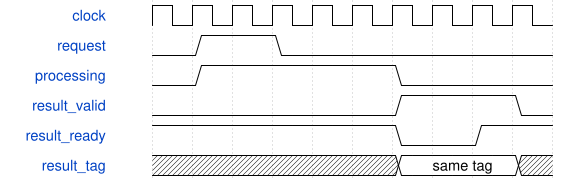

# AxiVoiceEndpoint 模块规范

> RTL: `rtl/AxiVoiceEndpoint.v`

## 1. 模块目的

AXI4内存映射Voice Engine外设，命令与完成FIFO各四项。

## 2. 参数

| 参数 | 默认值 | 说明 |
| --- | --- | --- |
| — | — | 本模块没有可配置参数。 |

## 3. 时钟与复位

- 时钟：`{"name": "i_axi_aclk", "edge": "posedge", "frequency_hz": 50000000}`
- 复位：`{"name": "i_axi_arstn", "active": "low", "style": "asynchronous"}`

## 4. 接口信号规范

| 信号 | 方向 | 位宽 | 时钟域 | 语义角色 | 描述 |
| --- | --- | --- | --- | --- | --- |
| `i_axi_aclk` | input | 1 | 未声明 | clock | AXI与内部计算共用时钟 |
| `i_axi_arstn` | input | 1 | 未声明 | reset | 清除总线事务与队列 |
| `i_s_axi_awid` | input | 4 | 未声明 | data | 请求awid |
| `i_s_axi_awaddr` | input | 16 | 未声明 | data | 请求awaddr |
| `i_s_axi_awlen` | input | 8 | 未声明 | data | 请求awlen |
| `i_s_axi_awsize` | input | 3 | 未声明 | data | 请求awsize |
| `i_s_axi_awburst` | input | 2 | 未声明 | data | 请求awburst |
| `i_s_axi_awlock` | input | 1 | 未声明 | data | 请求awlock |
| `i_s_axi_awvalid` | input | 1 | 未声明 | control | 请求awvalid |
| `o_s_axi_awready` | output | 1 | 未声明 | control | 接纳aw通道 |
| `i_s_axi_arid` | input | 4 | 未声明 | data | 请求arid |
| `i_s_axi_araddr` | input | 16 | 未声明 | data | 请求araddr |
| `i_s_axi_arlen` | input | 8 | 未声明 | data | 请求arlen |
| `i_s_axi_arsize` | input | 3 | 未声明 | data | 请求arsize |
| `i_s_axi_arburst` | input | 2 | 未声明 | data | 请求arburst |
| `i_s_axi_arlock` | input | 1 | 未声明 | data | 请求arlock |
| `i_s_axi_arvalid` | input | 1 | 未声明 | control | 请求arvalid |
| `o_s_axi_arready` | output | 1 | 未声明 | control | 接纳ar通道 |
| `i_s_axi_wdata` | input | 32 | 未声明 | data | AXI wdata事务字段 |
| `i_s_axi_wstrb` | input | 4 | 未声明 | data | AXI wstrb事务字段 |
| `i_s_axi_wlast` | input | 1 | 未声明 | control | AXI wlast事务字段 |
| `i_s_axi_wvalid` | input | 1 | 未声明 | control | AXI wvalid事务字段 |
| `o_s_axi_wready` | output | 1 | 未声明 | control | AXI wready事务字段 |
| `o_s_axi_bid` | output | 4 | 未声明 | data | AXI bid事务字段 |
| `o_s_axi_bresp` | output | 2 | 未声明 | data | AXI bresp事务字段 |
| `o_s_axi_bvalid` | output | 1 | 未声明 | control | AXI bvalid事务字段 |
| `i_s_axi_bready` | input | 1 | 未声明 | control | AXI bready事务字段 |
| `o_s_axi_rid` | output | 4 | 未声明 | data | AXI rid事务字段 |
| `o_s_axi_rdata` | output | 32 | 未声明 | data | AXI rdata事务字段 |
| `o_s_axi_rresp` | output | 2 | 未声明 | data | AXI rresp事务字段 |
| `o_s_axi_rlast` | output | 1 | 未声明 | control | AXI rlast事务字段 |
| `o_s_axi_rvalid` | output | 1 | 未声明 | control | AXI rvalid事务字段 |
| `i_s_axi_rready` | input | 1 | 未声明 | control | AXI rready事务字段 |
| `o_pcm_valid` | output | 1 | 未声明 | control | PCM 队列输出有效 |
| `i_pcm_ready` | input | 1 | 未声明 | control | PCM 消费者接纳 |
| `o_pcm_data` | output | 64 | 未声明 | data | 左右 signed Q26 采样 |
| `o_pcm_frame` | output | 32 | 未声明 | data | 采样帧编号 |

## 5. 周期行为与延迟

- 16-bit byte offset,32-bit data,4-bit IDs; one read burst and one write burst can run concurrently.
- Aligned SIZE=2 INCR bursts up to256 beats, FIXED up to16. WRAP/narrow/exclusive/4KiB crossings rejected with SLVERR and no write effects.
- AW accepted before WREADY; B only after the actual WLAST handshake. AWLEN/WLAST mismatch returns SLVERR; earlier valid staging writes are not rolled back. R/B remain stable until ready.
- 0x100..0x124 payload,0x128 opcode,0x12C tag,0x130 COMMIT; COMMIT must be single beat.
- 0x200..0x214 completion image snapshot at AR;0x218 POP must be single beat.
- Full COMMIT or empty POP returns SLVERR without side effects. Reads of empty result return SLVERR.
- AXI write acknowledgment means enqueue, not DSP completion. Software writes payload burst then separate COMMIT.
- ABI minor version00010001. Add context/generation staging at0x134 and sequence at0x138; both honor WSTRB and are atomically copied on COMMIT.
- Feature flags0x01C=7, runtime executed/replayed/rejected/bound counters0x020..0x02C, capacity0x030=32.
- CMD FIFO width424 includes payload320,context32,sequence32,tag32,opcode8; completion records unchanged.
- AxisVoiceRuntime shares the original Fabric; cached commands80..84,90,91 hex, legacy raw operations unchanged.
- C_DELAY_ADDR_BITS defaults15 in the library; board top uses14. Depth=2**bits, Q16.16 maximum delay=(depth<<16)-1; capability registers report actual depth. Supported board configurations14/15.
- DX ABI0x00010005 exposes the extended A1/A2 and A4/A6 encodings; old commands remain valid.
- Registered424-bit command head separates FIFO read selection from runtime decode. VALID holds until READY; only this handshake pops the queue, preserving four-entry capacity. Reset discards any held command.
- Engine extension: ABI 0x00010005; A0..A9 voice, B0..B3 modulation, C0..C4 shared FX; 0x048 modulation and 0x04c..0x060 FX capabilities/telemetry. LEGACY_ENABLE=0 removes old raw/context hardware and clears 0x00c/0x01c/0x030 capabilities. Independent PCM FIFO and 0x300..0x30c AR snapshot. See FX.md, MODULATION.md and ENGINE.md.
- C_DELAY_ADDR_BITS defaults15 in the library; board top uses13. Depth=2**bits, Q16.16 maximum delay=(depth<<16)-1; capability registers report actual depth. Supported board configurations13/14/15.

## 6. WaveDrom 时序图

### 任务提交与结果保持

输入握手移交所有权；结果等待消费时数据和事务身份保持。精确延迟以行为合同为准。

- WaveJSON：[AxiVoiceEndpoint_flow.json5](waveforms/AxiVoiceEndpoint_flow.json5)

## 7. 边界、反压与错误

- backpressure and bubbles
- full and empty queues
- reset with in-flight tasks
- invalid stage or operation or bus request

## 8. CDC 与综合约束

- Candidate subsystem; existing board top unchanged; no Gowin timing/area claim.
- Common core clock only, no CDC. Caller provides synchronous reset release.
- AXI endpoint is a slave; it does not fetch RAM itself or implement a program scheduler.

## 9. 验证与验收

- independent integer reference
- mixed tagged transactions and all sideband stability
- event/phase transition sequence
- AXI IDs, independent channels, WSTRB, bursts and FIFO side effects

## 10. 可追溯性

- 规格模块：`AxiVoiceEndpoint`
- RTL 路径：`rtl/AxiVoiceEndpoint.v`
- 交付要求：本文档、WaveJSON 和 SVG 必须与同一版本规格一同发布。
