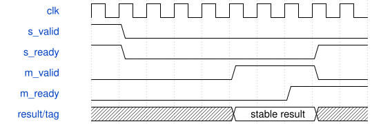

# AxisDxEnvelope 模块规范

> RTL: `rtl/AxisDxEnvelope.v`

## 1. 模块目的

DX 对数包络、键位/力度/速率缩放；独立任务与状态

## 2. 参数

| 参数 | 默认值 | 说明 |
| --- | --- | --- |
| — | — | 本模块没有可配置参数。 |

## 3. 时钟与复位

- 时钟：`{"name": "i_axis_aclk", "edge": "posedge", "frequency_hz": 50000000}`
- 复位：`{"name": "i_axis_arstn", "active": "low", "style": "asynchronous"}`

## 4. 接口信号规范

| 信号 | 方向 | 位宽 | 时钟域 | 语义角色 | 描述 |
| --- | --- | --- | --- | --- | --- |
| `i_axis_aclk` | input | 1 | 未声明 | clock | 共用计算时钟 |
| `i_axis_arstn` | input | 1 | 未声明 | reset | 异步清除资格，外部同步释放 |
| `i_s_axis_tdata` | input | 384 | 未声明 | data | 本次任务的状态与参数 |
| `i_s_axis_tuser` | input | 32 | 未声明 | data | 透明事务编号 |
| `i_s_axis_tvalid` | input | 1 | 未声明 | control | 源端有效资格 |
| `o_s_axis_tready` | output | 1 | 未声明 | control | 入口可接纳 |
| `o_m_axis_tdata` | output | 96 | 未声明 | data | 完成结果 |
| `o_m_axis_tuser` | output | 32 | 未声明 | data | 原请求编号 |
| `o_m_axis_tvalid` | output | 1 | 未声明 | control | 完成资格 |
| `i_m_axis_tready` | input | 1 | 未声明 | control | 下游接受完成 |

## 5. 周期行为与延迟

- Input words0..9: log-Q24 level, stage/event/restart, four scaled levels0..4032 (L4=0), four rates0..63.
- Word10: note[6:0], velocity[13:7], scaled output level[20:14]. Word11: breakpoint[6:0], LD[13:7], RD[20:14], LC[22:21], RC[24:23], KRS[27:25], KVS[30:28].
- Independent Python formulas in model/dx7_model.py; MSFA-derived key/velocity/rate tables. Increments rescaled from44100 to48828.125Hz.
- Output words: log-Q24 state, stage/status, normalized Q26 linear amplitude. Stages0=off,1..3=segments,4=hold,5=release. Events0=step,1=on,2=off,3=kill.
- E0 request; E1 stage/scaling decode; E2 key delta and rate; E3 target; E4 advance/exp2 read; E5 result valid. Single outstanding; result/tag stable under stall.
- Rate0 advances slowly; output becomes zero at the release floor. Each request advances at most one segment. Reset cancels pending result.
- Not bit-exact DX7: per-sample EG with256-entry exp2 LUT, normalized by8; no nonzero release-level profile.

## 6. WaveDrom 时序图

### DX 单次包络计算

E0接收，E5结果有效；随后示例停顿两拍。

- WaveJSON：[AxisDxEnvelope_stream.json5](waveforms/AxisDxEnvelope_stream.json5)

## 7. 边界、反压与错误

- backpressure and bubbles
- full and empty queues
- reset with in-flight tasks
- invalid stage or operation or bus request

## 8. CDC 与综合约束

- Single50MHz clock; upstream validates parameter ranges. Level input0..(17<<24), note/velocity0..127, output0..127.
- ROM contents generated by dx7_model.py must be present under rom/.
- No extra operator latency permitted; hardware routing50MHz remains unverified.

## 9. 验证与验收

- Independent numerical vectors including all events, all curves, velocity/rate extremes, low levels and release.
- Backpressure data/tag stability and reset cancellation.
- Four factory presets and native operator regression.

## 10. 可追溯性

- 规格模块：`AxisDxEnvelope`
- RTL 路径：`rtl/AxisDxEnvelope.v`
- 交付要求：本文档、WaveJSON 和 SVG 必须与同一版本规格一同发布。
