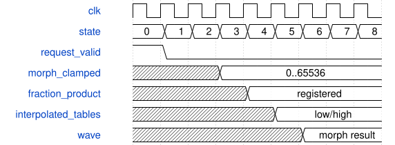

# AxisFmOperator 模块规范

> RTL: `rtl/AxisFmOperator.v`

## 1. 模块目的

单个可复用 PM/FM/AM/Ring 算子，EG 与波形计算并行。

## 2. 参数

| 参数 | 默认值 | 说明 |
| --- | --- | --- |
| — | — | 本模块没有可配置参数。 |

## 3. 时钟与复位

- 时钟：`{"name": "i_axis_aclk", "edge": "posedge", "frequency_hz": 50000000}`
- 复位：`{"name": "i_axis_arstn", "active": "low", "style": "asynchronous", "values": "all pipeline valid and output data/tag registers clear; external synchronous release"}`

## 4. 接口信号规范

| 信号 | 方向 | 位宽 | 时钟域 | 语义角色 | 描述 |
| --- | --- | --- | --- | --- | --- |
| `i_axis_aclk` | input | 1 | 未声明 | clock | 任务与结果共用时钟 |
| `i_axis_arstn` | input | 1 | 未声明 | reset | 异步清除有效资格；外部同步释放 |
| `i_s_axis_tdata` | input | 672 | 未声明 | data | 本次操作的状态与参数原子快照 |
| `i_s_axis_tuser` | input | 32 | 未声明 | data | 调用者的透明事务编号 |
| `i_s_axis_tvalid` | input | 1 | 未声明 | control | 源端持有完整请求 |
| `o_s_axis_tready` | output | 1 | 未声明 | control | 本拍可以接收快照 |
| `o_m_axis_tdata` | output | 160 | 未声明 | data | 该事务的数值和状态结果 |
| `o_m_axis_tuser` | output | 32 | 未声明 | data | 与结果同步返回的原编号 |
| `o_m_axis_tvalid` | output | 1 | 未声明 | control | 输出寄存器包含可消费事务 |
| `i_m_axis_tready` | input | 1 | 未声明 | control | 调用者可以提交输出结果 |
| `i_wave_write` | input | 1 | 未声明 | control | 仅空闲时写波表 |
| `i_wave_address` | input | 11 | 未声明 | data | 帧与采样地址 |
| `i_wave_data` | input | 32 | 未声明 | data | 有符号 Q26 采样 |
| `o_wave_ready` | output | 1 | 未声明 | control | 波表可安全写入 |
| `i_wave_read` | input | 1 | i_axis_aclk | data | i_wave_read |
| `o_wave_data` | output | 32 | i_axis_aclk | data | o_wave_data |

## 5. 周期行为与延迟

- 21-word request contains phase, increment, modulation, depth, gain, EG state/control/eight parameters, two feedback samples, feedback depth, noise state, waveform/mode flags, shape.
- Output words: sample, next phase, EG level, EG flags, next noise state.
- Independent four-stage linear EG advances once per request. Feedback reads two previous samples, not current output.
- Six waveform types; 1024-point interpolated sine and two writable frames; initial tables are sine.
- Single in-flight request. Output and tag stable during backpressure. Table writes only when idle and no request accepted.
- DX envelope executes in parallel with wave math. State result is logarithmic, amplitude is separate. PM source normalized by8 restores phase with source<<9; feedback strength0..7 uses history_average<<(strength+1). DX sine reads old phase before increment.
- DX extension: request flags word19 bit5 selects DX mode; bits12:6 note,19:13 velocity,26:20 scaled output level. Word20 carries packed key/velocity scaling.
- Two signed33-by-signed32 lanes share phase/feedback and gain phases. Dedicated signed33-by-positive23 interpolation and signed33-by-positive18 morph products break mux paths. Preserve native64, interpolation56, morph51 and factor65 slices; latency remains10 clocks.
- Interpolation pipeline: state2 table read; state3 signed56 delta*fraction registers; state4 add held base to product>>>22; state5 morph and AM/ring factor; state6 wave*factor and parallel EG completion; state7 scaled wave plus EG*gain; state8 final sample product; state9 result; state10 valid. State6 may wait for EG without consuming or advancing a second request. Nominal latency remains10 clocks; waveform and coefficient snapshots stay stable.
- DX EG新增ROM前寄存边界，由现有state6等待完成；native10拍不变，DX11拍，不改变本模块RTL。
- 波表morph系数在state2读表期间提前限幅并寄存，state5插值只使用该17位系数。切断参数比较/mux到乘加路径；十拍延迟、插值精度、饱和范围和ready/valid语义保持不变。
- Wave read reuses common-address write-through DPB port A; two idle clocks settle read data. DSP lookup uses separate sine/wave outputs with unchanged computation states.

## 6. WaveDrom 时序图

### 波表插值系数提前准备

state2读表并限幅morph，state3分数乘积、state4基值相加、state5双表morph；最终握手保持原来的十拍结果延迟。

- WaveJSON：[AxisFmOperator_morph-coefficient.json5](waveforms/AxisFmOperator_morph-coefficient.json5)

## 7. 边界、反压与错误

- signed minima/maxima and zero
- changing tags and parameters every accepted beat
- long backpressure and bubbles
- reset while pipeline holds transactions

## 8. CDC 与综合约束

- Single 50 MHz clock domain; reset cancels in-flight work.
- See ENGINE.md for exact fixed-point and command ABI.
- Candidate: board timing and strict style gate are separate from functional simulation.

## 9. 验证与验收

- Independent Python integer model versus xsim
- Backpressure stability and reset cancellation
- Illegal parameters and voice lifecycle
- 1024-clock frame deadline under eight voices and six operators
- Full signed32 uploaded tables, fraction boundaries, neighbour1023 wrap, morph endpoints/clamp, exact ten-cycle latency, output stalls, reset at every compute stage.

## 10. 可追溯性

- 规格模块：`AxisFmOperator`
- RTL 路径：`rtl/AxisFmOperator.v`
- 交付要求：本文档、WaveJSON 和 SVG 必须与同一版本规格一同发布。
