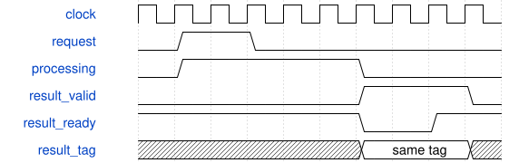

# AxisVoiceFabric 模块规范

> RTL: `rtl/AxisVoiceFabric.v`

## 1. 模块目的

Voice Engine内部任务路由与公平结果归并；外部主干是AXI内存映射。

## 2. 参数

| 参数 | 默认值 | 说明 |
| --- | --- | --- |
| — | — | 本模块没有可配置参数。 |

## 3. 时钟与复位

- 时钟：`{"name": "i_axis_aclk", "edge": "posedge", "frequency_hz": 50000000}`
- 复位：`{"name": "i_axis_arstn", "active": "low", "style": "asynchronous"}`

## 4. 接口信号规范

| 信号 | 方向 | 位宽 | 时钟域 | 语义角色 | 描述 |
| --- | --- | --- | --- | --- | --- |
| `i_axis_aclk` | input | 1 | 未声明 | clock | 共用计算时钟 |
| `i_axis_arstn` | input | 1 | 未声明 | reset | 异步清除资格，外部同步释放 |
| `i_s_axis_tdata` | input | 320 | 未声明 | data | 本次任务的状态与参数 |
| `i_s_axis_tuser` | input | 32 | 未声明 | data | 透明事务编号 |
| `i_s_axis_tdest` | input | 8 | 未声明 | data | 操作码路由 |
| `i_s_axis_tlast` | input | 1 | 未声明 | control | 完整任务必须为单拍包 |
| `i_s_axis_tvalid` | input | 1 | 未声明 | control | 源端有效资格 |
| `o_s_axis_tready` | output | 1 | 未声明 | control | 入口可接纳 |
| `o_m_axis_tdata` | output | 128 | 未声明 | data | 完成结果 |
| `o_m_axis_tuser` | output | 32 | 未声明 | data | 原请求编号 |
| `o_m_axis_tdest` | output | 8 | 未声明 | data | 返回原操作码 |
| `o_m_axis_tlast` | output | 1 | 未声明 | control | 每个完成为单拍包 |
| `o_m_axis_tvalid` | output | 1 | 未声明 | control | 完成资格 |
| `i_m_axis_tready` | input | 1 | 未声明 | control | 下游接受完成 |

## 5. 周期行为与延迟

- One ingress slot, five independent compute endpoints and one error completion lane.
- TDEST=0 PM,1 segment,2 MAC,3 noise,4 multi-envelope.
- Return low64 result, bits71:64 status; tag and destination preserved.
- Unknown opcode returns status1. TLAST=0 returns one status2 error and drains until packet end.
- Round-robin result arbitration, registered output holds all fields under backpressure.
- Completion order may differ from issue order; caller must track tag.

## 6. WaveDrom 时序图

### 任务提交与结果保持

输入握手移交所有权；结果等待消费时数据和事务身份保持。精确延迟以行为合同为准。

- WaveJSON：[AxisVoiceFabric_flow.json5](waveforms/AxisVoiceFabric_flow.json5)

## 7. 边界、反压与错误

- backpressure and bubbles
- full and empty queues
- reset with in-flight tasks
- invalid stage or operation or bus request

## 8. CDC 与综合约束

- Candidate subsystem; existing board top unchanged; no Gowin timing/area claim.
- Common core clock only, no CDC. Caller provides synchronous reset release.
- AXI endpoint is a slave; it does not fetch RAM itself or implement a program scheduler.

## 9. 验证与验收

- independent integer reference
- mixed tagged transactions and all sideband stability
- event/phase transition sequence
- AXI IDs, independent channels, WSTRB, bursts and FIFO side effects

## 10. 可追溯性

- 规格模块：`AxisVoiceFabric`
- RTL 路径：`rtl/AxisVoiceFabric.v`
- 交付要求：本文档、WaveJSON 和 SVG 必须与同一版本规格一同发布。
