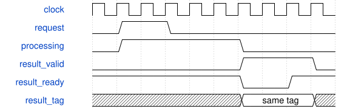

# AxisVoiceRuntime 模块规范

> RTL: `rtl/AxisVoiceRuntime.v`

## 1. 模块目的

Resident operator contexts, ordered execution, exact retry replay and transparent raw-task bypass.

## 2. 参数

| 参数 | 默认值 | 说明 |
| --- | --- | --- |
| — | — | 本模块没有可配置参数。 |

## 3. 时钟与复位

- 时钟：`{"name": "i_axis_aclk", "edge": "posedge", "frequency_hz": 50000000}`
- 复位：`{"name": "i_axis_arstn", "active": "low", "style": "asynchronous"}`

## 4. 接口信号规范

| 信号 | 方向 | 位宽 | 时钟域 | 语义角色 | 描述 |
| --- | --- | --- | --- | --- | --- |
| `i_axis_aclk` | input | 1 | 未声明 | clock | 共用计算时钟 |
| `i_axis_arstn` | input | 1 | 未声明 | reset | 异步清除资格，外部同步释放 |
| `i_s_axis_tdata` | input | 384 | 未声明 | data | Low320 payload, next32 generation/context, high32 execution sequence. |
| `i_s_axis_tuser` | input | 32 | 未声明 | data | 透明事务编号 |
| `i_s_axis_tdest` | input | 8 | 未声明 | data | 操作码路由 |
| `i_s_axis_tlast` | input | 1 | 未声明 | control | 完整任务必须为单拍包 |
| `i_s_axis_tvalid` | input | 1 | 未声明 | control | 源端有效资格 |
| `o_s_axis_tready` | output | 1 | 未声明 | control | 入口可接纳 |
| `o_m_axis_tdata` | output | 128 | 未声明 | data | 完成结果 |
| `o_m_axis_tuser` | output | 32 | 未声明 | data | 原请求编号 |
| `o_m_axis_tdest` | output | 8 | 未声明 | data | 返回原操作码 |
| `o_m_axis_tlast` | output | 1 | 未声明 | control | 每个完成为单拍包 |
| `o_m_axis_tvalid` | output | 1 | 未声明 | control | 完成资格 |
| `i_m_axis_tready` | input | 1 | 未声明 | control | 下游接受完成 |
| `o_count_executed` | output | 32 | 未声明 | data | Accepted valid arithmetic executions, raw or cached |
| `o_count_replayed` | output | 32 | 未声明 | data | Exact cached RUN and BIND retries |
| `o_count_rejected` | output | 32 | 未声明 | data | Error completions |
| `o_count_bound` | output | 32 | 未声明 | data | New or newer-generation parameter bindings |

## 5. 周期行为与延迟

- Raw opcodes0..4 bypass to the existing fabric; non-context errors and malformed packets preserve raw fabric semantics.
- Context opcodes80..84 hex bind core0..4;90 hex RUN;91 hex INSPECT. A context command waits for all raw completions and packet drain.
- Metadata: context_id bits327:320 must be0..31; generation bits351:328 monotonic24; sequence bits383:352 contiguous32 starting0 after bind.
- BIND caches exact320-bit initial image and initial state. Same generation/image/type replays acknowledgment without resetting state; changed same generation conflicts; older generation is rejected.
- RUN runtime_a bits31:0, runtime_b bits63:32, EG event bits65:64; upper payload bits319:66 must be zero. First sequence0, then last+1; exact last sequence and signature replay cached result.
- Older sequences return status6, gaps7, same sequence/different signature5, missing/bad ID3, stale generation4, reserved payload8. Error has no state effects.
- PM/segment/noise update current low32; MultiEG also updates stage bits34:32; MAC is stateless and uses live a/b with resident gains.
- Response low64 core result, bits71:64 status, bit72 replay. INSPECT returns state bits34:0, history valid73, core78:76,last sequence111:80.
- Output remains stable under backpressure. State commits once when the checked core completion is accepted, before response consumption.
- Only last execution retained per context. Context generation and history are volatile; reset invalidates all contexts and cancels outstanding tasks.

## 6. WaveDrom 时序图

### 任务提交与结果保持

输入握手移交所有权；结果等待消费时数据和事务身份保持。精确延迟以行为合同为准。

- WaveJSON：[AxisVoiceRuntime_flow.json5](waveforms/AxisVoiceRuntime_flow.json5)

## 7. 边界、反压与错误

- Duplicate submitted while original is pending
- Delayed old NoteOff after context reuse
- Duplicate BIND after state progresses
- Raw out-of-order completions before context barrier
- Reset while output stalled
- Full-width sequence and generation boundaries

## 8. CDC 与综合约束

- Candidate only; no board integration. Single clock, external synchronized reset release.
- This is an operator context table, not a voice allocator, autonomous sample scheduler or complete FM operator.
- Generation/sequence must not wrap within a context session. Caller must establish a fresh transport session after reset.
- Same AXI ID or note number is not a deduplication key. New sequence means a new legitimate calculation.

## 9. 验证与验收

- Independent Python stateful model
- 32 contexts/all5operators
- Exact duplicate versus same-sequence conflict
- RAW throughput/regression
- AXI additive register staging and cached result replay
- Counter and state conservation under random stalls

## 10. 可追溯性

- 规格模块：`AxisVoiceRuntime`
- RTL 路径：`rtl/AxisVoiceRuntime.v`
- 交付要求：本文档、WaveJSON 和 SVG 必须与同一版本规格一同发布。
