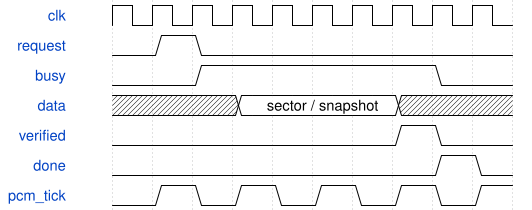

# SynthWaveRam 模块规范

> RTL: `rtl/SynthWaveRam.v`

## 1. 模块目的

双端口波表 RAM；明确使用 Gowin 写穿模式。

## 2. 参数

| 参数 | 默认值 | 说明 |
| --- | --- | --- |
| — | — | 本模块没有可配置参数。 |

## 3. 时钟与复位

- 时钟：`{"name": "i_clk", "edge": "posedge", "frequency_hz": 50000000}`
- 复位：`{"name": "none", "polarity": "none", "synchronous": true, "description": "No RAM reset; configuration initialization only."}`

## 4. 接口信号规范

| 信号 | 方向 | 位宽 | 时钟域 | 语义角色 | 描述 |
| --- | --- | --- | --- | --- | --- |
| `i_clk` | input | 1 | i_clk | clock | i_clk |
| `i_write` | input | 1 | i_clk | data | i_write |
| `i_address_a` | input | 10 | i_clk | data | i_address_a |
| `i_data` | input | 32 | i_clk | data | i_data |
| `i_address_b` | input | 10 | i_clk | data | i_address_b |
| `o_data_a` | output | 32 | i_clk | data | o_data_a |
| `o_data_b` | output | 32 | i_clk | data | o_data_b |

## 5. 周期行为与延迟

- Two physical DPB blocks provide 1024 x 32 storage, one-clock read latency, port A write-through.
- INIT_RAM values generated from canonical Q26 sine; port B read during same-address A write is not consumed.

## 6. WaveDrom 时序图

### 后台读取、校验与提交

存储请求独立于 PCM；校验完成之前不给调用方成功状态。每格表示事务阶段，不是固定总周期数。

- WaveJSON：[SynthWaveRam_transaction.json5](waveforms/SynthWaveRam_transaction.json5)

## 7. 边界、反压与错误

- signed minima/maxima and zero
- changing tags and parameters every accepted beat
- long backpressure and bubbles
- reset while pipeline holds transactions

## 8. CDC 与综合约束

- Verilog-2001, single50MHz clock; asynchronous reset assertion, externally synchronized release.
- See SYSTEM.md and model/system_model.py for ABI, numerical behavior, memory images and validation scope.

## 9. 验证与验收

- Full existing board regression: 134 UART replies, all 32 keys, eight-voice load and serial DAC.
- tb_studio_system: local command CRC/replay, distinct key patches, held remapping/release, 512 signed16 capture samples compared to DAC quantization, tagged latency.

## 10. 可追溯性

- 规格模块：`SynthWaveRam`
- RTL 路径：`rtl/SynthWaveRam.v`
- 交付要求：本文档、WaveJSON 和 SVG 必须与同一版本规格一同发布。
