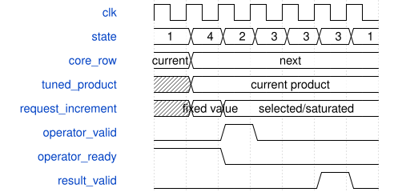

# VoiceSynthEngine 模块规范

> RTL: `rtl/VoiceSynthEngine.v`

## 1. 模块目的

驻留音色程序、8 声部生命周期与 6 算子逐采样调度。

## 2. 参数

| 参数 | 默认值 | 说明 |
| --- | --- | --- |
| — | — | 本模块没有可配置参数。 |

## 3. 时钟与复位

- 时钟：`{"name": "i_axis_aclk", "edge": "posedge", "frequency_hz": 50000000}`
- 复位：`{"name": "i_axis_arstn", "active": "low", "style": "asynchronous", "values": "all pipeline valid and output data/tag registers clear; external synchronous release"}`

## 4. 接口信号规范

| 信号 | 方向 | 位宽 | 时钟域 | 语义角色 | 描述 |
| --- | --- | --- | --- | --- | --- |
| `i_axis_aclk` | input | 1 | 未声明 | clock | 任务与结果共用时钟 |
| `i_axis_arstn` | input | 1 | 未声明 | reset | 异步清除有效资格；外部同步释放 |
| `i_s_axis_tdata` | input | 384 | 未声明 | data | 本次操作的状态与参数原子快照 |
| `i_s_axis_tuser` | input | 32 | 未声明 | data | 调用者的透明事务编号 |
| `i_s_axis_tvalid` | input | 1 | 未声明 | control | 源端持有完整请求 |
| `o_s_axis_tready` | output | 1 | 未声明 | control | 本拍可以接收快照 |
| `o_m_axis_tdata` | output | 128 | 未声明 | data | 该事务的数值和状态结果 |
| `o_m_axis_tuser` | output | 32 | 未声明 | data | 与结果同步返回的原编号 |
| `o_m_axis_tvalid` | output | 1 | 未声明 | control | 输出寄存器包含可消费事务 |
| `i_m_axis_tready` | input | 1 | 未声明 | control | 调用者可以提交输出结果 |
| `i_s_axis_tdest` | input | 8 | 未声明 | data | 高层命令 A0..A9 与调制 B0..B3 |
| `o_m_axis_tdest` | output | 8 | 未声明 | data | 完成的命令 |
| `i_sample_tick` | input | 1 | 未声明 | control | 一个采样周期的启动脉冲 |
| `o_pcm_valid` | output | 1 | 未声明 | control | 单周期完成脉冲 |
| `o_pcm_data` | output | 64 | 未声明 | data | 左右 Q26 采样 |
| `o_frame` | output | 32 | 未声明 | data | 完成帧数 |
| `o_overruns` | output | 32 | 未声明 | data | 忙碌时到来的采样脉冲 |
| `o_render_cycles` | output | 32 | 未声明 | data | 最近一次渲染时钟数 |
| `o_active` | output | 8 | 未声明 | data | 活动声部位图 |
| `i_touch_gain` | input | 18 | 未声明 | data | i_touch_gain |
| `i_touch_pitch` | input | 32 | 未声明 | data | i_touch_pitch |

## 5. 周期行为与延迟

- Four patch slots, two atomic parameter banks each; six topologically ordered operators per patch.
- Eight dynamic voices, independent phase/EG/noise/feedback state; a single physical composite operator is scheduled for each enabled logical operator.
- Control sequence/epoch protects retries; note identity protects held-key duplicate events; note release never targets a replacement with another identity.
- Commands apply between frames; completion backpressure never freezes audio rendering.
- VoiceModulation advances patch-global and voice-local LFOs once per enabled audio frame, then resolves eight routes per voice; base parameters remain unchanged.
- Fixed voice-capacity headroom, normalized carriers, smoothed live gain/pan and stereo output. This is a generic engine, not exact DX7 or Surge emulation.
- A4/A6 optional word4 marker31 plus velocity[13:7]/note[6:0]. Zero defaults60/100. Duplicate identity must match metadata. Metadata stored independently per voice. Four resident slots and eight voices unchanged.
- DX extension: A1 flags15 mode,22:16 scaled output; DX sine/PM only, feedback0..7, depth0, ratio<=64. A2 DX levels<=4032,L4=0,rates<=63; A1 invalidates that row EG until A2 reloads it.
- A3 returns BUSY10 when any active voice uses the slot and any row changes native/DX state format; the old bank stays live and the draft remains available for a later new-sequence retry after voices finish or panic.
- Note CAM is an eight-cycle snapshot search while audio FSM idle. Note commands A4/A5/A6 wait for lookup DONE before READY. A sample tick or non-idle audio cancels the lookup; restart after rendering. Exact ID last match, first free, oldest first tie remain unchanged; other commands do not wait for CAM.
- Command identity and payload validation are registered before mutation. The source holds its request through READY; a sample tick discards the checked snapshot and restarts lookup/validation after audio. Rendering latency is unchanged.
- Packet predecode registers 20 payload-signature equality slices plus opcode equality and ten payload-zero words. Identity and business checks are registered independently, then selected into the checked completion. Sample tick cancels all three validation stages; no command side effects occur before handshake.
- Synchronous program and packed163-bit context RAM: the existing RAM output registers prefetch the next operator during states1/2/3; voice rendering uses the documented audio FSM; frame deadline remains1024. Allocation invalidates context flags; first use zeroes phase/EG/history and seeds noise=context+1; note gate events cannot bypass initialization.
- 声像系数在 state16 从已限幅的 reg_mod_pan 锁存，左右各为无符号 27 位 [0,2^26]；本次不改变 gain/pan 每帧平滑写回或调制限幅行为。
- state7 将有符号 32 位音频与 {0,coefficient[25:0]} 相乘并寄存 59 位精确乘积，同时锁存音频。state18 对 coefficient[26]=1 的满增益选择 sample<<26，否则对乘积符号扩展。没有额外量化或截断，后级仍消费原 product[57:26]。
- state7→state18→state8，每个走完整计算路径的声部增加一个时钟；禁用/非活动声部仍 state1 清零立体声乘积后直接 state8。原声像流水基线Voice874/整链948；本次预取实测减少88拍，采样周期1024不变。
- 新增声像系数、输入样本和乘积寄存器异步清零；现有复位、完成握手、程序 RAM 和命令编排保持原接口。
- 单个预取槽复用core/envelope/context同步RAM输出；state1/2/3/4读取下一个算子（最后一个保持5）。state1打包当前请求并锁存当前carrier位；state3仅在结果有效时提交当前context/输出，再推进索引并直接进入state1或state5。禁用算子在state1清零自身输出并直接推进。state4用于部分和的最终求和/饱和；状态17退出正常调度，不增加DSP/RAM或宽参数队列。
- 完成写回older历史时使用当前reg_operator_request[511:480]保存的last，不读取此时属于下一算子的reg_context_row。当前请求在结果提交前不被覆盖。
- 关键路径分拍：state13锁存当前声部gain/pan及target，state14将smooth结果暂存到现有reg_mod_gain/pan，state15才加调制并限幅；对mem_gain/pan的原state1写回不变。state1捕获两组signed34的三路部分和与请求其它字段，state4对signed35总和饱和并补齐请求modulation，state2才握手；预取包含state4。
- 实测native Voice834/可选FX整链908拍；全DX带全部LFO的估计上限Voice882拍。当前干声整板回归最大PCM脉冲延迟878拍，native压力835拍（均比对应Voice遥测多1拍观察延迟）。单物理算子、当前carrier与context/history归属不变。
- Accepted successful Note-On completion bits63:32 carry cnt_frame+1, the first rendered frame affected by that event. Cached replay returns the same frame tag. Other completion words and DSP scheduling are unchanged.
- Unmodulated gain/pan baseline writes at the end of state14 from state13 prefetched operands, sharing the smoothing calculation. No array mux enters the arithmetic writeback cone. Inactive/muted voices do not advance unused ramps; allocation initializes those states. Active audio timing and values remain unchanged.
- C_TOUCH_ENABLE默认0保持旧行为。预先寄存主增益×触摸Q16增益并限制到UNITY，每帧锁存。state14叠加触摸与原调制矩阵音高，state15原乘法器执行；固定频率算子保持原频率。无新增音频FSM拍数。
- 命令发放许可flag_issue在校验和Completion可用之后独立寄存。当前sample_tick仍立即取消ready，已接受包立即清许可；新增1拍命令等待，不改音频帧计算状态或PCM采样周期。
- 算子频率比乘积在state1寄存，state4再饱和并组装请求；固定频率直接保留state1的参数。复用原路由求和拍，不增加算子或整帧周期，位精确截断不变。
- AA snapshot command categories 0 core, 1 EG, 2 LFO, 3 routes, 4 wave, 5 master/enable, 6 patch revision. Payload word0 selects word; all other words zero. Four-cycle settling restarts across sample boundaries; responses use existing replay/sequence control.

- 2026-11-04: state13 snapshots gain/pan operands and starts the eight-route modulation walk. State17 registers distances and directions. State14 applies the minimum-one-LSB step and writes each baseline once at mod_done. This splits compare/subtract from step/add without extending the route walk or audio frame. 4096 exact arithmetic vectors and full AXI/ADC/PT8211 regressions cover the change.

## 6. WaveDrom 时序图

### 频率比乘法与饱和分拍

当前参数行在state1被采样；state4使用寄存的乘积做饱和，state2发放完整请求。RAM可继续预取下一算子；固定频率保留原参数。

- WaveJSON：[VoiceSynthEngine_ratio-pipeline.json5](waveforms/VoiceSynthEngine_ratio-pipeline.json5)

## 7. 边界、反压与错误

- signed minima/maxima and zero
- changing tags and parameters every accepted beat
- long backpressure and bubbles
- reset while pipeline holds transactions
- 声像0、2^26、中心及相邻LSB；有符号音频最小/最大值；活动声部之后紧接非活动声部；声像乘法执行中复位。

## 8. CDC 与综合约束

- Single 50 MHz clock domain; reset cancels in-flight work.
- See ENGINE.md for exact fixed-point and command ABI.
- Candidate: board timing and strict style gate are separate from functional simulation.
- 2026-11-02干声整板完整PnR：50MHz、WNS+0.169ns，setup/hold0；未烧录。

## 9. 验证与验收

- Independent Python integer model versus xsim
- Backpressure stability and reset cancellation
- Illegal parameters and voice lifecycle
- 1024-clock frame deadline under eight voices and six operators
- 独立整数模型覆盖完整 signed32 音频范围与 [0,2^26] 声像范围；随机20万组和边界，逐位比较精确乘积。
- 定向声像时序测试与真实 AXI/键盘/PCM 整链回归，包含满载帧期限与音频整数参考模型。
- 全部64启用掩码和64载波掩码的抽象RAM调度随机验证；真实请求/完成归属scoreboard、native/DX混合PCM与整板回归。实测满载Voice786、整链860拍。
- 分拍算术模型、独立PCM/算子参考、随机反压、reset取消及整板UART/键床/PT8211；不放宽1024拍期限。
- dsp_regression.py及system_test.py：DX音色数值逐位比较、固定/比例频率、非DX波表/AM、AXI背压与饱和调度；分拍不增加帧周期。

## 10. 可追溯性

- 规格模块：`VoiceSynthEngine`
- RTL 路径：`rtl/VoiceSynthEngine.v`
- 交付要求：本文档、WaveJSON 和 SVG 必须与同一版本规格一同发布。
