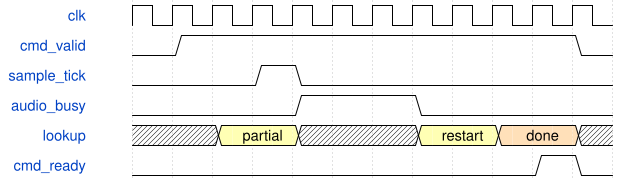

# VoiceSynthEngine 模块规范

> RTL: `rtl/VoiceSynthEngine.v`

## 1. 模块目的

驻留音色程序、8 声部生命周期与 6 算子逐采样调度。

## 2. 参数

| 参数 | 默认值 | 说明 |
| --- | --- | --- |
| — | — | 本模块没有可配置参数。 |

## 3. 时钟与复位

- 时钟：`{"name": "i_axis_aclk", "edge": "posedge", "frequency_hz": 50000000}`
- 复位：`{"name": "i_axis_arstn", "active": "low", "style": "asynchronous", "values": "all pipeline valid and output data/tag registers clear; external synchronous release"}`

## 4. 接口信号规范

| 信号 | 方向 | 位宽 | 时钟域 | 语义角色 | 描述 |
| --- | --- | --- | --- | --- | --- |
| `i_axis_aclk` | input | 1 | 未声明 | clock | 任务与结果共用时钟 |
| `i_axis_arstn` | input | 1 | 未声明 | reset | 异步清除有效资格；外部同步释放 |
| `i_s_axis_tdata` | input | 384 | 未声明 | data | 本次操作的状态与参数原子快照 |
| `i_s_axis_tuser` | input | 32 | 未声明 | data | 调用者的透明事务编号 |
| `i_s_axis_tvalid` | input | 1 | 未声明 | control | 源端持有完整请求 |
| `o_s_axis_tready` | output | 1 | 未声明 | control | 本拍可以接收快照 |
| `o_m_axis_tdata` | output | 128 | 未声明 | data | 该事务的数值和状态结果 |
| `o_m_axis_tuser` | output | 32 | 未声明 | data | 与结果同步返回的原编号 |
| `o_m_axis_tvalid` | output | 1 | 未声明 | control | 输出寄存器包含可消费事务 |
| `i_m_axis_tready` | input | 1 | 未声明 | control | 调用者可以提交输出结果 |
| `i_s_axis_tdest` | input | 8 | 未声明 | data | 高层命令 A0..A9 与调制 B0..B3 |
| `o_m_axis_tdest` | output | 8 | 未声明 | data | 完成的命令 |
| `i_sample_tick` | input | 1 | 未声明 | control | 一个采样周期的启动脉冲 |
| `o_pcm_valid` | output | 1 | 未声明 | control | 单周期完成脉冲 |
| `o_pcm_data` | output | 64 | 未声明 | data | 左右 Q26 采样 |
| `o_frame` | output | 32 | 未声明 | data | 完成帧数 |
| `o_overruns` | output | 32 | 未声明 | data | 忙碌时到来的采样脉冲 |
| `o_render_cycles` | output | 32 | 未声明 | data | 最近一次渲染时钟数 |
| `o_active` | output | 8 | 未声明 | data | 活动声部位图 |

## 5. 周期行为与延迟

- Four patch slots, two atomic parameter banks each; six topologically ordered operators per patch.
- Eight dynamic voices, independent phase/EG/noise/feedback state; a single physical composite operator is scheduled for each enabled logical operator.
- Control sequence/epoch protects retries; note identity protects held-key duplicate events; note release never targets a replacement with another identity.
- Commands apply between frames; completion backpressure never freezes audio rendering.
- VoiceModulation advances patch-global and voice-local LFOs once per enabled audio frame, then resolves eight routes per voice; base parameters remain unchanged.
- Fixed voice-capacity headroom, normalized carriers, smoothed live gain/pan and stereo output. This is a generic engine, not exact DX7 or Surge emulation.
- A4/A6 optional word4 marker31 plus velocity[13:7]/note[6:0]. Zero defaults60/100. Duplicate identity must match metadata. Metadata stored independently per voice. Four resident slots and eight voices unchanged.
- DX extension: A1 flags15 mode,22:16 scaled output; DX sine/PM only, feedback0..7, depth0, ratio<=64. A2 DX levels<=4032,L4=0,rates<=63; A1 invalidates that row EG until A2 reloads it.
- A3 returns BUSY10 when any active voice uses the slot and any row changes native/DX state format; the old bank stays live and the draft remains available for a later new-sequence retry after voices finish or panic.
- Note CAM is an eight-cycle snapshot search while audio FSM idle. Note commands A4/A5/A6 wait for lookup DONE before READY. A sample tick or non-idle audio cancels the lookup; restart after rendering. Exact ID last match, first free, oldest first tie remain unchanged; other commands do not wait for CAM.
- Command identity and payload validation are registered before mutation. The source holds its request through READY; a sample tick discards the checked snapshot and restarts lookup/validation after audio. Rendering latency is unchanged.
- Packet predecode registers 20 payload-signature equality slices plus opcode equality and ten payload-zero words. Identity and business checks are registered independently, then selected into the checked completion. Sample tick cancels all three validation stages; no command side effects occur before handshake.
- Synchronous program and packed163-bit context RAM: state17 waits after operator advance; pipelined modulation gives voice866 / full chain940 of1024. Allocation invalidates context flags; first use zeroes phase/EG/history and seeds noise=context+1; note gate events cannot bypass initialization.

## 6. WaveDrom 时序图

### 流水接纳与反压

请求锁存后运算；结果可以暂停，已驻留声部仍按采样时钟推进。图示握手关系，不按图推断延迟。

- WaveJSON：[VoiceSynthEngine_stream.json5](waveforms/VoiceSynthEngine_stream.json5)

### 声部查找与音频优先

示例采样tick打断未接纳查找，渲染结束后重新读取状态；READY只在查找完成后有效。

- WaveJSON：[VoiceSynthEngine_control.json5](waveforms/VoiceSynthEngine_control.json5)

## 7. 边界、反压与错误

- signed minima/maxima and zero
- changing tags and parameters every accepted beat
- long backpressure and bubbles
- reset while pipeline holds transactions

## 8. CDC 与综合约束

- Single 50 MHz clock domain; reset cancels in-flight work.
- See ENGINE.md for exact fixed-point and command ABI.
- Candidate: board timing and strict style gate are separate from functional simulation.

## 9. 验证与验收

- Independent Python integer model versus xsim
- Backpressure stability and reset cancellation
- Illegal parameters and voice lifecycle
- 1024-clock frame deadline under eight voices and six operators

## 10. 可追溯性

- 规格模块：`VoiceSynthEngine`
- RTL 路径：`rtl/VoiceSynthEngine.v`
- 交付要求：本文档、WaveJSON 和 SVG 必须与同一版本规格一同发布。
