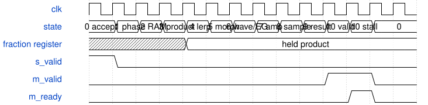

# tb_fm_interpolation 模块规范

> RTL: `sim/tb_fm_interpolation.v`

## 1. 模块目的

真实FM算子插值流水的满位宽边界、十拍延迟与事务取消验证。

## 2. 参数

| 参数 | 默认值 | 说明 |
| --- | --- | --- |
| — | — | 本模块没有可配置参数。 |

## 3. 时钟与复位

- 时钟：`{"name": "clk", "edge": "posedge", "frequency_hz": 50000000}`
- 复位：`{"name": "rstn", "active": "low", "style": "asynchronous", "values": "初始复位，并分别在state1..10取消在途请求；波表内容保持。"}`

## 4. 接口信号规范

| 信号 | 方向 | 位宽 | 时钟域 | 语义角色 | 描述 |
| --- | --- | --- | --- | --- | --- |
| `o_done` | output | 1 | 未声明 | control | 全部自检通过置1；内部提供时钟与刺激。 |

## 5. 周期行为与延迟

- 接口上传2048个signed32边界样点，无force；Python整数参考生成960个独立请求/结果。
- fraction含0/1/半程邻点/最大值，地址含1023到0的回绕，morph覆盖0/65536及越界钳位。
- 计算请求与波表写同时出现时计算优先；计算及输出反压期间写不得生效。
- 每次结果必须在10拍出现，全部五个返回word及tag逐位核对；反压期间输出不变。
- 分别在state1..10复位，检查无幽灵结果；每次随后执行新请求，末尾重查首样点确认被拒绝的写没有污染波表。

## 6. WaveDrom 时序图

### 插值乘法寄存与十拍调度

采样沿接纳请求后逐状态执行；EG未就绪则在state6等待。标称EG无额外等待，结果在state10有效。

- WaveJSON：[tb_fm_interpolation_interpolation-pipeline.json5](waveforms/tb_fm_interpolation_interpolation-pipeline.json5)

## 7. 边界、反压与错误

- signed32极值、负数算术右移、波表地址回绕、morph钳位、反压、逐拍复位。

## 8. CDC 与综合约束

- 功能时钟50MHz；真实物理时序另由Gowin完整STA证明。
- 测试覆盖声明的状态和边界，不宣称形式等价或全部参数穷举。

## 9. 验证与验收

- 971个完成结果、10个复位取消点、全部返回延迟10拍。
- 主算子通用/DX参考向量和全链整数音频回归另外覆盖。

## 10. 可追溯性

- 规格模块：`tb_fm_interpolation`
- RTL 路径：`sim/tb_fm_interpolation.v`
- 交付要求：本文档、WaveJSON 和 SVG 必须与同一版本规格一同发布。
