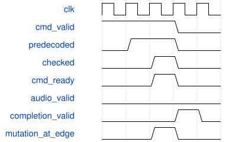

# tb_fx_control_pipeline 模块规范

> RTL: `sim/tb_fx_control_pipeline.v`

## 1. 模块目的

真实FX命令域校验流水、反压、原子提交及音频抢占定向验证。

## 2. 参数

| 参数 | 默认值 | 说明 |
| --- | --- | --- |
| — | — | 本模块没有可配置参数。 |

## 3. 时钟与复位

- 时钟：`{"name": "clk", "edge": "posedge", "frequency_hz": 50000000}`
- 复位：`{"name": "rstn", "active": "low", "style": "asynchronous", "values": "起始复位及已校验命令被完成反压阻塞时复位"}`

## 4. 接口信号规范

| 信号 | 方向 | 位宽 | 时钟域 | 语义角色 | 描述 |
| --- | --- | --- | --- | --- | --- |
| `o_done` | output | 1 | 未声明 | control | 全部自检通过置1；内部提供时钟与刺激。 |

## 5. 周期行为与延迟

- 不force任何硬件逻辑，直接实例化C_DELAY_ADDR_BITS=13的真实AxisFxEngine。
- 先以阻塞的C0完成包占据输出槽，C4查询校验后两次插入音频；旧查询必须重新校验并返回更新后的帧数。
- C2原子提交和C3清空各在checked之后被音频抢占，控制动作必须延后到音频完成并重新校验后执行。
- 同序号同payload重放只返回缓存并使用新tag；冲突及非法参数不修改配置；非法但合格序号仍被消耗。
- 复位取消一个已接受完成包和一个尚未接受命令，随后seq0重新建立会话。
- 校验后临时翻转raw payload再恢复，期间不发生采样沿，仅验证参数到执行使能的组合传播已经切断；正式输入在实际采样沿遵守保持协议。

## 6. WaveDrom 时序图

### 控制校验寄存与接受

空闲且完成输出可接收：列表示采样沿前状态，操作在列末上升沿提交。先比较块，再校验快照，第三沿才执行；期间音频到达会取消两级资格。

- WaveJSON：[tb_fx_control_pipeline_control-check.json5](waveforms/tb_fx_control_pipeline_control-check.json5)

## 7. 边界、反压与错误

- 完成阻塞+同时出入队；快照就绪后音频到达；错误重放；复位丢弃在途命令。

## 8. CDC 与综合约束

- 只证明功能与握手行为，不能替代STA。
- 真实音频路径固定四帧，独立核对返回帧号与完成包完整字段。

## 9. 验证与验收

- xsim: accepted12/delivered11/reset_cancelled1/audio4/preemptions4/clears1+1。
- 严格测试门禁；完整Voice/LFO/FX音频整数模型和UART/键盘回归另行覆盖。

## 10. 可追溯性

- 规格模块：`tb_fx_control_pipeline`
- RTL 路径：`sim/tb_fx_control_pipeline.v`
- 交付要求：本文档、WaveJSON 和 SVG 必须与同一版本规格一同发布。
