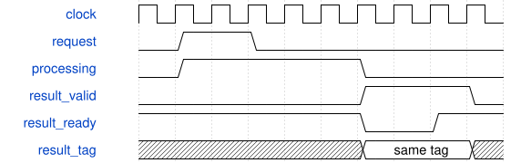

# tb_keyboard_hold 模块规范

> RTL: `sim/tb_keyboard_hold.v`

## 1. 模块目的

Regression of the active board KeyboardVoiceBridge edge semantics under repeated held snapshots.

## 2. 参数

| 参数 | 默认值 | 说明 |
| --- | --- | --- |
| — | — | 本模块没有可配置参数。 |

## 3. 时钟与复位

- 时钟：`{"name": "clk", "edge": "posedge", "frequency_hz": 50000000}`
- 复位：`{"name": "rstn", "active": "low", "style": "asynchronous"}`

## 4. 接口信号规范

| 信号 | 方向 | 位宽 | 时钟域 | 语义角色 | 描述 |
| --- | --- | --- | --- | --- | --- |
| `o_done` | output | 1 | 未声明 | data | All self-checking cases completed; observable by an enclosing simulation fixture. |

## 5. 周期行为与延迟

- The actual keyboard-latency project uses keyboard-studio/src/KeyboardVoiceBridge.v.
- Ignore initialization transfers, then hold/release/repress a key and add a chord; expect exactly four NoteOn and four NoteOff events.
- Destination stalls must preserve event data; frame completion pulses permit next key scanning.
- Fixture contains32 zero initial profiles; this is a logic simulation, not physical keyboard timing or board sound validation.

## 6. WaveDrom 时序图

### 任务提交与结果保持

输入握手移交所有权；结果等待消费时数据和事务身份保持。精确延迟以行为合同为准。

- WaveJSON：[tb_keyboard_hold_flow.json5](waveforms/tb_keyboard_hold_flow.json5)

## 7. 边界、反压与错误

- backpressure and bubbles
- full and empty queues
- reset with in-flight tasks
- invalid stage or operation or bus request

## 8. CDC 与综合约束

- Simulation only; source board bridge is read-only.
- Run in reports/key-hold-run with generated note_profiles.hex fixture.

## 9. 验证与验收

- The actual keyboard-latency project uses keyboard-studio/src/KeyboardVoiceBridge.v.
- Ignore initialization transfers, then hold/release/repress a key and add a chord; expect exactly four NoteOn and four NoteOff events.
- Destination stalls must preserve event data; frame completion pulses permit next key scanning.
- Fixture contains32 zero initial profiles; this is a logic simulation, not physical keyboard timing or board sound validation.

## 10. 可追溯性

- 规格模块：`tb_keyboard_hold`
- RTL 路径：`sim/tb_keyboard_hold.v`
- 交付要求：本文档、WaveJSON 和 SVG 必须与同一版本规格一同发布。
