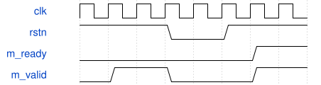

# tb_voice_operators 模块规范

> RTL: `sim/tb_voice_operators.v`

## 1. 模块目的

四个独立算子的并发参考向量、连续吞吐、反压和复位取消验证。

## 2. 参数

| 参数 | 默认值 | 说明 |
| --- | --- | --- |
| — | — | 本模块没有可配置参数。 |

## 3. 时钟与复位

- 时钟：`{"name": "i_clk", "edge": "posedge", "frequency_hz": 50000000}`
- 复位：`{"name": "i_rstn", "active": "low", "style": "asynchronous"}`

## 4. 接口信号规范

| 信号 | 方向 | 位宽 | 时钟域 | 语义角色 | 描述 |
| --- | --- | --- | --- | --- | --- |
| `o_done` | output | 1 | 未声明 | data | 最终轮所有算子事务完成；供外层仿真夹具观察 |

## 5. 周期行为与延迟

- Four independent input streams use Python reference vectors.
- Reset at cycle 70 cancels 15 pipeline transactions; restart tags use another epoch.
- No-stall latency is 3/4/4/4; each operator accepts every cycle.
- No source or destination payload may change while that transfer is stalled.

## 6. WaveDrom 时序图

### 阻塞期间复位撤销任务

在输出被反压时断言复位，清除有效位；释放后使用新 epoch。

- WaveJSON：[tb_voice_operators_reset.json5](waveforms/tb_voice_operators_reset.json5)

## 7. 边界、反压与错误

- signed min/max and saturation boundaries
- zero-step and zero-seed
- whole pipeline blocked at reset

## 8. CDC 与综合约束

- Testbench only; not synthesizable and not included in board source lists.
- Run from voice-engine directory so vectors paths resolve.

## 9. 验证与验收

- 7861 post-reset transactions checked bit-for-bit
- output tags and results remain stable on stalls
- timeout at 30000 cycles

## 10. 可追溯性

- 规格模块：`tb_voice_operators`
- RTL 路径：`sim/tb_voice_operators.v`
- 交付要求：本文档、WaveJSON 和 SVG 必须与同一版本规格一同发布。
