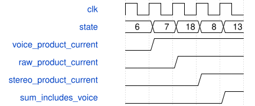

# tb_voice_pan_pipeline 模块规范

> RTL: `sim/tb_voice_pan_pipeline.v`

## 1. 模块目的

定向检查真实 VoiceSynthEngine 声像分拍、精确乘积、非活动清零和复位。

## 2. 参数

| 参数 | 默认值 | 说明 |
| --- | --- | --- |
| — | — | 本模块没有可配置参数。 |

## 3. 时钟与复位

- 时钟：`{"name": "clk", "edge": "posedge", "frequency_hz": 50000000}`
- 复位：`{"name": "rstn", "active": "low", "style": "asynchronous", "values": "初始复位及11次声像乘积寄存后复位"}`

## 4. 接口信号规范

| 信号 | 方向 | 位宽 | 时钟域 | 语义角色 | 描述 |
| --- | --- | --- | --- | --- | --- |
| `o_done` | output | 1 | 未声明 | control | 全部检查通过时置1；内部产生时钟与激励，无外部输入。 |

## 5. 周期行为与延迟

- force限定于状态、已限幅声像与音频源；真实系数寄存、乘法、选择、清零和声部累加逻辑保持运行。
- 90组边界与2000组固定种子随机输入，每组用原signed32乘法表达式计算左右精确64位参考结果。
- 检查state7不提前更新最终乘积、state18结果准确、state1→8快速路径不重复累加、流水中异步复位清空全部新增状态。
- 真实状态机、AXI控制和音频端到端行为另由tb_axi_fx、tb_axi_synth_engine、tb_axi_lfo和tb_synth_system覆盖。

## 6. WaveDrom 时序图

### 声像乘法分拍

示例非最后一个活动声部；各列为采样沿前状态，运算在本列末沿提交。声像系数已在 state16 锁存。新增加 state18；非活动快速路径仍 state1→state8。

- WaveJSON：[tb_voice_pan_pipeline_stereo-pan.json5](waveforms/tb_voice_pan_pipeline_stereo-pan.json5)

## 7. 边界、反压与错误

- signed32最小最大值；声像0、1、中心±1、2^26−1、2^26；上一声部非零后进入非活动声部。

## 8. CDC 与综合约束

- 只用于功能仿真，不能替代STA。
- o_done仅在2090组向量、4180个乘积、2090次非活动检查及11次复位均通过后置1。

## 9. 验证与验收

- xsim PASS voice_pan_pipeline，遇Fatal或缺少PASS均失败。
- 新测试严格门禁0错误、0警告。

## 10. 可追溯性

- 规格模块：`tb_voice_pan_pipeline`
- RTL 路径：`sim/tb_voice_pan_pipeline.v`
- 交付要求：本文档、WaveJSON 和 SVG 必须与同一版本规格一同发布。
