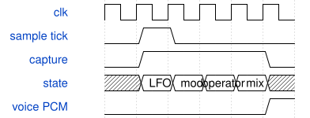

# tb_voice_schedule 模块规范

> RTL: `sim/tb_voice_schedule.v`

## 1. 模块目的

真实AXI/FX压力激励上的被动逐帧调度计数

## 2. 参数

| 参数 | 默认值 | 说明 |
| --- | --- | --- |
| — | — | 本模块没有可配置参数。 |

## 3. 时钟与复位

- 时钟：`{"name": "Stimulus.clk", "edge": "negedge", "frequency_hz": 50000000}`
- 复位：`{"name": "Stimulus.rstn", "active": "low", "style": "synchronous observation", "values": "取消本次计数，下一有效tick重新开始"}`

## 4. 接口信号规范

| 信号 | 方向 | 位宽 | 时钟域 | 语义角色 | 描述 |
| --- | --- | --- | --- | --- | --- |
| `o_done` | output | 1 | 未声明 | control | 原AXI压力测试完成标志 |

## 5. 周期行为与延迟

- 复用tb_axi_fx真实控制/音频激励，不驱动DUT内部信号。
- 在被接受的frame tick开始逐拍累计状态0..18；Voice PCM结果时校验计数之和等于o_render_cycles，并输出CSV。
- 单独统计state3未完成等待及state2请求背压；原测试负责功能断言及终止。
- 在请求构造沿核对当前程序/包络/有效context行；握手时保存当前context、carrier和反馈历史，完成时核对tag、状态写回和载波累加。只观察、不驱动DUT。
- 预取版不得访问旧等待状态17；确认单算子在途，反馈旧last从当前context独立取期望值，不能被预取行覆盖。

## 6. WaveDrom 时序图

### 观察帧内状态占用

下降沿只读取稳定状态；从被接受的tick开始，在Voice PCM有效时结束当前计数。

- WaveJSON：[tb_voice_schedule_frame-profile.json5](waveforms/tb_voice_schedule_frame-profile.json5)

## 7. 边界、反压与错误

- 复位取消当前计数；空闲声部、全48算子、FX背压与命令并发。

## 8. CDC 与综合约束

- 本夹具用于当前单帧Voice状态机，不把端到端帧延迟等同于通用流水II。
- 必须与sim/tb_axi_fx.v及真实sources.f共同编译。

## 9. 验证与验收

- 逐帧计数与硬件遥测相等；预取版满载834拍，原AXI/FX回归和独立PCM模型必须通过。
- 真实请求和完成的归属scoreboard；抽象模型另行覆盖全部64启用掩码和64载波掩码。

## 10. 可追溯性

- 规格模块：`tb_voice_schedule`
- RTL 路径：`sim/tb_voice_schedule.v`
- 交付要求：本文档、WaveJSON 和 SVG 必须与同一版本规格一同发布。
