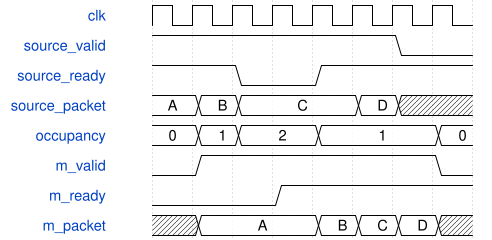

# tb_completion_isolation 验证规格

验证对象：`rtl/AxisSynthSystem.v` 的公共完成仲裁与两槽缓冲。测试文件：`sim/tb_completion_isolation.v`。

这是无外部端口的仿真顶层，内部生成 10 ns 时钟与异步低有效复位。实例使用 `LEGACY_ENABLE=0`、`C_DELAY_ADDR_BITS=13`。测试通过 force 驱动三个完成源的 VALID、opcode、tag、result，独立保存每个源的待发送包，并观察真实子模块输入 READY。该测试不证明 DSP 算术正确性，真实子模块另由 AXI 与整板回归覆盖。

当前测试保持内核默认`C_FX_ENABLE=1`，FX源路径改为`FxDomain.Fx_Inst`；整板默认关闭FX的完成回复由`tb_synth_system`另外覆盖。

## 行为模型

独立队列仅在实际输入握手时记录完整 168 位包，仅在输出握手时逐包比较。轮询模型独立维护 Legacy → Voice → FX 优先级。计分板检查 `accepted = delivered + cancelled + occupancy`，其中复位将已有队列内容计入 cancelled；不使用生产模块的旧协议遥测计数推断事务数量。

## 覆盖与判定

- 长时间输出堵塞、队列空/满、满载后恢复、连续同时出入队，以及伪随机三源到达和下游反压。
- 满载时不能借用同一拍出队空间接受新包；输出堵塞期间保持 VALID 与完整数据。
- 无时钟沿翻转下游 READY，确认三个源的 READY 均不组合改变。
- 两次满队列复位取消在途完成包；结束时停止生产并排空队列。
- 输出没有 X，TLAST 恒为 1，完整包内容、顺序与标签不变。
- 最少覆盖 100 次满队列、20 次空队列、100 次同时出入、两个满载复位和每源 200 包。

## 时序

与 DUT 合同共用精确的填满、停顿、恢复、同时出入时序：



WaveJSON：`spec/waveforms/AxisSynthSystem_completion-buffer.json5`。信号含义及采样沿约定见 `AxisSynthSystem_spec.md`。

## 外部证据

新版 PASS：accepted=4843、delivered=4839、cancelled=4；8188 次无时钟 READY 隔离检查通过。相同测试在不可变旧 RTL 上于 52 ns 检出 READY 组合传播，构成负对照。日志位于 `../voice-system/reports/completion-isolation/` 及 `reports/completion-xsim.log`。

真实功能补充验证：`tb_axi_fx`、`tb_axi_voice_endpoint`、`tb_axi_synth_engine`、`tb_axi_lfo`、板级 `tb_synth_system`，以及 `model/check_fx_capture.py` 的整数 PCM 参考比对。

## 单独重跑

在 `voice-engine` 根目录执行以下命令，保持该目录下 `rom/` 可见：

```powershell
& 'D:/Xilinx/2025.1/Vivado/bin/xvlog.bat' -f sources.f sim/tb_completion_isolation.v
& 'D:/Xilinx/2025.1/Vivado/bin/xelab.bat' tb_completion_isolation -s completion_isolation
& 'D:/Xilinx/2025.1/Vivado/bin/xsim.bat' completion_isolation -runall
```

每步都必须成功退出，最后日志必须包含 `PASS completion_isolation` 且没有 `Fatal:`、`FATAL` 或 `ERROR:`。xsim 遇到测试断言失败仍可能返回进程退出码 0，因此不能只检查退出码。原始 RTL 负对照特意保留上述断言失败日志。
