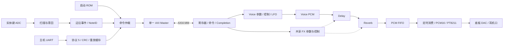

# 当前板级增量（2026-11-03）：共享低通 / Cutoff LFO

实际使用 `SynthHdmiTop` 包装整机，保留 HDMI、32 键标定与速度力度；50 MHz、48,828.125 Hz / 16-bit stereo。下方 FX 开启时的 hierarchy 为历史版本：**当前 C_FX_ENABLE=0，Delay/Reverb 未实例化**。

`AxiVoiceEndpoint.Runtime_Inst` / `AxisSynthSystem` 下新增 **`Filter_Inst: AxisMasterLowpass` × 1**：

```text
VoiceSynthEngine → 混合后双声道 Q26 → AxisMasterLowpass → PCM FIFO → SynthPcmOutput → PT8211
                                           ↑
UART D0/D1 → SynthAxiMaster → AXI-MM 邮箱 → 配置 / 独立完成通道
```

模块内左右各两级低通状态，共享音频乘加通路；12 dB/oct，无共振。Cutoff 20～18,000 Hz；内部全局 LFO 正弦/三角、0.05～20 Hz、深度 0～6 oct，逐采样运行。VoiceModulation 的逐声部 LFO 与此次全局 LFO 分开。模块每帧计算 30 拍，配置 ACK 的反压不阻塞音频。

ABI `0x00010006`，新增 `0x64=0x4c504631`（LPF1）。D0 配置 / D1 查询复用原有命令、完成邮箱；`SynthAxiMaster.cnt_filter_sequence` 独立递增，不制造 Voice 命令序号缺口。控制操作不重新触发声音。完整字段见 [filter/CONTRACT.md](filter/CONTRACT.md)。

App 控制入口为声音设计和设备与输出；保存配置以硬件 ACK 为准，连续拖动合并更新，错误提供重试。上板证据与限制见 [reports/master-lowpass/README.md](reports/master-lowpass/README.md)。以下保留原始 FM1/FX 设计说明。

# FM1增量（2026-11-02，历史配置）

当前ABI更新为0x00010005；以下原始结构说明中的0x00010004是FX加入时的历史版本。
`AxisFmOperator` 新增并行子模块 `AxisDxEnvelope`，原生线性EG保留。A1/A2增加DX参数格式，
A4/A6可携带真实音高与力度；跨包络格式的活动音色切换受到A3 BUSY保护。
启动4槽改为PIANO 2、ORGAN 1、BASS 3、BRASS 2，共60条启动命令。
实体键盘仍连续映射MIDI48..79、槽0、固定力度100。全部增量协议与边界见
[FM1.md](../voice-engine/FM1.md) 和 [FM1_PLAN.md](../voice-engine/FM1_PLAN.md)。

---

# SynthString 整机候选系统

日期：2026-11-02。目标 Tang Mega 60K / GW5AT-LV60PG484AC1/I0，系统时钟 50 MHz。

这里把驻留 Voice Engine、LFO 和 FX 接入了真实板级顶层。旧的 `keyboard-latency` 演奏工程未修改；本工程独立构建。最新物理时序、烧录及硬件验证结果见 [BOARD_TEST.md](BOARD_TEST.md)。

## 1. 完整 hierarchy

以下是 `LEGACY_ENABLE=0` 实际展开的功能层级。每行模块物理实例数均为 1；包括顶层共 **24 个模块实例/24 种模块**。`sources.f` 同时编译 29 种模块，其中 5 种旧 raw/context 算术模块未被这个配置例化。RAM、乘法器及寄存器是各模块内部推断资源，不能把“一个模块实例”理解为只有一个乘法器。

```text
SynthSystemTop
├─ KeyboardSampler                    多路复用 ADC 扫描
├─ LatencyKeyThresholds                每键标定门限、滞回、两次确认
├─ SynthKeyboardSource                bitmap → 唯一 NoteID 的起音/释音事件
├─ SynthBootSequencer                 ROM → 四个音色与共享 FX 初始化
├─ SynthUartControl                   主机分包、CRC、重放缓存
│  ├─ UartRx                          UART 接收字节
│  └─ EncoderUartTx                   UART 发送字节
├─ SynthCommandArbiter                启动独占；随后键盘/主机轮询
├─ SynthAxiMaster                     发命令、读完成、核对 tag、POP
├─ AxiSynthEndpoint                   精简配置包装
│  └─ AxiVoiceEndpoint                AXI4-MM 寄存器与任务/完成队列
│     └─ AxisSynthSystem              Voice/FX 分发与 PCM 缓冲
│        ├─ VoiceSynthEngine          参数双缓冲、8 声部状态、调度与混音
│        │  ├─ VoiceModulation        24 个 LFO 上下文、路由与调制累加
│        │  │  └─ AxisLfoStep         共享 LFO 计算单元
│        │  └─ AxisFmOperator         共享波形/PM/FM/AM/增益计算单元
│        │     ├─ AxisEnvelopeMulti   共享多段 EG 计算单元
│        │     │  └─ AxisEnvelopeSegment  单段包络步进流水线
│        │     └─ AxisDxEnvelope      DX四速率/四电平对数包络
│        └─ AxisFxEngine              FX 参数提交、时序、状态与计数
│           ├─ AxisStereoDelay        立体声分数延迟、反馈、ping-pong
│           └─ AxisSchroederReverb    四梳状线 + 每声道两级全通
└─ SynthPcmOutput                     PCM FIFO 消费、Q26→PCM16、PT8211 串行
```

### 物理算力与逻辑实例

| 功能 | 物理计算模块 | 独立逻辑状态/容量 |
|---|---:|---|
| Voice 调度器 | 1 | 8 个声部，释放尾音参与生命周期管理 |
| 复合振荡/算子 | 1 | 每声部 6 个算子，共 48 份算子状态 |
| EG | 原生与DX各1 | 每算子独立 level/stage，按音色格式使用 |
| LFO | 1 | 8 个音色级 + 16 个声部级上下文；每音色两个 LFO |
| 调制路由 MAC | 1 | 每音色最多 8 条路由，15 个累加目标 |
| 音色参数库 | 双缓冲共享 RAM | 4 个音色槽，各有 active/draft 两份 |
| Delay | 1 套立体声 | 板级默认每声道 8K × 18 bit，最大约 167.772 ms |
| Reverb | 1 套共享立体声 | 4 条梳状线 + 4 条全通线；分配 10,240 个 18-bit RAM 字 |
| 输出 | 1 | 双声道，16 bit，48,828.125 Hz |

Delay 库默认仍为 `C_DELAY_ADDR_BITS=15`（32K/声道，约 671.089 ms）；**本板顶层传入 13**。0x4C 能力字中 bits[23:16] 报告地址位数，0x50 返回最大整数采样延迟。主机必须按实际能力校验，不能把更长时间截断后下发。`fx_pad_space.json` 的 450 ms 在此板级配置下会被拒绝。

## 2. 控制、参数与音频通路



- **控制面**：主机、实体按键与 ROM 使用同一个 Master。只有一个生产者拥有一次完整事务，避免 staging 寄存器、序列号或完成队列相互覆盖。启动完成后键盘/主机公平轮询，已接纳请求保持到完成。
- **参数面**：A0 开始音色草稿；A1/A2 写算子与包络；B0/B1 写 LFO 与路由；A3 提交银行。写入后参数驻留 FPGA，不随每个音频采样从 UART 重传。四个音色初始化后，按键只发 NoteOn/NoteOff。
- **执行面**：VoiceSynthEngine 根据驻留的六算子路由描述遍历声部/算子，读取独立状态，提交计算，回写状态。它是固定六算子模型的驻留描述调度器，**尚不是具有通用 PC、分支、任意 DSP 指令序列的处理器**。
- **状态存储**：相位、EG、噪声和两拍反馈合为 163-bit 同步上下文 RAM。新起音只清有效位，首次计算提供零状态和确定的噪声种子；每次完成只写一个上下文，避免起音时六路并行写导致大量寄存器与多路器。起音初始化与 NoteOff 事件独立，因此快速按下松开不会读到上一声部的陈旧状态。
- **数据面**：当前 PCM 经内部 ready/valid 流由 Voice → Delay → Reverb → FIFO，最后定时输出。Voice/LFO/FX 共用一个 AXI-MM Slave，通过命令域分发；还没有为每个模块设独立 Slave 地址窗、通用 AXI 交叉开关或 RAM DMA。内部全宽 ready/valid 不等于所有连接都是完整 AXI4-Stream。
- **完成面**：Master 检查 tag 与 opcode 后 POP；命令写响应与实际执行完成是两个阶段。串口堵塞、主机等待不会停止音频采样。

### 命令与寄存器

| 命令域 | 内容 |
|---|---|
| A0…A3 | 开始、算子核心参数、EG 参数、提交音色 |
| A4…A7 | NoteOn、NoteOff、实时 Note 参数、全局启停/延音/panic/master |
| A8/A9 | 波表写入、诊断/状态 |
| B0…B3 | LFO 参数、稀疏路由、重新触发、状态 |
| C0…C4 | Delay 草稿、Reverb 草稿、原子提交、清尾音、FX 状态 |

精确字段继承 [Voice Engine](../voice-engine/ENGINE.md)、[LFO](../voice-engine/MODULATION.md) 和 [FX](../voice-engine/FX.md) 的 ABI，主机编译器直接复用 `compile_voice_patch.py` 与 `compile_fx.py`。

| 地址 | 作用 |
|---|---|
| 0x004 | ABI = 0x00010004 |
| 0x008 | 完成 FIFO 数量位 [6:4] |
| 0x034…0x044 | Voice 能力、活动声部、超期、最大/当前帧耗时、PCM 丢帧 |
| 0x048 | LFO 能力 |
| 0x04C…0x060 | FX 能力、Delay 容量、帧数、限幅帧数、入口丢帧、FX 运算周期 |
| 0x100…0x124 | 10 个 32-bit 参数字 |
| 0x128/0x12C | opcode / tag |
| 0x134/0x138 | epoch+argument / domain sequence |
| 0x130 | COMMIT；写入 bit0=1 |
| 0x200…0x214 | 完成结果、tag、opcode |
| 0x218 | 完成 POP；写入 bit0=1 |

Master 每条命令执行 15 次单拍写，随后读状态及完成，最终 POP。当前使用 32-bit AXI4-MM、16-bit 字节地址、ID=0、INCR、单 outstanding；不在实时音频关键通路上。Slave 支持的边界、异常及反压见其单元仿真。

## 3. 重复包、重复按键与故障

- 持续按键仅改变 pressed bitmap，不反复发 NoteOn。起音分配新的、bit31=1 的 NoteID；释音使用原 ID，避免抢音后旧释音关闭新声部。
- 主机 NoteID 的 bit31 必须为 0，与实体键隔离。32 个键最多同时分配 8 个声部，超出时按引擎策略抢音；32 键不等于 32 复音。
- 主机 stop-and-wait；相同序列号、完全相同请求返回最近一次缓存结果，不再次执行。相同序列但内容不同拒绝；缺号、旧号拒绝。缓存深度为最近一次，不是任意历史请求库。
- Master 自己维护 Voice 与 FX 两个命令域的顺序号。UART 请求号用于主机重放，不直接用作内核域序号。
- CRC、版本、帧错误或半包超时丢弃，不执行；忙时新包丢弃，由主机超时后原包重试。
- AXI 错误、完成归属错误或 watchdog 置 sticky fault。watchdog 不撤回已发出的 VALID；收尾当前 AXI 传输后停止后续提交，恢复需要复位。错误完成不 POP。
- 本地状态查询也遵循串口 stop-and-wait：控制器空闲时可查询启动/故障状态；若对端永久不握手，当前事务无法收尾，串口仍等待这次结果，不能同时处理另一条状态命令，此时需要复位。watchdog报警不等于强行取消合法AXI事务。
- 音频首次有效帧前输出静音；之后 FIFO 缺帧计为 underrun，输出零，关闭功放。真实板级模拟器件行为尚需上板实测。
- bitmap 短暂变化可能在积压时合并：若按下/松开都发生在事件源来得及采样之前，可能不形成音符；本设计没有保存无限输入历史。

## 4. 时序与音量

系统只有 50 MHz 时钟域。复位异步置位、同步延迟释放；ADC DOUT 由顶层同步，UART RX 由接收器同步。

- 采样间隔固定 1024 拍 = 20.48 µs。
- 同步音色参数RAM切换到下一个算子时增加一个取参拍；调制改为每拍发一条路由的四级流水，声部路由由17拍减为13拍。最新完整负载仿真为 Voice866拍、FX72拍、接口2拍，tick到最终结果 **940拍**，剩余84拍。
- 940拍是数字计算周期，不是实体按键到耳机的总延迟。总延迟还包括ADC扫描、两次门限确认、事件队列等待、采样边界与DAC转换；旧工程测过的约6.7ms不能作为此候选版的测量值。
- 参数与控制更新在帧间生效。输出消费严格固定节拍，不能用“平均吞吐足够”替代最坏采样期限。
- 载波按数量归一化，声部混合保留固定余量，再乘 master；启动 master=0.5。固定余量避免和弦数变化造成音量抽动；该策略不等同于自动响度匹配或 LUFS 归一。
- FX 反馈 RAM 为 18-bit Q16，计算/流为 32-bit Q26。输出转换为 PCM16，使用对称最近舍入并饱和。反馈尾音、限幅与浮点高保真混响仍有精度差别。

## 5. 启动、键位与主机诊断

ROM 共有 64 条初始化命令：slot0 FM_Keys、slot1 Round_Bass、slot2 LFO_Tremolo_Pad、slot3 Noise_Drum，加 FX Room 和全局启用。全部完成后才允许功放打开。实体 32 键目前固定 MIDI48…79、slot0；主机可选 slot0…3。逐实体键音色映射、App 可视化编辑仍需适配。

本版 **UART 协议号 5**，不同于旧板上的 App 协议；没有直接替换旧 App 后端。诊断客户端 [host/control.py](host/control.py) 使用 pyserial，需要一个主机进程独占串口。它保存序列号及尚未确认的完整请求，超时后可精确重试。

```powershell
# 首次使用或 FPGA 刚复位后；COMx 必须换成当前实际端口
python host/control.py --port COMx --new-session status
python host/control.py --port COMx play --note 60 --slot 0 --seconds 1
python host/control.py --port COMx upload ../voice-engine/examples/fx_room.json --fx
python host/control.py --port COMx panic
# 上次命令失去响应时先恢复；不要用 --new-session 来重试
python host/control.py --port COMx recover
```

不要在没有复位 FPGA 时删除会话文件或用 `--new-session`。多个客户端无法共享这一个重放序列；需统一经 App 后端串行调度。上传已有音色槽须使用新 revision，否则内核拒绝旧版本。

请求 52 字节：`53 59 | 05 | kind | sequence32 | opcode8 | argument8 | payload320 | CRC16`。响应 32 字节：`53 52 | 05 | kind | sequence32 | result128 | transport8 | opcode8 | argument8 | replay8 | reserved16 | CRC16`。多字节整数均小端；CRC16-CCITT 初值 FFFF、多项式 1021，覆盖 CRC 前全部字节。

kind0=引擎命令，kind1=只读寄存器，kind2=本地状态。transport0 成功，2 相同序列冲突，3 乱序，5 非法请求，6 AXI 故障，7 未就绪。引擎状态另在 result[71:64]，**transport 成功不代表引擎命令成功**。

本地状态 W0=`0x53590500 | flags`：bit0 boot完成、bit1 Master故障、bit2键事件故障、bit3启动故障、bit4功放已开；W1 pressed bitmap；W2已输出PCM帧数；W3高16坏包计数、低16输出underrun计数（均取低16位）。

## 6. 可复现构建与检查

```powershell
python model/system_model.py
python model/build_wiring.py
python model/build_project.py
./model/run_validation.ps1
../voice-engine/model/run_fx_validation.ps1
python model/check_host.py
& 'C:/Gowin/Gowin_V1.9.11.03_Education_x64/IDE/bin/gw_sh.exe' build.tcl
```

仿真覆盖真实 UART 引脚数据、ADC SPI 采集、boot/按键/主机争用、AXI 乱序与暂停、重放/CRC、音色/FX装载、48算子满载、panic/尾音清空、PT8211 左右声道逐样本比对。xsim 进程退出码不足以证明通过，脚本还检查 PASS 和 Fatal/ERROR。

资源/时序必须以完整板级 PnR 为准；核心综合报告不能代替整板布局布线。当前 SDC 声明 20 ns 系统时钟；外设 PCB 的输入/输出时序预算和板级电气验证尚未闭合。

## 7. 后续仍要做

1. 完成此配置的资源、布局与 50 MHz 时序闭合；再做 SRAM 烧录、真实键盘/串口/耳机音频验证。
2. App Rust 后端加入协议5、能力发现、会话恢复与串行命令队列，再接现有 GUI。
3. 每个实体键的音色槽/音高映射；必要时增加有时间戳的键事件 FIFO。
4. 通用音色程序指令 RAM、依赖调度、独立模块地址窗/总线互联；当前固定六算子路由不能冒称通用 DSP 程序执行器。
5. 新通路尚无 VCF/Biquad、独立 Chorus/Flanger、SD音色装载、USB/BLE MIDI、屏幕/旋钮；旧工程相关实现尚未合并。
6. 音频数值通过不等于满足全部代码规范；严格 RTL 门禁结果必须保留，不能通过关检查来宣称完成。
