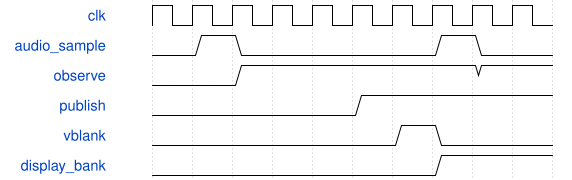

# SynthDisplayAudio 模块规范

> RTL: `rtl/SynthDisplayAudio.v`

## 1. 模块目的

64-bin 256-sample rectangular-window fixed-point DFT; logarithmic magnitude model is display_model.spectrum.

## 2. 参数

| 参数 | 默认值 | 说明 |
| --- | --- | --- |
| — | — | 本模块没有可配置参数。 |

## 3. 时钟与复位

- 时钟：`{"name": "i_clk", "edge": "posedge", "frequency_hz": 50000000}`
- 复位：`{"name": "i_rstn", "active": "low", "style": "asynchronous", "values": "all pipeline valid and output data/tag registers clear; external synchronous release"}`

## 4. 接口信号规范

| 信号 | 方向 | 位宽 | 时钟域 | 语义角色 | 描述 |
| --- | --- | --- | --- | --- | --- |
| `i_clk` | input | 1 | i_clk | clock | i_clk |
| `i_rstn` | input | 1 | i_clk | reset | i_rstn |
| `i_sample_valid` | input | 1 | i_clk | data | i_sample_valid |
| `i_sample` | input | 16 | i_clk | data | i_sample |
| `i_pixel_clk` | input | 1 | i_pixel_clk | clock | i_pixel_clk |
| `i_pixel_rstn` | input | 1 | i_pixel_clk | reset | i_pixel_rstn |
| `i_blank_start` | input | 1 | i_pixel_clk | data | i_blank_start |
| `i_wave_address` | input | 8 | i_pixel_clk | data | i_wave_address |
| `i_spectrum_address` | input | 6 | i_pixel_clk | data | i_spectrum_address |
| `o_wave` | output | 8 | i_pixel_clk | data | o_wave |
| `o_spectrum` | output | 7 | i_pixel_clk | data | o_spectrum |
| `o_available` | output | 1 | i_pixel_clk | data | o_available |
| `o_publish` | output | 1 | i_pixel_clk | data | o_publish |

## 5. 周期行为与延迟

- 64-bin 256-sample rectangular-window fixed-point DFT; logarithmic magnitude model is display_model.spectrum.
- Two pipelined signed products and shared accumulators; 448 clocks/sample, no audio backpressure.
- Dual-clock ping-pong waveform/spectrum RAM publishes only at vertical blank; producer waits for acknowledged bank and discards observation samples meanwhile.
- Frozen waveform peak selects1..128 display gain, unity below64 counts. Gain and bank are held together through CDC; actual audio is unchanged.
- TRIGGER waits for a negative excursion then a rising zero crossing before collecting256 consecutive samples. Threshold=max(4,previous_peak/16);2048-sample timeout forces fresh DC/silence capture. No synthesized-audio backpressure or circular sample rotation.

## 6. WaveDrom 时序图

### 显示旁路与提交

音频独立推进，显示仅消费快照并在消隐时提交。

- WaveJSON：[SynthDisplayAudio_pipeline.json5](waveforms/SynthDisplayAudio_pipeline.json5)

## 7. 边界、反压与错误

- Reset while transfer pending; invalid opcode/argument; sustained key; missing display consumer.
- No host connection: monitoring and page navigation continue; metadata edits require connected App.

## 8. CDC 与综合约束

- 50MHz system; 73.333333MHz pixel; related5x serializer. Hold multi-bit CDC payload through toggle acknowledgement.
- ROM/RAM contents generated by prepare_assets.mjs; no asynchronous array reset.

## 9. 验证与验收

- tb_display_audio: phase-invariant triggered captures, bounded quiet/silence/DC timeout,448 spectral bins and1792 waveform values including30.5Hz exact vs Python, dual-clock publication.
- tb_display_control: valid/invalid local commands, text ACK ordering and decimal CDC.
- tb_display_video: six921600-pixel frames with no unknown RGB; visually inspect actual RTL images.
- Full SynthSystemTop UART/keyboard/PCM regression and actual Gowin place-and-route.

## 10. 可追溯性

- 规格模块：`SynthDisplayAudio`
- RTL 路径：`rtl/SynthDisplayAudio.v`
- 交付要求：本文档、WaveJSON 和 SVG 必须与同一版本规格一同发布。
