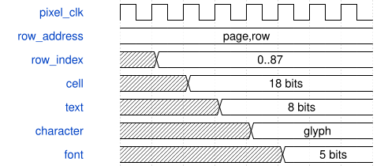
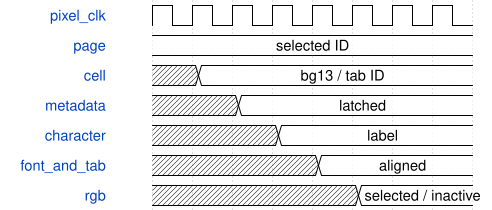

# SynthDisplayVideo 模块规范

> RTL: `rtl/SynthDisplayVideo.v`

## 1. 模块目的

1280x720 active; totals1650x750; HS1390..1429, VS725..729, positive polarity. Pixel clock73.333333MHz.

## 2. 参数

| 参数 | 默认值 | 说明 |
| --- | --- | --- |
| — | — | 本模块没有可配置参数。 |

## 3. 时钟与复位

- 时钟：`{"name": "i_clk", "edge": "posedge", "frequency_hz": 73333333}`
- 复位：`{"name": "i_rstn", "active": "low", "style": "asynchronous", "values": "all pipeline valid and output data/tag registers clear; external synchronous release"}`

## 4. 接口信号规范

| 信号 | 方向 | 位宽 | 时钟域 | 语义角色 | 描述 |
| --- | --- | --- | --- | --- | --- |
| `i_clk` | input | 1 | i_clk | clock | i_clk |
| `i_rstn` | input | 1 | i_clk | reset | i_rstn |
| `i_system_clk` | input | 1 | i_system_clk | clock | i_system_clk |
| `i_calibrating` | input | 1 | i_clk | data | i_calibrating |
| `i_host_live` | input | 1 | i_system_clk | data | i_host_live |
| `i_page` | input | 3 | i_clk | data | i_page |
| `i_fields` | input | 160 | i_clk | data | i_fields |
| `i_text_write` | input | 1 | i_system_clk | data | i_text_write |
| `i_text_address` | input | 10 | i_system_clk | data | i_text_address |
| `i_text_data` | input | 8 | i_system_clk | data | i_text_data |
| `i_wave` | input | 8 | i_clk | data | i_wave |
| `i_spectrum` | input | 7 | i_clk | data | i_spectrum |
| `i_audio_available` | input | 1 | i_clk | data | i_audio_available |
| `i_publish` | input | 1 | i_clk | data | i_publish |
| `o_wave_address` | output | 8 | i_clk | data | o_wave_address |
| `o_spectrum_address` | output | 6 | i_clk | data | o_spectrum_address |
| `o_blank_start` | output | 1 | i_clk | data | o_blank_start |
| `o_rgb` | output | 24 | i_clk | data | o_rgb |
| `o_hsync` | output | 1 | i_clk | data | o_hsync |
| `o_vsync` | output | 1 | i_clk | data | o_vsync |
| `o_de` | output | 1 | i_clk | data | o_de |
| `i_touch_mode` | input | 2 | 未声明 | data | i_touch_mode |

## 5. 周期行为与延迟

- 1280x720 active; totals1650x750; HS1390..1429, VS725..729, positive polarity. Pixel clock73.333333MHz.
- Deduplicated12x16 character cells use SynthUI palette and original5x7 bitmap font, eight pages, real32-key highlight. Footer order is E5,E4,E3,E2,E1 matching physical placement.
- Five pixel pipeline stages align RGB and timing. No framebuffer or external RAM. Text metadata may become visible during the current frame; whole-page geometry changes in blanking.
- Host-live synchronizes to pixel clock; expired connection selects offline banner. 64x64 spectrum history updates in blanking; DFT display covers190.735Hz..12.207kHz.
- C_TOUCH_ENABLE开启时页眉显示TOUCH 1..4，2位模式经两拍同步用于显示。
- 页面单元 ROM 保持 128 单元行跨度，以 C_CELL_DEPTH=11264 分配十一组 1024x18 存储；88 个实际行，流水延迟不变。
- Gowin 对非二次幂深度仍取整，实际使用三个 8192/2048/1024 数组和各自的寄存读出；选区标志同步寄存，组合选择进入原有文本与字符后级，不插入额外时钟。
- 资源生成器提供八页，总计88个唯一128字符行，仍使用11264×18位字符ROM（11块BSRAM）和原512项行指针。共享导航块背景元数据13表示页签，前景3位表示页编号；末级按i_page匹配绘制选中颜色。
- 新库页面共用文本128..383显示8条列表，512..639显示库标题/操作说明/选择/状态；其余页面显示内容不变。未挂载时显示明确的SD未就绪状态，不显示伪造条目。
- 八个144×48像素等宽页签从x=24、y=64开始，步进156像素，间隔12像素。标签位于y=80，页标题下移到y=128。选中背景efad73、字101820；其他背景21323f、字dce8ed。总88行、11264×18字符ROM和原像素流水延迟不变。

## 6. WaveDrom 时序图

### 页面 ROM 容量压缩不改变流水

行指针、单元、文本和字形均沿用原有寄存读出级；缩小数组上界不增加或删除任何寄存器。

- WaveJSON：[SynthDisplayVideo_cell-lookup.json5](waveforms/SynthDisplayVideo_cell-lookup.json5)

### 页签元数据与字形同拍着色

背景标记13和页ID沿现有cell/font流水，在RGB输出拍与i_page比较；页面号在消隐区稳定提交。

- WaveJSON：[SynthDisplayVideo_selected-tab.json5](waveforms/SynthDisplayVideo_selected-tab.json5)

## 7. 边界、反压与错误

- Reset while transfer pending; invalid opcode/argument; sustained key; missing display consumer.
- No host connection: monitoring and page navigation continue; metadata edits require connected App.

## 8. CDC 与综合约束

- 50MHz system; 73.333333MHz pixel; related5x serializer. Hold multi-bit CDC payload through toggle acknowledgement.
- ROM/RAM contents generated by prepare_assets.mjs; no asynchronous array reset.
- prepare_assets.mjs 从 RTL 读取 C_CELL_DEPTH，容量必须是 1024 的倍数且容纳全部唯一行；所有 512 个只读行指针均指向已分配范围。
- 总容量固定等于三存储区之和；页生成器超容量即失败，不允许静默截断。main 使用 row[5:0]，middle 使用 row[3:0]，tail 使用 row[2:0]；只读行索引当前范围 0..87。

## 9. 验证与验收

- tb_display_audio: phase-invariant triggered captures, bounded quiet/silence/DC timeout,448 spectral bins and1792 waveform values including30.5Hz exact vs Python, dual-clock publication.
- tb_display_control: valid/invalid local commands, text ACK ordering and decimal CDC.
- tb_display_video: six921600-pixel frames with no unknown RGB; visually inspect actual RTL images.
- Full SynthSystemTop UART/keyboard/PCM regression and actual Gowin place-and-route.
- check_storage_compaction.py 枚举 65536 个页/行/列地址，并比较七幅完整 RGB 图逐字节一致；MprScanner 仅存储映射属性改变。
- tb_display_control覆盖页面6/7、无效8、7→0和0→7回绕；显示资源88行不超原ROM；Rust库页面屏蔽算子编辑内容。
- tb_display_video九幅完整图；validate_navigation.py逐像素核对页签位置/留白/字色/唯一选中项，并验证标题移动外其他画面逐位一致。

## 10. 可追溯性

- 规格模块：`SynthDisplayVideo`
- RTL 路径：`rtl/SynthDisplayVideo.v`
- 交付要求：本文档、WaveJSON 和 SVG 必须与同一版本规格一同发布。
