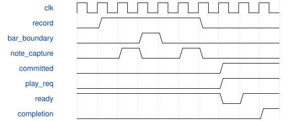

# SynthHdmiTop 模块规范

> RTL: `rtl/SynthHdmiTop.v`

## 1. 模块目的

Existing50MHz audio and key engine plus independent73.333MHz pixel/366.666MHz serializer clocks.

## 2. 参数

| 参数 | 默认值 | 说明 |
| --- | --- | --- |
| — | — | 本模块没有可配置参数。 |

## 3. 时钟与复位

- 时钟：`{"name": "i_clk", "edge": "posedge", "frequency_hz": 50000000}`
- 复位：`{"name": "i_rstn", "active": "low", "style": "asynchronous", "values": "all pipeline valid and output data/tag registers clear; external synchronous release"}`

## 4. 接口信号规范

| 信号 | 方向 | 位宽 | 时钟域 | 语义角色 | 描述 |
| --- | --- | --- | --- | --- | --- |
| `i_clk` | input | 1 | i_clk | clock | i_clk |
| `i_rstn` | input | 1 | i_clk | reset | i_rstn |
| `i_adc_dout` | input | 1 | i_clk | data | i_adc_dout |
| `i_uart_rx` | input | 1 | i_clk | data | i_uart_rx |
| `i_encoder_a` | input | 5 | i_clk | data | i_encoder_a |
| `i_encoder_b` | input | 5 | i_clk | data | i_encoder_b |
| `i_joystick` | input | 5 | i_clk | data | i_joystick |
| `o_mux_sel` | output | 3 | i_clk | data | o_mux_sel |
| `o_mux_en` | output | 1 | i_clk | data | o_mux_en |
| `o_adc_cs_n` | output | 1 | i_clk | data | o_adc_cs_n |
| `o_adc_sclk` | output | 1 | i_clk | data | o_adc_sclk |
| `o_adc_din` | output | 1 | i_clk | data | o_adc_din |
| `o_uart_tx` | output | 1 | i_clk | data | o_uart_tx |
| `HP_BCK` | output | 1 | i_clk | data | HP_BCK |
| `HP_WS` | output | 1 | i_clk | data | HP_WS |
| `HP_DIN` | output | 1 | i_clk | data | HP_DIN |
| `PA_EN` | output | 1 | i_clk | data | PA_EN |
| `tmds_clk_p_0` | output | 1 | i_clk | data | tmds_clk_p_0 |
| `tmds_clk_n_0` | output | 1 | i_clk | data | tmds_clk_n_0 |
| `tmds_d_p_0` | output | 3 | i_clk | data | tmds_d_p_0 |
| `tmds_d_n_0` | output | 3 | i_clk | data | tmds_d_n_0 |
| `hpd_en` | output | 1 | i_clk | data | hpd_en |
| `io_touch_scl` | inout | 2 | 未声明 | data | io_touch_scl |
| `io_touch_sda` | inout | 2 | 未声明 | data | io_touch_sda |
| `i_buttons` | input | 6 | 未声明 | data | i_buttons |
| `i_sd_miso` | input | 1 | i_clk | data | i_sd_miso |
| `o_sd_cs_n` | output | 1 | i_clk | data | o_sd_cs_n |
| `o_sd_sclk` | output | 1 | i_clk | data | o_sd_sclk |
| `o_sd_mosi` | output | 1 | i_clk | data | o_sd_mosi |

## 5. 周期行为与延迟

- Existing50MHz audio and key engine plus independent73.333MHz pixel/366.666MHz serializer clocks.
- Official DVI-compatible HDMI video output; headphone PT8211 remains the audio output.
- Display local commands share existing durable CRC/sequence/replay UART; no second serial owner.
- FX remains disabled. No display ready signal can stall synthesis or audio.
- 启用双MPR触摸；DisplayControl长按脉冲切换模式，模式编号同步到HDMI页眉。
- 板级开启C_SEQUENCE_ENABLE，映射demo_test六个独立高有效按钮；保留50MHz音频、73.333MHz像素时钟。
- 显示分析入口将16位PCM和valid一同寄存一级，切断PCM舍入/节拍相加到峰值和触发比较的组合链。声音采样周期不变，显示分析延后一个系统时钟。
- SD local requests 0x50..0x55 share the existing CRC/replay-protected UART. SynthHdmiTop instantiates autonomous storage mount; archive save/load control is not yet connected.

## 6. WaveDrom 时序图

### 小节提交与回放握手

按键事件暂存，停止后保留完成的小节；回放命令稳定等待仲裁和回执。

- WaveJSON：[SynthHdmiTop_record-play.json5](waveforms/SynthHdmiTop_record-play.json5)

## 7. 边界、反压与错误

- Reset while transfer pending; invalid opcode/argument; sustained key; missing display consumer.
- No host connection: monitoring and page navigation continue; metadata edits require connected App.

## 8. CDC 与综合约束

- 50MHz system; 73.333333MHz pixel; related5x serializer. Hold multi-bit CDC payload through toggle acknowledgement.
- ROM/RAM contents generated by prepare_assets.mjs; no asynchronous array reset.

## 9. 验证与验收

- tb_display_audio: phase-invariant triggered captures, bounded quiet/silence/DC timeout,448 spectral bins and1792 waveform values including30.5Hz exact vs Python, dual-clock publication.
- tb_display_control: valid/invalid local commands, text ACK ordering and decimal CDC.
- tb_display_video: six921600-pixel frames with no unknown RGB; visually inspect actual RTL images.
- Full SynthSystemTop UART/keyboard/PCM regression and actual Gowin place-and-route.

## 10. 可追溯性

- 规格模块：`SynthHdmiTop`
- RTL 路径：`rtl/SynthHdmiTop.v`
- 交付要求：本文档、WaveJSON 和 SVG 必须与同一版本规格一同发布。
