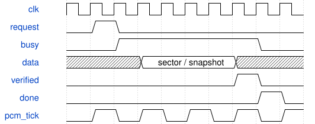

# SynthStorageDisplay 模块规范

> RTL: `rtl/SynthStorageDisplay.v`

## 1. 模块目的

Autonomous SD page text renderer

## 2. 参数

| 参数 | 默认值 | 说明 |
| --- | --- | --- |
| — | — | 本模块没有可配置参数。 |

## 3. 时钟与复位

- 时钟：`{"name": "i_clk", "edge": "posedge", "frequency_hz": 50000000}`
- 复位：`{"name": "i_rstn", "active": "low", "style": "asynchronous", "values": "all pipeline valid and output data/tag registers clear; external synchronous release"}`

## 4. 接口信号规范

| 信号 | 方向 | 位宽 | 时钟域 | 语义角色 | 描述 |
| --- | --- | --- | --- | --- | --- |
| `i_clk` | input | 1 | i_clk | clock | i_clk |
| `i_rstn` | input | 1 | i_clk | reset | i_rstn |
| `i_page` | input | 3 | i_clk | data | i_page |
| `i_slot` | input | 2 | i_clk | data | i_slot |
| `i_delete_mode` | input | 1 | i_clk | data | i_delete_mode |
| `i_status` | input | 32 | i_clk | data | i_status |
| `i_ready` | input | 1 | i_clk | data | i_ready |
| `i_busy` | input | 1 | i_clk | data | i_busy |
| `i_dirty` | input | 1 | i_clk | data | i_dirty |
| `i_error` | input | 8 | i_clk | data | i_error |
| `i_sequence` | input | 8 | i_clk | data | i_sequence |
| `i_preset` | input | 8 | i_clk | data | i_preset |
| `i_sequence_count` | input | 8 | i_clk | data | i_sequence_count |
| `i_preset_count` | input | 8 | i_clk | data | i_preset_count |
| `i_sequence_status` | input | 32 | i_clk | data | i_sequence_status |
| `i_bpm` | input | 9 | i_clk | data | i_bpm |
| `o_title_address` | output | 6 | i_clk | data | o_title_address |
| `i_title` | input | 8 | i_clk | data | i_title |
| `o_write` | output | 1 | i_clk | data | o_write |
| `o_address` | output | 10 | i_clk | data | o_address |
| `o_data` | output | 8 | i_clk | data | o_data |

## 5. 周期行为与延迟

- Pages 6/7 update only addresses 128..383, 512..639 and 832..863 in existing character RAM.
- A 1024-byte synchronous ROM supplies text; address, valid and character selection are delayed together by one clock.
- 416 writes per 2^20 clocks show card/service state, number/count, title, Slot and errors. No new framebuffer.

## 6. WaveDrom 时序图

### 后台读取、校验与提交

存储请求独立于 PCM；校验完成之前不给调用方成功状态。每格表示事务阶段，不是固定总周期数。

- WaveJSON：[SynthStorageDisplay_transaction.json5](waveforms/SynthStorageDisplay_transaction.json5)

## 7. 边界、反压与错误

- Page change, title absent, count 0/128, error and busy priority.

## 8. CDC 与综合约束

- 50 MHz control; existing dual-clock text RAM crosses to video.

## 9. 验证与验收

- tb_storage_display verifies address/valid alignment, fields and page isolation.

## 10. 可追溯性

- 规格模块：`SynthStorageDisplay`
- RTL 路径：`rtl/SynthStorageDisplay.v`
- 交付要求：本文档、WaveJSON 和 SVG 必须与同一版本规格一同发布。
