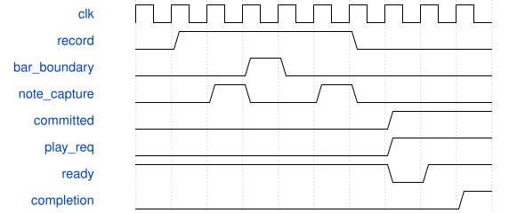

# SynthMetronome 模块规范

> RTL: `rtl/SynthMetronome.v`

## 1. 模块目的

i_click将DDS相位归零并设置重音/普通音幅度；i_sample每个PCM帧更新一次。

## 2. 参数

| 参数 | 默认值 | 说明 |
| --- | --- | --- |
| — | — | 本模块没有可配置参数。 |

## 3. 时钟与复位

- 时钟：`{"name": "i_clk", "edge": "posedge", "frequency_hz": 50000000}`
- 复位：`{"name": "i_rstn", "active": "low", "style": "asynchronous", "values": "all pipeline valid and output data/tag registers clear; external synchronous release"}`

## 4. 接口信号规范

| 信号 | 方向 | 位宽 | 时钟域 | 语义角色 | 描述 |
| --- | --- | --- | --- | --- | --- |
| `i_clk` | input | 1 | 未声明 | clock | i_clk |
| `i_rstn` | input | 1 | 未声明 | reset | i_rstn |
| `i_sample` | input | 1 | 未声明 | data | i_sample |
| `i_running` | input | 1 | 未声明 | data | i_running |
| `i_click` | input | 1 | 未声明 | data | i_click |
| `i_accent` | input | 1 | 未声明 | data | i_accent |
| `o_sample` | output | 16 | 未声明 | data | o_sample |

## 5. 周期行为与延迟

- i_click将DDS相位归零并设置重音/普通音幅度；i_sample每个PCM帧更新一次。
- 24位相位累加，1320/880Hz近似方波、一阶平滑及线性衰减；峰值限制1536/1024，不占用合成声部、DSP或RAM。
- i_running无效立即归零；独立固定低音量监听，未绑定用户主音量。声音路由最终经PCM饱和混音。

## 6. WaveDrom 时序图

### 小节提交与回放握手

按键事件暂存，停止后保留完成的小节；回放命令稳定等待仲裁和回执。

- WaveJSON：[SynthMetronome_record-play.json5](waveforms/SynthMetronome_record-play.json5)

## 7. 边界、反压与错误

- 不足一小节、边界同拍事件、截断长音、满缓存、背压清空、重复包、音色覆盖、暂停时现场键仍按住。

## 8. CDC 与综合约束

- 50MHz单时钟；异步低有效复位。事件RAM无清零复位。参数C_ADDRESS_BITS为6..10，C_PPQ为1..1024，C_US_CYCLES为1..64。C_EARLY_WINDOW=1时C_PPQ至少32；正式板级PPQ=960，BPM20..300。

## 9. 验证与验收

- sequence_model.py参考行为；tb_sequencer边界/叠录/背压。
- tb_sequencer_system真实ADC/UART/AXI/PT8211；UART重复包只翻转一次。

## 10. 可追溯性

- 规格模块：`SynthMetronome`
- RTL 路径：`rtl/SynthMetronome.v`
- 交付要求：本文档、WaveJSON 和 SVG 必须与同一版本规格一同发布。
