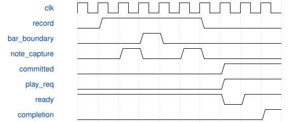
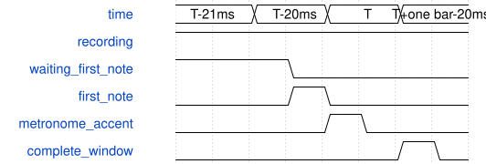
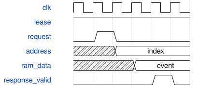

# SynthSequencer 模块规范

> RTL: `rtl/SynthSequencer.v`

## 1. 模块目的

50MHz 独立音乐时钟：每微秒累加 BPM×16，960PPQ，20..300BPM，4/4；AXI 背压不暂停时间。

## 2. 参数

| 参数 | 默认值 | 说明 |
| --- | --- | --- |
| — | — | 本模块没有可配置参数。 |

## 3. 时钟与复位

- 时钟：`{"name": "i_clk", "edge": "posedge", "frequency_hz": 50000000}`
- 复位：`{"name": "i_rstn", "active": "low", "style": "asynchronous", "values": "all pipeline valid and output data/tag registers clear; external synchronous release"}`

## 4. 接口信号规范

| 信号 | 方向 | 位宽 | 时钟域 | 语义角色 | 描述 |
| --- | --- | --- | --- | --- | --- |
| `i_clk` | input | 1 | 未声明 | clock | i_clk |
| `i_rstn` | input | 1 | 未声明 | reset | i_rstn |
| `i_enabled` | input | 1 | 未声明 | data | i_enabled |
| `i_silent` | input | 1 | 未声明 | data | i_silent |
| `i_buttons` | input | 6 | 未声明 | data | i_buttons |
| `i_capture` | input | 1 | 未声明 | data | i_capture |
| `i_key` | input | 5 | 未声明 | data | i_key |
| `i_event` | input | 392 | 未声明 | data | i_event |
| `o_request` | output | 392 | 未声明 | data | o_request |
| `o_request_valid` | output | 1 | 未声明 | data | o_request_valid |
| `i_request_ready` | input | 1 | 未声明 | data | i_request_ready |
| `i_response` | input | 136 | 未声明 | data | i_response |
| `i_response_valid` | input | 1 | 未声明 | data | i_response_valid |
| `o_response_ready` | output | 1 | 未声明 | data | o_response_ready |
| `i_local_request` | input | 1 | 未声明 | data | i_local_request |
| `i_opcode` | input | 8 | 未声明 | data | i_opcode |
| `i_argument` | input | 8 | 未声明 | data | i_argument |
| `i_words` | input | 64 | 未声明 | data | i_words |
| `o_local_valid` | output | 1 | 未声明 | data | o_local_valid |
| `o_local_response` | output | 136 | 未声明 | data | o_local_response |
| `o_patch_lock` | output | 4 | 未声明 | data | o_patch_lock |
| `o_click` | output | 1 | 未声明 | data | o_click |
| `o_accent` | output | 1 | 未声明 | data | o_accent |
| `o_recording` | output | 1 | 未声明 | data | o_recording |
| `o_bpm` | output | 9 | 未声明 | data | o_bpm |
| `o_status` | output | 32 | 未声明 | data | o_status |

## 5. 周期行为与延迟

- 50MHz 独立音乐时钟：每微秒累加 BPM×16，960PPQ，20..300BPM，4/4；AXI 背压不暂停时间。
- 能力版本3沿用版本2按键：SW1开始/停止，SW2清空，SW3保存请求，SW4播放/暂停，SW5/6上一条/下一条；按键5ms消抖、仅取按下边沿。BPM通过App/0x42修改。存取请求尚未接入SD执行器，不能声称保存成功。
- 只记录已被仲裁器接受的实体键盘/触摸拨弦 A4/A5；回放不会再次录入。首次完整小节决定循环长度，之后同长度叠录。
- 首次录制以首个Note-On所在小节为起点。C_EARLY_WINDOW默认1，将四拍窗口前移约20ms：floor(BPM*8/25)个960PPQ tick；迭代减25求商，最多98拍，无DSP/除法器。BPM开始录制前稳定时取得偏移，单次录制期间冻结。C_EARLY_WINDOW=0关闭提前。启用时要求C_PPQ>=32。
- 首音基于包含当前flag_tick的窗口相位，边界当拍音符属于新窗口。首音之前空小节不入长度；首次录制仅在含Note-On或持续按住的完整窗口更新提交边界，删除末尾纯空小节，中间休止和持续长音保留。已有叠录沿用原长度和时间基准。
- 首次录制的窗口尚未完成时不发布录音；截断长音补Off。导入的已存音序不自动裁剪；该改动只影响随后新录的第一层。状态bit6表示已开始节拍但尚未收到首音，不改变现场音频延迟。
- 五个1024×18独立地址同步RAM，事件90位；保留32条收尾空间，满时保留上次完整小节。初始化只清元数据，不清RAM。
- 回放按音乐时间窗口遍历已提交事件；请求VALID保持到READY，等待Completion后才继续。帧延误不静默丢掉整段时间事件，但无无限队列或无限复音保证。
- 回放NoteID高四位4，现场按键高位8。八个回放声部索引按A4回执更新；清空/暂停/循环只释放回放ID，不发全局panic。
- 0x40能力、0x41状态、0x42控制、0x43..0x48事件快照、0x49库按键累计数；由上层CRC/重放缓存去重，同一个包不能重复翻转录制或追加事件。锁住提交/录制的音色槽，由Master拒绝覆盖。
- 0x49依次返回SW3/SW5/SW6三个16位无符号计数（高16位零）及工作区32位代数。录制/收尾/租约/禁用期间不产生库操作；空循环长度时不产生保存请求，同时按前后键两者均不触发。计数仅表示输入事件，不能作为SD成功回执。
- 快照租约只在录制/回放停止且回放Note-Off已完成时接受。导出模式复用原同步RAM读口；请求后两拍返回90位事件和32位代数，不增加事件RAM副本。
- 导入要求空工作区。先0x46暂存低64位，再0x47提交高26位和顺序索引；只接受保留位零、起音索引等于自身、松键引用更早索引的事件。主机还必须验证松键引用的是Note-On。0x48验证数量/BPM/小节数/最大时间戳后一次性发布。中止和超时不发布部分事件。
- 租约期间锁四槽，拒绝录放、清空和BPM更改；独立现场演奏和PCM不暂停。C_ARCHIVE_TIMEOUT默认为2147483647个50MHz时钟（约42.95秒），每个有效快照命令刷新；不得短于单个传输事务。
- SD文件系统、断电保存/自动恢复未实现；不能把这个RAM模块称为持久化音序器。
- Status opcode 41 response bits 127:124 expose the saved recording slot mask independently of the all-slot archive lease lock; low twenty bits of the same word remain playback position.

## 6. WaveDrom 时序图

### 小节提交与回放握手

按键事件暂存，停止后保留完成的小节；回放命令稳定等待仲裁和回执。

- WaveJSON：[SynthSequencer_record-play.json5](waveforms/SynthSequencer_record-play.json5)

### 首音归属提前窗口

T为强拍；提前窗口起点T-20ms。靠近强拍的首音归入新窗口，首音之前的空小节不计入循环。只保留完整且有演奏的首尾窗口。

- WaveJSON：[SynthSequencer_early-window.json5](waveforms/SynthSequencer_early-window.json5)

### 暂停期间复用事件RAM读口

已取得导出租约。接受0x44索引后，下一拍同步RAM取数，再一拍返回；等待期间不置本地完成。

- WaveJSON：[SynthSequencer_archive-read.json5](waveforms/SynthSequencer_archive-read.json5)

## 7. 边界、反压与错误

- 不足一小节、边界同拍事件、截断长音、满缓存、背压清空、重复包、音色覆盖、暂停时现场键仍按住。

## 8. CDC 与综合约束

- 50MHz单时钟；异步低有效复位。事件RAM无清零复位。参数C_ADDRESS_BITS为6..10，C_PPQ为1..1024，C_US_CYCLES为1..64。C_EARLY_WINDOW=1时C_PPQ至少32；正式板级PPQ=960，BPM20..300。

## 9. 验证与验收

- sequence_model.py参考行为；tb_sequencer边界/叠录/背压。
- tb_sequencer_system真实ADC/UART/AXI/PT8211；UART重复包只翻转一次。
- tb_record_window及record_window.py：20ms窗口前/当拍/后、原始强拍前后，删除首尾空小节、中间休止/长音保留、四轮播放周期、所有20..300BPM偏移。旧版本复现768tick循环，新版本收紧为256tick。
- tb_sequence_archive：租约/超时、半包/乱序拒绝、原子发布、导出逐位一致；tb_sequencer_system通过真实UART导入后回放至PT8211。

## 10. 可追溯性

- 规格模块：`SynthSequencer`
- RTL 路径：`rtl/SynthSequencer.v`
- 交付要求：本文档、WaveJSON 和 SVG 必须与同一版本规格一同发布。
