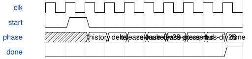

# KeyboardCrossingTime 模块规范

> RTL: `rtl/KeyboardCrossingTime.v`

## 1. 模块目的

Shared sequential threshold timestamp interpolation for32physical keys

## 2. 参数

| 参数 | 默认值 | 说明 |
| --- | --- | --- |
| — | — | 本模块没有可配置参数。 |

## 3. 时钟与复位

- 时钟：`{"name": "i_clk", "edge": "posedge", "frequency_hz": 50000000}`
- 复位：`{"name": "i_rstn", "active": "low", "style": "asynchronous", "values": "all pipeline valid and output data/tag registers clear; external synchronous release"}`

## 4. 接口信号规范

| 信号 | 方向 | 位宽 | 时钟域 | 语义角色 | 描述 |
| --- | --- | --- | --- | --- | --- |
| `i_clk` | input | 1 | i_clk | clock | i_clk |
| `i_rstn` | input | 1 | i_clk | reset | i_rstn |
| `i_start` | input | 1 | i_clk | data | i_start |
| `i_key` | input | 5 | i_clk | data | i_key |
| `i_raw` | input | 12 | i_clk | data | i_raw |
| `i_time` | input | 32 | i_clk | data | i_time |
| `i_release` | input | 12 | i_clk | data | i_release |
| `i_press` | input | 12 | i_clk | data | i_press |
| `i_falling` | input | 1 | i_clk | data | i_falling |
| `o_done` | output | 1 | i_clk | data | o_done |
| `o_release_time` | output | 32 | i_clk | data | o_release_time |
| `o_press_time` | output | 32 | i_clk | data | o_press_time |
| `o_interval` | output | 32 | i_clk | data | o_interval |
| `o_release_estimated` | output | 1 | i_clk | data | o_release_estimated |
| `o_press_estimated` | output | 1 | i_clk | data | o_press_estimated |

## 5. 周期行为与延迟

- Capture input on idle/start; synchronous per-key44bit history and valid bitmap; delta=current_time-previous_time unsigned32 wraps naturally.
- For forward bracketed motion and interval1..65535us, estimate each crossing as now-floor(interval*overshoot/distance); shared28bit restoring divider,28cycles each. Otherwise return now and clear estimated flag.
- Done pulses one clock; caller must not start while busy. Worst case below80clocks, then idle. Reset clears validity so uninitialized history never qualifies.

## 6. WaveDrom 时序图

### Shared arithmetic sequence

Each divide span represents28core cycles; done follows both crossing estimates.

- WaveJSON：[KeyboardCrossingTime_interpolate.json5](waveforms/KeyboardCrossingTime_interpolate.json5)

## 7. 边界、反压与错误

- No history,zero delta/reversal,stale/zero interval,timestamp wrap,positive/negative direction,threshold exactly on endpoint,both thresholds same interval.

## 8. CDC 与综合约束

- 50MHz singleclock; caller holds start onecycle only and serializes requests.32keys,12bitADC,1us timestamp. Acquisition cadence unchanged.

## 9. 验证与验收

- tb_keyboard_crossing uses model-generated directed and random vectors with exact integer quotient; verify latency bound and reset.

## 10. 可追溯性

- 规格模块：`KeyboardCrossingTime`
- RTL 路径：`rtl/KeyboardCrossingTime.v`
- 交付要求：本文档、WaveJSON 和 SVG 必须与同一版本规格一同发布。
