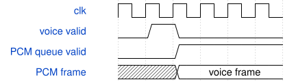

# SynthBootSequencer 模块规范

> RTL: `rtl/SynthBootSequencer.v`

## 1. 模块目的

Synchronous 32-bit ROM contains count followed by opcode/argument plus ten payload words per command.

## 2. 参数

| 参数 | 默认值 | 说明 |
| --- | --- | --- |
| — | — | 本模块没有可配置参数。 |

## 3. 时钟与复位

- 时钟：`{"name": "i_axis_aclk", "edge": "posedge", "frequency_hz": 50000000}`
- 复位：`{"name": "i_axis_arstn", "active": "low", "style": "asynchronous", "values": "all pipeline valid and output data/tag registers clear; external synchronous release"}`

## 4. 接口信号规范

| 信号 | 方向 | 位宽 | 时钟域 | 语义角色 | 描述 |
| --- | --- | --- | --- | --- | --- |
| `i_clk` | input | 1 | 未声明 | clock | i_clk |
| `i_rstn` | input | 1 | 未声明 | reset | i_rstn |
| `o_request` | output | 392 | 未声明 | data | o_request |
| `o_request_valid` | output | 1 | 未声明 | control | o_request_valid |
| `i_request_ready` | input | 1 | 未声明 | control | i_request_ready |
| `i_response` | input | 136 | 未声明 | data | i_response |
| `i_response_valid` | input | 1 | 未声明 | control | i_response_valid |
| `o_response_ready` | output | 1 | 未声明 | control | o_response_ready |
| `o_done` | output | 1 | 未声明 | control | o_done |
| `o_fault` | output | 1 | 未声明 | control | o_fault |

## 5. 周期行为与延迟

- Synchronous 32-bit ROM contains count followed by opcode/argument plus ten payload words per command.
- Four presets, shared FX and safe master level loaded through the same AXI master as live controls. Done only after every success completion; failure prevents amplifier enable.
- C_FX_ENABLE编译期选择；整板SynthSystemTop默认0，内核默认1保留回归。关闭时不实例化Delay/Reverb，Voice PCM直接进入原四项PCM队列，FX能力/容量/遥测为0，C0..C4通过不支持完成路径返回状态1。开机使用剔除FX命令的boot_dry.hex，正常音色、键床、UART及音频频率不变。

## 6. WaveDrom 时序图

### 流水接纳与反压

事件或命令稳定保持至握手，执行后完成返回；音频按固定帧节拍独立运行。示意图不表示绝对运算周期。

- WaveJSON：[SynthBootSequencer_stream.json5](waveforms/SynthBootSequencer_stream.json5)

### 关闭FX的直接音频通路

Voice结果脉冲在下一沿进入PCM队列；固定音频采样时钟继续消费，队列满记录drop。

- WaveJSON：[SynthBootSequencer_dry-path.json5](waveforms/SynthBootSequencer_dry-path.json5)

## 7. 边界、反压与错误

- signed minima/maxima and zero
- changing tags and parameters every accepted beat
- long backpressure and bubbles
- reset while pipeline holds transactions

## 8. CDC 与综合约束

- Verilog-2001, single50MHz clock; asynchronous reset assertion, externally synchronized release.
- See SYSTEM.md and model/system_model.py for ABI, numerical behavior, memory images and validation scope.

## 9. 验证与验收

- Independent protocol/PCM model
- Real UART/ADC pins to serial DAC simulation
- AXI stalls, transaction ownership, duplicate/conflicting/invalid requests and reset
- Boot, physical chord, release, host voice/FX commands and resource/timing checks
- 关闭FX的整板启动、真实键床/UART、不支持命令和重放、PCM/PT8211一致性；保留FX配置兼容回归。

## 10. 可追溯性

- 规格模块：`SynthBootSequencer`
- RTL 路径：`rtl/SynthBootSequencer.v`
- 交付要求：本文档、WaveJSON 和 SVG 必须与同一版本规格一同发布。
