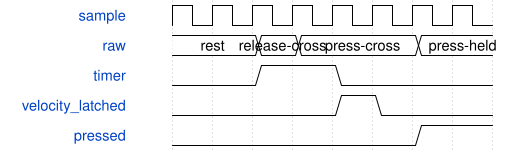

# SynthKeyboardControl 模块规范

> RTL: `rtl/SynthKeyboardControl.v`

## 1. 模块目的

Atomic keyboard calibration, ADC threshold debounce and physical press velocity

## 2. 参数

| 参数 | 默认值 | 说明 |
| --- | --- | --- |
| — | — | 本模块没有可配置参数。 |

## 3. 时钟与复位

- 时钟：`{"name": "i_clk", "edge": "posedge", "frequency_hz": 50000000}`
- 复位：`{"name": "i_rstn", "active": "low", "style": "asynchronous", "values": "all pipeline valid and output data/tag registers clear; external synchronous release"}`

## 4. 接口信号规范

| 信号 | 方向 | 位宽 | 时钟域 | 语义角色 | 描述 |
| --- | --- | --- | --- | --- | --- |
| `i_clk` | input | 1 | i_clk | clock | i_clk |
| `i_rstn` | input | 1 | i_clk | reset | i_rstn |
| `i_key` | input | 5 | i_clk | data | i_key |
| `i_raw` | input | 12 | i_clk | data | i_raw |
| `i_valid` | input | 1 | i_clk | data | i_valid |
| `o_pressed` | output | 32 | i_clk | data | o_pressed |
| `o_calibrating` | output | 1 | i_clk | data | o_calibrating |
| `o_velocity_enabled` | output | 1 | i_clk | data | o_velocity_enabled |
| `i_velocity_key` | input | 5 | i_clk | data | i_velocity_key |
| `o_velocity` | output | 7 | i_clk | data | o_velocity |
| `i_request` | input | 1 | i_clk | data | i_request |
| `i_opcode` | input | 8 | i_clk | data | i_opcode |
| `i_argument` | input | 8 | i_clk | data | i_argument |
| `i_words` | input | 64 | i_clk | data | i_words |
| `o_response_valid` | output | 1 | i_clk | data | o_response_valid |
| `o_response` | output | 136 | i_clk | data | o_response |

## 5. 周期行为与延迟

- Two threshold banks and two velocity curve banks; commit requires32 threshold writes and16 curve chunks. Calibration/configuration mutes physical keys and requires release to rearm.
- Timestamp in1us units; interpolate both ADC thresholds between adjacent samples with shared iterative divider; freeze elapsed at first press crossing and confirm on second sample.128us bins below4.096ms,16bins/octave thereafter.
- Local kind3 opcodes20..28, KBD2 capability.28 returns atomic32bit travel_us,scan_interval_us,key/velocity/estimated and1us timer unit. Staging watchdog5seconds; UART owns replay.
- ADC processing bounded below96 core clocks; synchronous memories, unchanged sensor scan cadence. Fixed mode preserves previous map velocity/unity gain.

## 6. WaveDrom 时序图

### Threshold traversal and confirmation

Velocity ends at first press crossing, NoteOn waits for the second.

- WaveJSON：[SynthKeyboardControl_press.json5](waveforms/SynthKeyboardControl_press.json5)

## 7. 边界、反压与错误

- Both ADC directions; incomplete config; threshold chatter; held key during commit; same-sample fast crossing; long holds; watchdog.

## 8. CDC 与综合约束

- 50MHz; C_US_CYCLES=50,C_MS_CYCLES=50000,C_TIMEOUT_MS=5000; ADC conversions spaced by at least96 clocks. History interpolation valid only for forward bracketed motion and interval1..65535us.
- Calibration UI in App only. Runtime held states cleared on calibration/configuration/timeout.

## 9. 验证与验收

- tb_keyboard_control and keyboard_model.py; full tb_studio_system; Rust calibration validation and complete50MHz implementation.

## 10. 可追溯性

- 规格模块：`SynthKeyboardControl`
- RTL 路径：`rtl/SynthKeyboardControl.v`
- 交付要求：本文档、WaveJSON 和 SVG 必须与同一版本规格一同发布。
