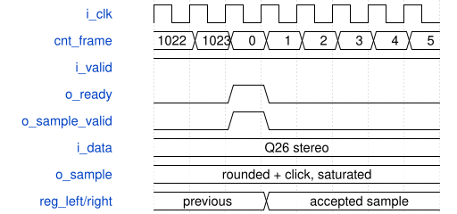

# SynthPcmOutput 模块规范

> RTL: `rtl/SynthPcmOutput.v`

## 1. 模块目的

Q26 stereo to saturated signed16 with symmetric nearest rounding; consume PCM only at fixed1024-clock frame boundaries.

## 2. 参数

| 参数 | 默认值 | 说明 |
| --- | --- | --- |
| — | — | 本模块没有可配置参数。 |

## 3. 时钟与复位

- 时钟：`{"name": "i_clk", "edge": "posedge", "frequency_hz": 50000000}`
- 复位：`{"name": "i_rstn", "active": "low", "style": "asynchronous", "values": "all pipeline valid and output data/tag registers clear; external synchronous release"}`

## 4. 接口信号规范

| 信号 | 方向 | 位宽 | 时钟域 | 语义角色 | 描述 |
| --- | --- | --- | --- | --- | --- |
| `i_clk` | input | 1 | 未声明 | clock | i_clk |
| `i_rstn` | input | 1 | 未声明 | reset | i_rstn |
| `i_valid` | input | 1 | 未声明 | control | i_valid |
| `i_data` | input | 64 | 未声明 | data | i_data |
| `o_ready` | output | 1 | 未声明 | control | o_ready |
| `o_bclk` | output | 1 | 未声明 | control | o_bclk |
| `o_ws` | output | 1 | 未声明 | control | o_ws |
| `o_data` | output | 1 | 未声明 | control | o_data |
| `o_frames` | output | 32 | 未声明 | data | o_frames |
| `o_underruns` | output | 32 | 未声明 | data | o_underruns |
| `o_sample_valid` | output | 1 | i_clk | control | o_sample_valid |
| `o_sample` | output | 16 | i_clk | data | o_sample |
| `i_click` | input | 16 | 未声明 | data | i_click |

## 5. 周期行为与延迟

- PT8211 runs at 50MHz/1024 with signed16 left/right samples, rounded and saturated from Q26.
- o_sample_valid is true only on the actual output frame acceptance; o_sample is that same signed16 left-channel value. No sampling, interpolation or visualization affects audio readiness.
- C_METRONOME_ENABLE默认0。启用时在原Q26→16位舍入后以17位相加再饱和；固定1024拍PT8211帧率不变，旁路监测包含节拍。
- Quantization is floor(x/2048) plus bit10 AND (nonnegative OR any low10 bits), then signed16 saturation. This is bit-exact nearest rounding with ties away from zero, without 33-bit absolute-value/sign-restore carry chains.

## 6. WaveDrom 时序图

### 固定帧边界接收 PCM

示意连续的 50 MHz 周期；每 1024 拍产生一次 ready。ready 与 valid 同时为高时锁存当前已舍入、饱和及混入节拍的左右声道数据。组合舍入替换不增加时钟周期。

- WaveJSON：[SynthPcmOutput_pcm-frame.json5](waveforms/SynthPcmOutput_pcm-frame.json5)

## 7. 边界、反压与错误

- signed minima/maxima and zero
- changing tags and parameters every accepted beat
- long backpressure and bubbles
- reset while pipeline holds transactions

## 8. CDC 与综合约束

- Verilog-2001, single50MHz clock; asynchronous reset assertion, externally synchronized release.
- See SYSTEM.md and model/system_model.py for ABI, numerical behavior, memory images and validation scope.

## 9. 验证与验收

- Full existing board regression: 134 UART replies, all 32 keys, eight-voice load and serial DAC.
- tb_studio_system: local command CRC/replay, distinct key patches, held remapping/release, 512 signed16 capture samples compared to DAC quantization, tagged latency.
- tb_pcm_rounding: 128672 independent Python oracle vectors covering all 2048 remainders at 14 signed boundary classes and 100000 deterministic random values; compares original/new DAC pins, frame/underrun counters and monitor samples, with metronome disabled/enabled and valid bubbles.

## 10. 可追溯性

- 规格模块：`SynthPcmOutput`
- RTL 路径：`rtl/SynthPcmOutput.v`
- 交付要求：本文档、WaveJSON 和 SVG 必须与同一版本规格一同发布。
