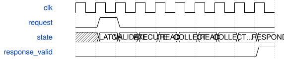

# SynthStudioMonitor 模块规范

> RTL: `rtl/SynthStudioMonitor.v`

## 1. 模块目的

Independent board-local key mapping control, frozen PCM capture and tagged digital output latency.

## 2. 参数

| 参数 | 默认值 | 说明 |
| --- | --- | --- |
| — | — | 本模块没有可配置参数。 |

## 3. 时钟与复位

- 时钟：`{"name": "i_clk", "edge": "posedge", "frequency_hz": 50000000}`
- 复位：`{"name": "i_rstn", "active": "low", "style": "asynchronous", "values": "all pipeline valid and output data/tag registers clear; external synchronous release"}`

## 4. 接口信号规范

| 信号 | 方向 | 位宽 | 时钟域 | 语义角色 | 描述 |
| --- | --- | --- | --- | --- | --- |
| `i_clk` | input | 1 | i_clk | clock | i_clk |
| `i_rstn` | input | 1 | i_clk | reset | i_rstn |
| `i_request` | input | 1 | i_clk | control | i_request |
| `i_opcode` | input | 8 | i_clk | data | i_opcode |
| `i_argument` | input | 8 | i_clk | data | i_argument |
| `i_words` | input | 64 | i_clk | data | i_words |
| `o_response_valid` | output | 1 | i_clk | control | o_response_valid |
| `o_response` | output | 136 | i_clk | data | o_response |
| `o_key_write` | output | 1 | i_clk | control | o_key_write |
| `o_key_index` | output | 5 | i_clk | data | o_key_index |
| `o_key_data` | output | 48 | i_clk | data | o_key_data |
| `i_key_data` | input | 48 | i_clk | data | i_key_data |
| `i_pcm_valid` | input | 1 | i_clk | control | i_pcm_valid |
| `i_pcm_sample` | input | 16 | i_clk | data | i_pcm_sample |
| `i_pcm_frame` | input | 32 | i_clk | data | i_pcm_frame |
| `i_key_start` | input | 1 | i_clk | control | i_key_start |
| `i_key_finish` | input | 1 | i_clk | control | i_key_finish |
| `i_key_failed` | input | 1 | i_clk | control | i_key_failed |
| `i_event_key` | input | 5 | i_clk | data | i_event_key |
| `i_event_frame` | input | 32 | i_clk | data | i_event_frame |
| `o_latency` | output | 32 | i_clk | data | Passive display / local request interface: o_latency |

## 5. 周期行为与延迟

- Command pulse latches opcode/argument/words; VALIDATE then EXECUTE; RESPOND asserts one cycle. No second command until response.
- Opcodes0..5 implement the exact table in UNIFIED_STUDIO_CONTRACT.md. Invalid arguments return status5; capture busy/not-ready returns10.
- Capture starts at the next accepted PCM frame and freezes after512 signed16 left samples; 64 chunks of8 samples read synchronously in16 clocks.
- Latency starts at key PREPARE, commits target tag on successful Note-On response, ends on matching PCM frame. Only one observation is in flight; other keys still execute normally.
- Reset clears capture-ready and observation state. Mapping RAM initialization belongs to SynthKeyboardSource.
- o_latency continuously exposes last completed digital key-to-PCM latency in50MHz clock cycles without consuming telemetry.

## 6. WaveDrom 时序图

### 本地命令与冻结快照读取

命令锁存、校验、执行；读样本每两拍装入一个16位结果，最后响应。此图是阶段示意。

- WaveJSON：[SynthStudioMonitor_local.json5](waveforms/SynthStudioMonitor_local.json5)

## 7. 边界、反压与错误

- Capture trigger while busy; read before ready; malformed opcode or argument.
- Identical request replay handled by SynthUartControl without repeating side effects.
- Old PCM frames queued before a key command do not complete the tagged latency observation.
- Simultaneous keys coalesce monitoring only; failed Note-On cancels pending observation.

## 8. CDC 与综合约束

- Verilog-2001, single50MHz clock; asynchronous reset assertion, externally synchronized release.
- See SYSTEM.md and model/system_model.py for ABI, numerical behavior, memory images and validation scope.

## 9. 验证与验收

- studio_monitor_model.py independent PCM rounding and scheduling model
- tb_studio_system bit-exact output sample capture and mapped real key path

## 10. 可追溯性

- 规格模块：`SynthStudioMonitor`
- RTL 路径：`rtl/SynthStudioMonitor.v`
- 交付要求：本文档、WaveJSON 和 SVG 必须与同一版本规格一同发布。
