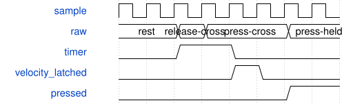

# tb_keyboard_control 模块规范

> RTL: `keyboard/tb_keyboard_control.v`

## 1. 模块目的

Self-checking ADC threshold, calibration transaction and note-source velocity testbench

## 2. 参数

| 参数 | 默认值 | 说明 |
| --- | --- | --- |
| — | — | 本模块没有可配置参数。 |

## 3. 时钟与复位

- 时钟：`{"name": "clk", "edge": "posedge", "frequency_hz": 50000000}`
- 复位：`{"name": "rstn", "active": "low", "style": "asynchronous", "values": "all pipeline valid and output data/tag registers clear; external synchronous release"}`

## 4. 接口信号规范

| 信号 | 方向 | 位宽 | 时钟域 | 语义角色 | 描述 |
| --- | --- | --- | --- | --- | --- |
| `o_done` | output | 1 | clk | data | All assertions completed |

## 5. 周期行为与延迟

- Drive both polarities, first/second crossing, two-sample confirmation, slow/fast and cancelled gestures.
- Write complete/incomplete shadow profiles; check active readback, raw grouped reads, timeout and release-to-rearm.
- Connect the actual SynthKeyboardSource and compare each emitted NoteOn velocity and Q26 gain with the originating per-key state.
- KBD2 microsecond observation; single-scan crossings must produce interpolated nonzero travel and submaximum velocity; realistic6700us per-key input.

## 6. WaveDrom 时序图

### Threshold traversal and confirmation

Velocity ends at first press crossing, NoteOn waits for the second.

- WaveJSON：[tb_keyboard_control_press.json5](waveforms/tb_keyboard_control_press.json5)

## 7. 边界、反压与错误

- Both ADC directions; incomplete config; threshold chatter; held key during commit; same-sample fast crossing; long holds; watchdog.

## 8. CDC 与综合约束

- Simulation only.50MHz clock with accelerated10-cycle millisecond and100ms watchdog.

## 9. 验证与验收

- tb_keyboard_control and keyboard_model.py; full tb_studio_system; Rust calibration validation and complete50MHz implementation.

## 10. 可追溯性

- 规格模块：`tb_keyboard_control`
- RTL 路径：`keyboard/tb_keyboard_control.v`
- 交付要求：本文档、WaveJSON 和 SVG 必须与同一版本规格一同发布。
