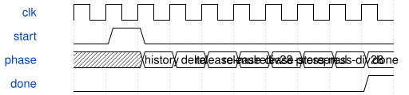

# tb_keyboard_crossing 模块规范

> RTL: `keyboard/tb_keyboard_crossing.v`

## 1. 模块目的

Bit-exact shared interpolation verification

## 2. 参数

| 参数 | 默认值 | 说明 |
| --- | --- | --- |
| — | — | 本模块没有可配置参数。 |

## 3. 时钟与复位

- 时钟：`{"name": "clk", "edge": "posedge", "frequency_hz": 50000000}`
- 复位：`{"name": "rstn", "active": "low", "style": "asynchronous", "values": "all pipeline valid and output data/tag registers clear; external synchronous release"}`

## 4. 接口信号规范

| 信号 | 方向 | 位宽 | 时钟域 | 语义角色 | 描述 |
| --- | --- | --- | --- | --- | --- |
| `o_done` | output | 1 | clk | data | All assertions completed |

## 5. 周期行为与延迟

- 2064 directed/random reference vectors, including32key histories, unsigned timestamp wrap, both motion polarities, exact endpoint threshold, zero/stale intervals, reversals and no motion.
- Assert both timestamps, estimation flags and valid-history interval against Python integer model; bound completion below80core clocks.

## 6. WaveDrom 时序图

### Shared arithmetic sequence

Each divide span represents28core cycles; done follows both crossing estimates.

- WaveJSON：[tb_keyboard_crossing_interpolate.json5](waveforms/tb_keyboard_crossing_interpolate.json5)

## 7. 边界、反压与错误

- Both ADC directions; incomplete config; threshold chatter; held key during commit; same-sample fast crossing; long holds; watchdog.

## 8. CDC 与综合约束

- Simulation only.50MHz clock with accelerated10-cycle millisecond and100ms watchdog.

## 9. 验证与验收

- test_crossing_vectors.py generates deterministic fixture; xsim executes every vector.

## 10. 可追溯性

- 规格模块：`tb_keyboard_crossing`
- RTL 路径：`keyboard/tb_keyboard_crossing.v`
- 交付要求：本文档、WaveJSON 和 SVG 必须与同一版本规格一同发布。
