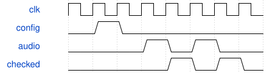

# tb_studio_system 模块规范

> RTL: `sim/tb_studio_system.v`

## 1. 模块目的

Lowpass module / integrated system verification

## 2. 参数

| 参数 | 默认值 | 说明 |
| --- | --- | --- |
| — | — | 本模块没有可配置参数。 |

## 3. 时钟与复位

- 时钟：`{"name": "clk", "edge": "posedge", "frequency_hz": 50000000}`
- 复位：`{"name": "rstn", "active": "low", "style": "asynchronous", "values": "all pipeline valid and output data/tag registers clear; external synchronous release"}`

## 4. 接口信号规范

| 信号 | 方向 | 位宽 | 时钟域 | 语义角色 | 描述 |
| --- | --- | --- | --- | --- | --- |
| `o_done` | output | 1 | clk | data | All assertions completed |

## 5. 周期行为与延迟

- UART/AXI D0 D1 enable,LFO,status,replay andbypass; physical release/newNoteOn between filtercommands verifies independent command sequences; existing512samplePCM checks retained.

## 6. WaveDrom 时序图

### Stimulus and result

Send atomicconfiguration, thenindependent audioframes andcompare reference samples.

- WaveJSON：[tb_studio_system_validate.json5](waveforms/tb_studio_system_validate.json5)

## 7. 边界、反压与错误

- Command and audio backpressure, bypass, stereo bounds andphysical note events

## 8. CDC 与综合约束

- Simulation-only,50MHzclock,allassertionsmustcomplete

## 9. 验证与验收

- Externalxsimcompile andexecution, PASS required

## 10. 可追溯性

- 规格模块：`tb_studio_system`
- RTL 路径：`sim/tb_studio_system.v`
- 交付要求：本文档、WaveJSON 和 SVG 必须与同一版本规格一同发布。
