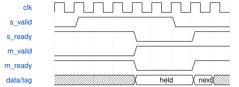

# tb_synth_master 模块规范

> RTL: `sim/tb_synth_master.v`

## 1. 模块目的

Random AXI channel stalls, payload/sequence ownership, response pressure, errors, watchdog containment and reset cancellation.

## 2. 参数

| 参数 | 默认值 | 说明 |
| --- | --- | --- |
| — | — | 本模块没有可配置参数。 |

## 3. 时钟与复位

- 时钟：`{"name": "i_axis_aclk", "edge": "posedge", "frequency_hz": 50000000}`
- 复位：`{"name": "i_axis_arstn", "active": "low", "style": "asynchronous", "values": "all pipeline valid and output data/tag registers clear; external synchronous release"}`

## 4. 接口信号规范

| 信号 | 方向 | 位宽 | 时钟域 | 语义角色 | 描述 |
| --- | --- | --- | --- | --- | --- |
| `o_done` | output | 1 | 未声明 | control | o_done |

## 5. 周期行为与延迟

- Random AXI channel stalls, payload/sequence ownership, response pressure, errors, watchdog containment and reset cancellation.

## 6. WaveDrom 时序图

### 流水接纳与反压

事件或命令稳定保持至握手，执行后完成返回；音频按固定帧节拍独立运行。示意图不表示绝对运算周期。

- WaveJSON：[tb_synth_master_stream.json5](waveforms/tb_synth_master_stream.json5)

## 7. 边界、反压与错误

- signed minima/maxima and zero
- changing tags and parameters every accepted beat
- long backpressure and bubbles
- reset while pipeline holds transactions

## 8. CDC 与综合约束

- Verilog-2001, single50MHz clock; asynchronous reset assertion, externally synchronized release.
- See SYSTEM.md and model/system_model.py for ABI, numerical behavior, memory images and validation scope.

## 9. 验证与验收

- Independent protocol/PCM model
- Real UART/ADC pins to serial DAC simulation
- AXI stalls, transaction ownership, duplicate/conflicting/invalid requests and reset
- Boot, physical chord, release, host voice/FX commands and resource/timing checks

## 10. 可追溯性

- 规格模块：`tb_synth_master`
- RTL 路径：`sim/tb_synth_master.v`
- 交付要求：本文档、WaveJSON 和 SVG 必须与同一版本规格一同发布。
