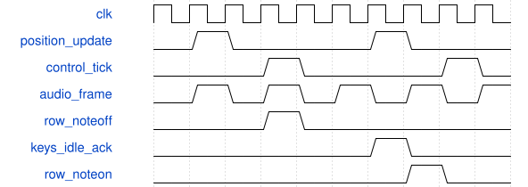

# TouchPosition 模块规范

> RTL: `rtl/TouchPosition.v`

## 1. 模块目的

双轴单触点重心；原始行电极5个映射X，列电极7个映射Y，归一化0..1023。

## 2. 参数

| 参数 | 默认值 | 说明 |
| --- | --- | --- |
| — | — | 本模块没有可配置参数。 |

## 3. 时钟与复位

- 时钟：`{"name": "i_clk", "edge": "posedge", "frequency_hz": 50000000}`
- 复位：`{"name": "i_rstn", "active": "low", "style": "asynchronous", "values": "all pipeline valid and output data/tag registers clear; external synchronous release"}`

## 4. 接口信号规范

| 信号 | 方向 | 位宽 | 时钟域 | 语义角色 | 描述 |
| --- | --- | --- | --- | --- | --- |
| `i_clk` | input | 1 | 未声明 | clock | i_clk |
| `i_rstn` | input | 1 | 未声明 | reset | i_rstn |
| `i_raw` | input | 336 | 未声明 | data | i_raw |
| `i_sequence` | input | 16 | 未声明 | data | i_sequence |
| `i_error` | input | 8 | 未声明 | data | i_error |
| `o_update` | output | 1 | 未声明 | data | o_update |
| `o_touch` | output | 1 | 未声明 | data | o_touch |
| `o_x` | output | 10 | 未声明 | data | o_x |
| `o_y` | output | 10 | 未声明 | data | o_y |

## 5. 周期行为与延迟

- 双轴单触点重心；原始行电极5个映射X，列电极7个映射Y，归一化0..1023。
- 检测扫描序号改变后逐电极提取、求权重、乘坐标并累加；再并行做两个10拍移位减法除法。没有组合除法器。
- 扫描器原子发布336位数据，约毫秒更新；计算期间若序号变化立即放弃，完成时重新校验。
- 两个轴均须有连续触摸簇，断裂多簇、缺轴、错误不产生有效触摸。输出位置仅在COMMIT提交，update为一拍。

## 6. WaveDrom 时序图

### 触摸事件与调制提交

触摸采集在系统域提交，调制每毫秒平滑；音频帧独立执行，NoteOff确认之后才重新起音。

- WaveJSON：[TouchPosition_touch.json5](waveforms/TouchPosition_touch.json5)

## 7. 边界、反压与错误

- 复位、数据过期、触点跳变、重复包、在途按键命令、方向与模式切换、空行。

## 8. CDC 与综合约束

- 50MHz系统域；实时控制不依赖串口；ROM由touch_model.py生成。

## 9. 验证与验收

- touch/model/run_simulations.py:位置/失联/四模式/右侧优先/重触发完成握手。
- tb_touch_voice5120帧逐样本等效；tb_touch_filter4096帧；tb_touch_system真实UART/ADC/PT8211通路。

## 10. 可追溯性

- 规格模块：`TouchPosition`
- RTL 路径：`rtl/TouchPosition.v`
- 交付要求：本文档、WaveJSON 和 SVG 必须与同一版本规格一同发布。
